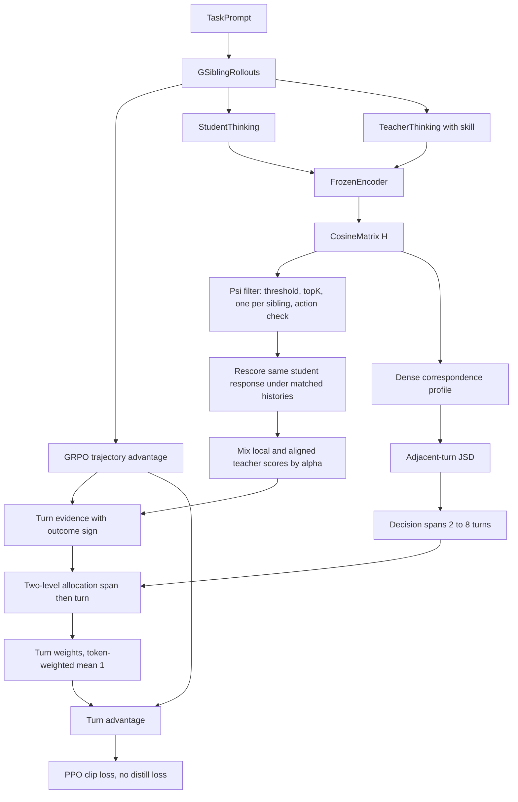
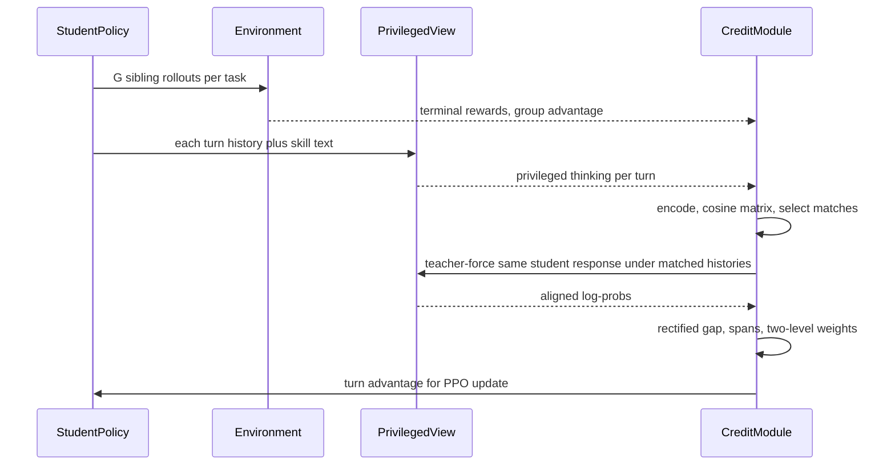

# 组会汇报：ALIGNOPSD（Beyond Timestamps: Decision-Aligned On-Policy Distillation for Long-Horizon Agents）

论文：Mingju Chen, Can Lv, Jinrong Liu, Huan Zhang, Heng Chang, Shiji Zhou. *Beyond Timestamps: Decision-Aligned On-Policy Distillation for Long-Horizon Agents*. arXiv:2609.33391v1, 2026-09-27.
单位：北京航空航天大学（未来区块链与隐私计算高精尖中心、人工智能学院）、清华大学
PDF：仓库副本 [`docs/ALIGNOPSD.pdf`](../../ALIGNOPSD.pdf)（25 页，含附录 A–F 与 Algorithm 1）
代码：本地 submodule [`algorithm/Align-OPSD/`](../../../algorithm/Align-OPSD/)（[github.com/mingju-c/Align-OPSD](https://github.com/mingju-c/Align-OPSD)，内部名 `BeyondTimestamps`，`main@6654edc`）。对照表：[`CODE_PAPER_MAP.md`](CODE_PAPER_MAP.md)；启动：[`QUICK_START.md`](QUICK_START.md)。
证据口径：论文正文 + 附录 > 官方启动脚本与 `CONFIGS.md`。**[推断]** 是我根据数字或代码做的判断；**【注解】** 是组会追问的展开。

和组里已读材料的位置：SAGE-OPD 是“外部大教师 + 按轮加权的 OPD loss”；ALIGNOPSD 是 **自教师（同一个模型加特权技能）+ 不加蒸馏 loss，只用教师证据重新分配 GRPO 的轨迹优势**。它更接近 RLSD 的思路（方向由环境奖励定，幅度由教师调），但加了两层新东西：**跨 rollout 找“功能上对应的决策”再打分**，以及 **可变长度的决策段（span）分层分配 credit**。

---

# 0. 一句话贡献

同一个时间步（第 k 轮）不等于同一个决策：兄弟 rollout 里的同一个决策可能出现在不同轮次，一个决策也可能横跨好几轮。ALIGNOPSD 先用思考文本的语义相似度，在兄弟 rollout 之间找到“做同一件事”的轮次，把学生这一轮的回复放到那些匹配上下文里让特权教师重新打分，得到校正后的教师证据。然后按“对应关系在哪里突变”把轨迹切成若干决策段，在“段 → 轮”两层上重新分配 GRPO 的轨迹优势。整个过程不额外加任何蒸馏 loss。

---

# 1. 任务定义与动机剖析

## 1.1 任务是什么

- **训练阶段**：agent 强化学习（RLVR / GRPO）+ 自蒸馏信号（OPSD 式），不是纯蒸馏。
- **谁生成**：学生 $\pi_\theta$ 和环境多轮交互；每个任务采 $G=8$ 条兄弟轨迹。部署时也是学生自己生成，不带特权信息。
- **谁当教师**：**同一个模型**，只是在上下文里多塞了训练期才有的特权信息 $k_x$（从 SkillBank 检索的技能文本）：$\pi^+_\theta(\cdot\mid h)\triangleq\pi_\theta(\cdot\mid h,k_x)$。
- **模型**：Qwen2.5-3B-Instruct、Qwen2.5-7B-Instruct。
- **环境**：ALFWorld（家务具身，最多 50 轮）、WebShop（网购，最多 15 轮）、Search-QA（检索问答，最多 4 轮）。

第 $k$ 轮的生成与历史更新（论文 Eq. 1）：

$$
a_{i,k}=(y_{i,k,r})_{r=1}^{L_{i,k}}\sim\pi_\theta(\cdot\mid h_{i,k}),\qquad h_{i,k+1}=h_{i,k}\oplus(a_{i,k},o_{i,k})
$$

GRPO 的轨迹优势（Eq. 2），对整条轨迹的所有 token 一视同仁地广播：

$$
A^{\text{seq}}_i=\frac{R_i-\bar R_x}{\hat\sigma_{R,x}+\epsilon},\qquad \bar R_x=\frac{1}{G}\sum_{j\in\mathcal{G}_x}R_j
$$

一句话任务：**在长程 agent 上，把稀疏的终局奖励更准地分配到真正起作用的那些轮次上，并且让教师证据和学生的“功能决策”对齐，而不是只和“第几轮”对齐。**

## 1.2 要解决的问题：Decision–Timestamp Mismatch

作者把问题命名为 **决策–时间戳错配**，分两层：

1. **跨 rollout 错配**：同一个第 $k$ 轮，不同轨迹可能在做完全不同的事。附录 C.1 在 WebShop 上统计：两条学生轨迹在同一轮的动作类型不同的比例是 **58.90%**（学生–特权教师之间是 55.06%）。而对得上的同一动作（同一商品 ID 等），**约 80% 不在同一轮**，中位数相差 **4 轮**。
2. **轨迹内错配**：一个功能决策（比如“比较几个候选商品”）可能持续好几轮。按单轮分 credit 会把它拆碎；按固定窗口分又会把不同决策混在一起。

**【注解 · 作者没有说 same-prefix 比较是错的】** 标准 OPSD 在“同一前缀”上比较学生和教师的 log 概率，这在数学上没错。作者的论点是：教师因为看到了特权信息，可能此刻想做另一件事（比如学生在比较商品，教师想先核对规格）。所以“教师给这个 token 的概率低”不一定说明学生这个决策差，可能只是两人此刻在做不同的事。

## 1.3 Motivation

问题被落成一句话：

> 能否先用“功能对应关系”决定 **拿哪份教师证据**，再用它决定 **credit 该按多长的时间跨度分**？

对应两个模块：

- **该拿哪份证据** → 决策对齐的监督校正（Decision-Aligned Supervision Rectification）。
- **该按多长分** → 半马尔可夫分层 credit 分配（Semi-Markov Hierarchical Credit Assignment）。

## 1.4 现有方法局限

| 方法族 | 作用位置 | 为何不够（作者视角） |
|---|---|---|
| GRPO | 轨迹级优势广播给所有 token | 分不清成功轨迹里哪一轮真有用、失败轨迹里错在哪一轮 |
| OPSD（Zhao et al.） | 同一前缀上的 token 级师生差 | 教师证据钉在“当前时间步”；单独用在 agent 上会崩（Table 1 里 3B Search-QA 平均只有 0.0） |
| GRPO+OPSD、SDAR | GRPO + 一个辅助蒸馏 loss（SDAR 带门控） | 蒸馏信号仍按时间步对齐 |
| Skill-SD、RLSD | 技能只给教师；RLSD 用有界的师生系数缩放 GRPO 更新 | 同上，都只在本轨迹本位置取证据 |
| StepOPSD | 把蒸馏信号按“步/轮”聚合 | 预先固定了 credit 单位（一轮） |
| GEAR | 从对角线上的特权散度变化切出自适应区域 | 区域仍由本轨迹本位置的证据定义 |

ALIGNOPSD 的切口：**先跨 rollout 解决“对应关系”，再在对应关系上定义决策段和分配 credit**。

## 1.5 用一个 WebShop 例子说明

任务：买一个“500 元以内、32GB 内存的轻薄本”。同一任务的两条兄弟轨迹：

| 轮 | 轨迹 A（学生） | 轨迹 B（兄弟） |
|---|---|---|
| 1 | search 轻薄本 32GB | search 轻薄本 |
| 2 | click 商品 X | click 商品 Y |
| 3 | 思考：比较 X 和 Y 的价格 | click 返回 |
| 4 | click buy now | click 商品 X |
| 5 | — | 思考：核对 X 的价格和内存 |

- **标准 OPSD**：只把 A 第 3 轮的回复放在 A 自己的第 3 轮历史上让教师打分。教师此时看到技能文本，可能更想“先核对规格”，于是对“比较价格”给出低概率，学生被误罚。
- **ALIGNOPSD**：发现 A 第 3 轮的思考（比较 X 的价格）和 B **第 5 轮** 的教师思考（核对 X 的价格）语义最接近，就把 A 第 3 轮的同一段回复放到 B 第 5 轮的历史下，再让教师打分，并和本地打分按匹配置信度混合。
- 另外，A 的第 2–3 轮可能属于同一个“选商品”决策，credit 应该作为一个整体先分到这个段上，再在段内细分。

---

# 2. 方法论树状拆解

## 2.1 为什么是这些工具

1. **思考文本当“决策状态”的替身。** 真正的决策状态分散在观察和历史里，很难直接匹配。agent 每轮都写 `<think>`，把它编码成向量就能近似比较“此刻在想做什么”。编码器是冻结的 Qwen3-Embedding-0.6B。
2. **兄弟 rollout 是现成的对照组。** GRPO 本来就对同一任务采 8 条轨迹，跨轨迹匹配不需要额外采样学生轨迹。
3. **重打分而不是模仿。** 不把兄弟轨迹的回复拿来当目标，而是让教师在兄弟的历史下给 **学生自己的回复** 打分（teacher forcing），所以被优化的行为始终是学生自己采的。
4. **半马尔可夫抽象。** 允许一个“决策”持续可变的轮数；段的边界在“对应关系发生突变”的地方。
5. **只改优势、不加 loss。** 教师证据经 stop-gradient 后只改变每轮分到的优势大小，正负号仍由环境奖励决定，并保持轨迹内总 credit 不变。

创新落在 **证据对齐（模块 A）和分层分配（模块 B）**；底下的 PPO-clip、GRPO 组内标准化都是现成组件。

## 2.2 ASCII 树

```text
ALIGNOPSD
|-- 模块 A：决策对齐的监督校正（拿哪份教师证据）
|   |-- A1 决策状态表示
|   |   |-- 学生思考 z_u：从学生回复里解析 <think>
|   |   |-- 教师思考 z+_v：特权视角在兄弟轮 v 的历史上重新生成思考
|   |   `-- 冻结编码器 Qwen3-Embedding-0.6B 编码，算余弦相似度矩阵 H
|   |-- A2 对齐算子 Psi
|   |   |-- 只看同任务其他兄弟 rollout 的轮次
|   |   |-- 相似度低于阈值 gamma_H 的丢掉
|   |   |-- 每条兄弟 rollout 最多留 1 个，总共最多留 K 个
|   |   `-- 动作一致性过滤：动作嵌入余弦 >= 0.8；WebShop 还要求操作类型和点击目标完全一致
|   `-- A3 多视角重打分与混合
|       |-- 本地教师分：学生回复放在本轮自己的特权历史下
|       |-- 对齐教师分：同一回复放在各匹配兄弟历史下，按概率混合
|       `-- 按匹配置信度 alpha_u 插值，得到校正后的师生差
|-- 模块 B：半马尔可夫分层 credit 分配（按多长时间跨度分）
|   |-- B1 决策段切分
|   |   |-- 每轮的对应分布 P（top-K 截断之前的稠密版本）
|   |   |-- 相邻两轮 P 的 JS 散度 = 对应关系突变程度
|   |   `-- 批内分位数阈值 + 段长 2 到 8 轮约束，切成连续不重叠的段
|   |-- B2 结果导向证据
|   |   `-- 轮证据 E = 轨迹优势的符号 x 这一轮校正师生差的平均
|   `-- B3 两层分配
|       |-- 段级：按段证据 softmax 分预算（以 token 数为先验）
|       |-- 轮级：段内按轮证据 softmax 细分
|       `-- 密度上限 4.0，再与均匀分配 1:1 混合，保证 token 加权平均为 1
`-- 优化：轮优势 = 轨迹优势 x 停梯度的轮权重，喂给标准 PPO-clip（无辅助蒸馏 loss）
```

## 2.3 Mermaid：模块关系



图里节点和公式的对应：CosineMatrix 是 Eq. 3–4，Rescore 和 Mix 是 Eq. 5–7，JSD 是 Eq. 8，Turn evidence 是 Eq. 9，两层分配是 Eq. 10–11 与附录 Eq. 17–19，Turn advantage 是 Eq. 12。

## 2.4 Mermaid：一个训练 step 的时序



## 2.5 两个模块怎么交互

- 模块 A 产出的相似度矩阵 $H$ 被用了 **两次**：截断后的稀疏矩阵 $M$ 用于重打分，截断前的稠密分布 $P$ 用于切段。
- 模块 A 的校正师生差 $\tilde\delta$ 是模块 B 的输入证据；模块 B 不产生新的教师调用。
- 教师证据 **只调幅度不改方向**：$\hat A_{i,k}=A^{\text{seq}}_i\cdot\mathrm{sg}(W_{i,k})$，且 $W_{i,k}>0$。成功轨迹的每一轮仍然是正优势，失败轨迹的每一轮仍然是负优势。
- 所有对齐、切段、分配量都 stop-gradient，只在训练时计算。

---

# 3. 算法流程与公式细节推演

## 3.1 符号表

| 符号 | 含义 | 来源 |
|---|---|---|
| $u=(i,k)$，$v=(j,l)$ | 目标轮（轨迹 $i$ 第 $k$ 轮），候选源轮（另一条兄弟轨迹） | §2.2 |
| $h^+_v=(h_v,k_x)$ | 加了技能文本的特权历史 | §2.1 |
| $z_u,\ z^+_v$ | 学生思考、特权视角重新生成的思考 | Eq. 3 |
| $H_{v,u}$ | 源轮与目标轮思考嵌入的余弦相似度 | Eq. 4 |
| $M_{v,u}$ | 稀疏匹配权重，每列和为 1 或全 0 | Eq. 4 |
| $\ell_{u,r}$ | 学生在本地历史下给自己第 $r$ 个 token 的 log 概率 | Eq. 5 |
| $\ell^+_{v\to u,r}$ | 特权视角在源历史 $h^+_v$ 下给同一个 token 的 log 概率 | Eq. 5 |
| $\alpha_u$ | 校正强度，$\le\alpha_{\max}=0.8$ | Eq. 7 |
| $\tilde\delta_{u,r}$ | 校正后的师生差 | Eq. 6 |
| $D^{\text{corr}}_{i,k}$ | 相邻两轮对应分布的 JS 散度 | Eq. 8 |
| $E_{i,k}$ | 轮证据 | Eq. 9 |
| $B_{i,m},\ Q_{i,k\mid m}$ | 段预算、段内轮分配 | Eq. 11, 17–18 |
| $W_{i,k}$ | 轮权重，token 加权平均为 1 | Eq. 12, 19 |

## 3.2 模块 A：校正师生差

对齐教师分是各匹配源历史下的 **概率混合**（log-sum-exp）：

$$
\ell^{+,\text{align}}_{u,r}=\log\sum_v M_{v,u}\exp\big(\ell^+_{v\to u,r}\big)
$$

再和本地教师分按 $\alpha_u$ 插值，减去学生分：

$$
\tilde\delta_{u,r}=(1-\alpha_u)\,\ell^+_{u\to u,r}+\alpha_u\,\ell^{+,\text{align}}_{u,r}-\ell_{u,r}
$$

插值强度由匹配质量决定（Eq. 7）：

$$
\hat H_{v,u}=\mathrm{clip}\Big(\frac{H_{v,u}-\gamma_H}{1-\gamma_H},0,1\Big),\qquad \rho_u=\sum_v M_{v,u}\hat H_{v,u},\qquad \alpha_u=\alpha_{\max}\rho_u
$$

没有匹配时 $\alpha_u=0$，退回标准的本地师生差 $\delta^{\text{id}}_{u,r}=\ell^+_{u\to u,r}-\ell_{u,r}$。

**【注解 · 这其实是一种几何插值】** $\tilde\delta$ 对两个 log 概率做线性插值，相当于在概率空间里做 **几何混合** $p_{\text{local}}^{1-\alpha}\,p_{\text{align}}^{\alpha}$，和 β-OPSD 的 logit 混合是同一类操作。区别在于：β-OPSD 混的是“学生和教师”，这里混的是“教师在两个不同上下文里的意见”。

**手算一个 token（数值是我设的）：**

- 学生 $\ell=-1.2$，本地教师 $\ell^+_{u\to u}=-1.0$，所以本地差 $\delta^{\text{id}}=0.2$。
- 两个匹配源，相似度 $H=0.90,\ 0.84$，阈值 $\gamma_H=0.8$。
- 匹配权重：附录说聚合温度 0.10、概率混合，我按 $M\propto\exp(H/0.1)$ 计算 [推断]，得到 $M=(0.646,\ 0.354)$。
- $\hat H=(0.5,\ 0.2)$，$\rho=0.646\times0.5+0.354\times0.2=0.394$，$\alpha=0.8\times0.394=0.315$。
- 两个源历史下教师分别给 $-0.4$ 和 $-0.9$：$\ell^{+,\text{align}}=\log(0.646e^{-0.4}+0.354e^{-0.9})=-0.550$。
- $\tilde\delta=0.685\times(-1.0)+0.315\times(-0.550)+1.2=0.342$。

在对应上下文里，教师更支持这个 token，教师支持度从 0.2 提到了 0.342。

## 3.3 模块 B：切段 + 两层分配

**切段**（Eq. 8）：$P_{i,k}=\mathrm{Norm}(H_{\cdot,(i,k)})$ 是第 $k$ 轮对所有候选源的稠密对应分布（top-K 截断之前，附录 profile temperature 0.10）。相邻两轮的突变程度：

$$
D^{\text{corr}}_{i,k}=\mathrm{JSD}\big(P_{i,k-1},P_{i,k}\big)
$$

阈值取本批 $D^{\text{corr}}$ 的 0.80 分位数，并裁剪到 $[0.01,0.10]$；段长限制为 2–8 轮。

**轮证据**（Eq. 9）：

$$
E_{i,k}=\mathrm{sgn}(A^{\text{seq}}_i)\cdot\frac{1}{N_{i,k}}\sum_{r=1}^{N_{i,k}}\tilde\delta_{i,k,r}
$$

成功轨迹里“教师支持”的轮证据大；失败轨迹里“教师反对”的轮证据大，所以分到的责备更多。

**两层分配**（附录 Eq. 17–18，温度 $T=0.5$，$M_{i,m}$ 在这里是段的 token 数，和上面的匹配矩阵同名，论文记号冲突）：

$$
B_{i,m}=\frac{M_{i,m}\exp(E^{\text{span}}_{i,m}/T)}{\sum_{m'}M_{i,m'}\exp(E^{\text{span}}_{i,m'}/T)},\qquad Q_{i,k\mid m}=\frac{N_{i,k}\exp(E_{i,k}/T)}{\sum_{t\in S_{i,m}}N_{i,t}\exp(E_{i,t}/T)}
$$

**归一化**（Eq. 19）：把 $B\cdot Q$ 换算成相对均匀分配的密度 $D_{i,k}$，裁到不超过 4.0，再与均匀分配 1:1 混合：

$$
W_{i,k}=(1-\eta)+\eta D_{i,k},\quad \eta=0.5,\qquad \sum_k N_{i,k}W_{i,k}=\sum_k N_{i,k}
$$

$D$ 的具体定义论文只写了“raw turn density”，我按 $D_{i,k}=B_{i,m}Q_{i,k\mid m}\big/\big(N_{i,k}/\sum_t N_{i,t}\big)$ 计算 [推断]。

## 3.4 手算：一条 4 轮轨迹

设每轮 10 个 token，切成两段 $S_1=\{1,2\}$、$S_2=\{3,4\}$，每轮平均校正师生差 $\bar{\tilde\delta}=(+0.2,\ 0.0,\ -0.1,\ +0.1)$。

**情况一：成功轨迹，$A^{\text{seq}}=+1$**

| 轮 | $E$ | 段预算 $B$ | 份额 $BQ$ | 密度 $D$ | 权重 $W$ | 轮优势 $\hat A$ |
|---|---:|---:|---:|---:|---:|---:|
| 1 | +0.2 | 0.55 | 0.329 | 1.317 | 1.158 | +1.158 |
| 2 | 0.0 | 0.55 | 0.221 | 0.883 | 0.941 | +0.941 |
| 3 | −0.1 | 0.45 | 0.181 | 0.723 | 0.861 | +0.861 |
| 4 | +0.1 | 0.45 | 0.270 | 1.078 | 1.039 | +1.039 |

**情况二：同样的师生差，但轨迹失败，$A^{\text{seq}}=-1$**

| 轮 | $E$ | 权重 $W$ | 轮优势 $\hat A$ |
|---|---:|---:|---:|
| 1 | −0.2 | 0.861 | −0.861 |
| 2 | 0.0 | 1.039 | −1.039 |
| 3 | +0.1 | 1.158 | −1.158 |
| 4 | −0.1 | 0.941 | −0.941 |

检查：两种情况都有 $\sum_k N_kW_k=40$。

三点直观结论：

1. 成功时，教师最支持的第 1 轮拿到最多奖励；失败时，教师最反对的第 3 轮背最多责备。教师只决定“谁多谁少”，正负号由环境决定。
2. **调整幅度很温和**：师生差在 ±0.2 nats/token 量级时，权重只在 0.86–1.16 之间。附录 Fig. 7 里训练中的师生差落在 0–0.2 nats/token 之间，Fig. 9 的轮权重标准差大多在 0.00–0.12。所以 ALIGNOPSD 实际上是对 GRPO 的 **轻微再分配**。
3. $W$ 的下界是 0.5（$D\ge0$），上界是 $0.5+0.5\times4=2.5$。任何一轮都不会被完全清零，也不会被放大到 2.5 倍以上。

**【注解 · 这么温和的权重为什么能涨 5–9 个点？】** 这是组会最值得追问的一点。论文没有给出“轮权重分布 vs 最终收益”的直接证据。可能的解释包括：代码里每个设置的超参各不相同（见 4.3 节）；单 seed 的方差；或者评测集只有 128 个 episode，一题约 0.8 个点 [推断]。

## 3.5 训练流程（Algorithm 1）

1. 冻结快照 $\theta_{\text{old}}$，每个任务用它采 $G=8$ 条兄弟轨迹，算 $A^{\text{seq}}$。
2. 检索技能 $k_x$，构造特权历史 $h^+_v$。
3. 解析每轮学生思考 $z_u$；**特权视角在每一轮重新生成一段思考** $z^+_v$。
4. 编码，算组内余弦矩阵 $H$，用 $\Psi$ 选出稀疏匹配 $M$。
5. 每个目标轮：先在本地历史和本地特权历史下 teacher-force 学生回复；有匹配时，再在每个匹配源历史下 teacher-force 同一回复，算 $\tilde\delta$。
6. 每条轨迹：算稠密分布 $P$ 和 JSD，切段，算 $E$ 和 $E^{\text{span}}$，两层分配，归一化得到 $W$。
7. $\hat A_{i,k,r}=A^{\text{seq}}_i\,\mathrm{sg}(W_{i,k})$，按标准 token-mean PPO-clip 更新（Eq. 14）。

**【注解 · 额外开销不小】** 第 3 步要让特权视角 **为每一轮生成一段完整思考**（ALFWorld 每条轨迹最多 50 轮），第 5 步每个目标轮最多要多做 $K$ 次 teacher-forcing 前向。论文说“保持优化步数一致、对齐计算算作训练开销”，但没有报告墙钟时间或额外 GPU-hour。

---

# 4. 实验设定与资源开销

## 4.1 模型、数据、评测

| 项 | 内容 |
|---|---|
| 主干 | Qwen2.5-3B-Instruct、Qwen2.5-7B-Instruct（学生与特权教师同一模型） |
| 特权信息 | 从 SkillBank 检索的技能文本，所有带技能的方法共用同一来源 |
| 编码器 | 冻结的 Qwen3-Embedding-0.6B |
| ALFWorld | 6 类任务：Pick、Look、Clean、Heat、Cool、Pick2；成功率 |
| WebShop | Score（部分满足约束也给分）与 Acc（完全成功） |
| Search-QA | Search-R1 设定；NQ 与 HotpotQA 为训练域，另外 5 个为域外；EM 准确率 |
| 评测规模 | 论文只说“取自评测 manifest”。官方脚本：ALFWorld / WebShop 的验证集是 `test.parquet` 中 128 条，Search 是 512 条 |

## 4.2 Baseline

| 组 | 方法 | 说明 |
|---|---|---|
| 免训练 | Vanilla、Skill-Prompt∗ | ∗ 表示评测时也给技能 |
| RLVR | GRPO、Skill-GRPO、Skill-GRPO∗ | Skill-GRPO 训练时给技能，评测时去掉或保留 |
| 自蒸馏 + RL | OPSD、GRPO+OPSD、Skill-SD、RLSD、SDAR、StepOPSD | 见 1.4 节 |

论文称所有后训练方法共享主干、环境接口、训练数据、rollout 预算、优化预算和 checkpoint 选择规则。

**【注解 · baseline 很可能不是本文重跑的】** Vanilla、GRPO、OPSD 在 3B 和 7B 上的每一格数字，都和 RetireOPD（浙大，SDAR 同组）论文的 Table 1 **完全相同**，只是 ALFWorld 列顺序不同；GRPO+OPSD 的 WebShop 两列也一样。最可能的解释是两篇都沿用了 SDAR 论文的 baseline 数字 [推断]。“matched protocol”的说法要打个问号。

## 4.3 超参与成本

| 项 | ALFWorld | WebShop | Search-QA |
|---|---|---|---|
| A800 GPU 数（论文 Table 8） | 8 | 2 | 4 |
| 训练步数 | 150 | 150 | 150 |
| 每批任务数 × 每任务 rollout | 16 × 8 | 16 × 8 | 128 × 8 |
| 最大 prompt / 每轮回复 token | 2048 / 512 | 4096 / 512 | 4096 / 512 |
| 最大轮数 | 50 | 15 | 4 |
| 训练 / 验证温度 | 1.0 / 0.4 | 1.0 / 0.4 | 1.0 / 0.4 |
| 墙钟时间 | 未报告 | 未报告 | 未报告 |

论文 Table 6–7 给的是 **一组统一超参**：$\gamma_H=0.80$，$K=3$，$\alpha_{\max}=0.80$，信用温度 $T=0.5$，段长 2–8，密度上界 4.0，混合系数 0.5。

**但官方启动脚本里每个设置各不相同**（`examples/beyond_timestamps_trainer/CONFIGS.md`）：

| 设置 | GPU | $\gamma_H$ | top-K | $T$ | 其他 |
|---|---:|---:|---:|---:|---|
| ALFWorld 3B | 8 | **0.65** | **2** | 0.5 | **开启 SDAR 辅助蒸馏 loss（系数 0.01）**，按轮做 GRPO 归一化 |
| ALFWorld 7B | 8 | 0.80 | 3 | 0.5 | 关闭动作一致性过滤 |
| Search 3B | 4 | 0.70 | 3 | **1.0** | $\alpha_{\max}=$ **0.20**，`log_mean` 聚合，按轨迹归一化 |
| Search 7B | 8 | 0.70 | 3 | 0.5 | — |
| WebShop 3B | **4** | 0.80 | 3 | **0.2** | 目标 80GB 显卡 |
| WebShop 7B | 8 | 0.80 | 2 | 0.5 | 关闭动作一致性过滤 |

这和论文有三处直接矛盾：

1. 正文 Eq. 14 后明确写“no auxiliary distillation loss is added”，但 ALFWorld 3B 的主结果配置开着 SDAR 辅助 loss。
2. ALFWorld 3B 的 $\gamma_H=0.65$ 不在论文敏感性实验的取值 $\{0.60,0.70,0.80\}$ 里，也不是 Table 6 的 0.80。
3. WebShop 的 GPU 数：论文写 2 张，脚本默认 4 张。

`CONFIGS.md` 里还专门有一节 “ALFWorld 3B step-145 schedule”，说明 3B 的 ALFWorld 结果可能取自第 145 步而不是第 150 步；而验证集就是测试集 [推断]。

---

# 5. 实验结论的因果支撑

## 5.1 指标

| 指标 | 含义 | 方向 |
|---|---|---|
| ALFWorld 各类 / Avg | 环境判定完成目标的比例；超出轮数算失败 | ↑ |
| Search-QA 各集 / Avg | 归一化后与任一参考答案完全匹配；论文说 Avg 按“官方协议”计算 | ↑ |
| WebShop Score | 终局得分 $r_i\in[0,1]$ 的平均 × 100 | ↑ |
| WebShop Acc | $r_i=1$ 的比例 × 100 | ↑ |

全部为单次评测，没有 seed 数和误差条。Figure 3 的阴影是“局部时间波动的两倍”，论文明确说不是跨 seed 方差。

## 5.2 主结果（Table 1 汇总列）

**Qwen2.5-3B-Instruct**

| 方法 | ALFWorld Avg | Search-QA Avg | WebShop Score | WebShop Acc |
|---|---:|---:|---:|---:|
| Vanilla | 21.9 | 31.7 | 6.7 | 0.8 |
| OPSD | 28.1 | 0.0 | 11.3 | 3.1 |
| GRPO | 75.0 | 36.4 | 79.8 | 63.3 |
| Skill-GRPO∗ | 80.5 | 36.1 | 76.3 | 66.4 |
| GRPO+OPSD | **81.2** | 43.9 | 77.8 | 66.4 |
| Skill-SD | 73.4 | 44.0 | 75.9 | 64.0 |
| RLSD | 79.7 | 44.2 | 84.4 | 66.4 |
| SDAR | 74.2 | 43.4 | 70.7 | 57.8 |
| StepOPSD | 73.4 | 43.7 | 82.4 | 66.4 |
| **ALIGNOPSD** | 80.5 | **45.1** | **86.8** | **68.8** |

**Qwen2.5-7B-Instruct**

| 方法 | ALFWorld Avg | Search-QA Avg | WebShop Score | WebShop Acc |
|---|---:|---:|---:|---:|
| Vanilla | 12.5 | 33.9 | 5.9 | 1.6 |
| OPSD | 32.8 | 6.2 | 4.5 | 2.3 |
| GRPO | 81.2 | 42.0 | 80.9 | 72.6 |
| Skill-GRPO∗ | 88.4 | 47.5 | 87.0 | **81.2** |
| GRPO+OPSD | 80.4 | 47.0 | 86.8 | 76.5 |
| Skill-SD | 85.1 | 47.8 | 86.1 | 76.5 |
| RLSD | 82.0 | 49.0 | 87.4 | 77.3 |
| SDAR | 85.9 | 49.0 | 83.6 | 74.2 |
| StepOPSD | 88.4 | 48.2 | 87.2 | 78.1 |
| **ALIGNOPSD** | **89.1** | **49.1** | **87.9** | 78.9 |

**摘要里“比 GRPO 高 5.5–8.7%”是绝对百分点，不是相对提升**：例如 3B ALFWorld 是 80.5−75.0=5.5，3B Search-QA 是 45.1−36.4=8.7。

**支撑：**

- 中：对 GRPO 8 格全胜，差距 5.5–8.7 个点。但 GRPO 在 Bamboogle 上异常低（3B 26.4、7B 37.6，Vanilla 都有 59.7 / 63.7），一个数据集就拉低了 GRPO 的 Search-QA 平均约 5 个点。
- 中：对 StepOPSD 8 格全胜。3B 差距明显（ALFWorld +7.1、WebShop Score +4.4）；7B 都在 1 个点以内（ALFWorld 89.1 vs 88.4，128 个 episode 里差 1 个）。
- 弱：“8 格里第一名 6 格”。7B 的 Search-QA 只比 RLSD / SDAR 高 0.1；3B ALFWorld 输给 GRPO+OPSD；7B WebShop Acc 输给评测时还能看技能的 Skill-GRPO∗。

## 5.3 必须报的数字问题：Search-QA 平均分

我把 7 个数据集的 EM 重新算了算术平均：

| 方法 | 7 集算术平均 | 论文报告 Avg | 差 |
|---|---:|---:|---:|
| 3B GRPO | 36.40 | 36.4 | 0 |
| 3B GRPO+OPSD | 43.86 | 43.9 | 0 |
| 3B StepOPSD | 43.74 | 43.7 | 0 |
| 3B RLSD | 43.64 | 44.2 | +0.56 |
| **3B ALIGNOPSD** | **44.20** | **45.1** | **+0.90** |
| 7B GRPO | 42.00 | 42.0 | 0 |
| 7B RLSD | 49.01 | 49.0 | 0 |
| 7B SDAR | 48.97 | 49.0 | 0 |
| 7B StepOPSD | 47.57 | 48.2 | +0.63 |
| **7B ALIGNOPSD** | **48.30** | **49.1** | **+0.80** |

大多数 baseline 的 Avg 恰好等于算术平均，ALIGNOPSD 自己的 Avg 却高了 0.8–0.9 分。论文说 Avg “遵循官方 Search-QA 协议”，可能是按题数加权；但如果是加权，baseline 也应该偏离算术平均。按算术平均统一口径，**7B 的 Search-QA 第一名会变成 RLSD（49.01）和 SDAR（48.97），ALIGNOPSD（48.30）排到第四**，“第一名 6 格”就变成 5 格 [推断]。组会上建议直接问作者。

另外，ALFWorld Avg 和 WebShop Acc 几乎都能被 128 / 256 整除（比如 80.5 = 103/128），和脚本里 128 条验证集一致；7B 有 7 个 baseline 数字除不尽，进一步说明 baseline 来源不一 [推断]。

## 5.4 消融（Table 2，只有 WebShop 7B）

| 变体 | Score | Acc |
|---|---:|---:|
| ALIGNOPSD | **87.9** | **78.9** |
| 去掉校正，保留自适应分配 | 84.2 | 71.9 |
| 保留校正，按 token 分配 | 81.6 | 71.1 |
| 保留校正，按轮分配 | 86.3 | 77.3 |
| 保留校正，随机切段分配 | 78.9 | 69.5 |

- 中：去掉校正后 Acc 掉 7.0 个点，说明“在对应上下文里重打分”有用。
- 弱：自适应切段比固定按轮分配只高 1.6 / 1.6 个点，WebShop 128 条里约 2 个 episode。模块 B 中“切段”这一层的独立贡献证据很弱；有效的主要是“按轮分配”本身。
- 有意思：按 token 分配比按轮差很多（81.6 vs 86.3），说明在 agent 上更细的 credit 不一定更好。
- 不足：只有一个设置、一个 seed；没有“完全去掉教师、只剩 GRPO + 同样的轮权重框架”的对照。

## 5.5 敏感性（Figure 3）

| 超参 | 取值 | ALFWorld 3B | WebShop 3B | WebShop 7B |
|---|---|---|---|---|
| top-K | 2 / 3 / 4 | 78.1 / 73.4 / 76.6 | 60.2 / 69.5 / 57.8 | 偏好 K=4 |
| $\gamma_H$ | 0.6 / 0.7 / 0.8 | 峰值在 0.70（78.1） | 51.6 → 69.5（单调升） | 偏好 0.80（76.6） |
| $T$ | 0.2 / 0.5 / 1.0 | 59.4 / 78.1 / 62.5 | 51.6 / 69.5 / 49.2 | 峰值 75.0，波动仅 3.1 |

- 3B 对 $T$ 非常敏感（ALFWorld 波动 18.7 个点，WebShop 20.3 个点），而且 3B 上 WebShop 的最优点和 ALFWorld 不同。这和“轮权重只在 1 附近小幅变化”的直觉不符，值得追问 [推断]。
- 这些曲线的终点（例如 ALFWorld 3B 最好 78.1）和主表（80.5）对不上，作者说是“开发阶段的验证曲线”。

## 5.6 机制分析（Figure 4 与附录 C）

- **跨轮匹配确实被用上了**：前 100 次更新里，跨轮源占匹配权重的 96.70%（ALFWorld）、83.63%（WebShop）、22.71%（Search-QA，只有 4 轮，空间小）。
- **思考相似度有区分度，但不大**：同一状态下学生 / 教师思考的平均余弦 0.7604，任意跨 rollout 对 0.7214，真正被选中的对 0.8805（作者承认这部分是被阈值选出来的）。45.20% 的目标轮至少匹配到 1 个源。
- **段长随任务变化**：平均每段 4.41 轮（ALFWorld）、3.92（WebShop）、2.24（Search-QA）。GPT-5.6 Sol 独立标注的平均值是 4.74 / 4.56 / 1.69，排序一致。但标注提示词也强制每段 2–8 轮，和方法自己的约束一样，排序一致有一部分是被约束“逼”出来的；论文只给了平均值，没有边界 F1。
- **校正改变了证据**：Figure 4(d) 校正前后的师生差明显偏离 $y=x$；Fig. 7 的平均修正量为 −0.018 至 −0.078 nats/token，绝对值很小。

## 5.7 不能支撑的地方

1. 单 seed、无误差条；ALFWorld / WebShop 评测只有 128 条，1 个 episode 约 0.8 个点。
2. 评测集就是训练过程中的验证集（`test.parquet`），代码里还有“第 145 步”的专门配置，存在按测试集挑 checkpoint 的风险 [推断]。
3. 论文给的是统一超参，代码是逐设置调参，并且 ALFWorld 3B 还开着辅助蒸馏 loss。
4. Search-QA 平均分口径不一致（5.3 节）。
5. baseline 数字很可能沿用自其他论文，不是在相同环境下重跑。
6. 没有报告重新生成教师思考和多视角 teacher-forcing 带来的额外计算。

---

# 6. 复现前置准备清单

## 6.1 数据

- **ALFWorld**：`alfworld` 数据（`json_2.1.1`），用 verl-agent 的 `examples/data_preprocess/prepare` 生成 parquet，验证集 128 条。
- **WebShop**：需要 **单独的 Python 3.10 环境**（官方 README 明确说明），以及 WebShop 商品库与搜索引擎。
- **Search-QA**：Search-R1 的数据与检索服务（需要事先建好索引并单独启动服务）；验证集 512 条。
- **SkillBank**：仓库 `skills/` 目录下的技能映射与文本，所有带技能的方法共用。

## 6.2 模型

- `Qwen/Qwen2.5-3B-Instruct`、`Qwen/Qwen2.5-7B-Instruct`（学生与特权教师共用权重）。
- `Qwen/Qwen3-Embedding-0.6B`，README 固定了 revision `c54f2e6e80b2d7b7de06f51cec4959f6b3e03418`。

## 6.3 硬件

- 论文：单机最多 8×A800。
- 脚本默认：ALFWorld 3B / 7B 用 8 卡，Search 3B 用 4 卡，WebShop 3B 用 4 卡（要求 80GB 显存）。
- 组里先跑 Search 3B（4 卡、最多 4 轮）或 WebShop 3B 最省 [估计]。ALFWorld 50 轮、每轮都要重新生成教师思考，最贵。

## 6.4 代码

本地已作为 submodule 放在 `algorithm/Align-OPSD/`。换电脑后在仓库根执行 `./gitsubmodules.sh algorithm/Align-OPSD`。

```text
cd algorithm/Align-OPSD
python scripts/check_training.py --task search --model-size 3b --config-only
bash examples/beyond_timestamps_trainer/run_search_3b.sh
```

对照与启动说明：[`CODE_PAPER_MAP.md`](CODE_PAPER_MAP.md)、[`QUICK_START.md`](QUICK_START.md)。

关键实现文件：

| 文件 | 内容 |
|---|---|
| `verl/trainer/ppo/thinking_correspondence_trainer.py` | 模块 A：思考解析、相似度矩阵、匹配、校正 |
| `verl/trainer/ppo/correspondence_credit.py` | 模块 B：稠密对应分布、切段、两层分配、密度上界 |
| `verl/trainer/ppo/action_consistency.py` | 动作一致性过滤（阈值 0.8） |
| `examples/beyond_timestamps_trainer/CONFIGS.md` | 6 个主实验配置的真实超参 |
| `examples/thinking_correspondence_trainer/` | 只开模块 A 的消融脚本 |

## 6.5 算法：必做与可延后

| 优先级 | 内容 |
|---|---|
| 必做 | 同一份代码、同一验证集，先跑 GRPO，确认能复现 75.0（3B ALFWorld）或 36.4（3B Search-QA） |
| 必做 | 跑 ALIGNOPSD 主配置；**单独记录 ALFWorld 3B 关掉 SDAR 辅助 loss 时的结果** |
| 必做 | 至少 3 个 seed；评测换成训练期间不参与选择的独立划分 |
| 再做 | WebShop 7B 的四个消融变体，重点是“按轮分配”与“自适应切段”的差距 |
| 可延后 | 敏感性扫描、GPT 标注的段对照 |

## 6.6 Sanity check

1. 令 $\alpha_{\max}=0$，并把所有 $W$ 设为 1：应精确退回 GRPO（按 token 平均）。
2. 令 $\alpha_{\max}=0$ 但保留分配：退回“本地 OPSD 证据 + 分层分配”，应接近消融变体 1。
3. 每批检查 $\sum_kN_{i,k}W_{i,k}=\sum_kN_{i,k}$，以及 $W\in[0.5,2.5]$。
4. 打印轮权重标准差（对照 Fig. 9 的 0.00–0.12）；如果远大于这个范围，说明 $T$ 或密度上界设置不同。
5. 打印匹配覆盖率（应约 45%）和跨轮源占比（ALFWorld 应超过 90%）。

---

# 7. 与组里已读论文的对照、组会追问

## 7.1 多轮 agent 上的几种“教师怎么用”

| 方法 | 教师 | 教师信号进入哪里 | credit 单位 | 是否改正负号 |
|---|---|---|---|---|
| SAGE-OPD | 外部更大教师 | 按轮加权的 OPD loss | 轮 | — |
| GRPO+OPSD / SDAR | 自教师 + 技能 | GRPO 外加辅助蒸馏 loss（SDAR 带门控） | token | 否 |
| RLSD | 自教师 + 技能 | 有界系数缩放 GRPO 更新 | token | 否 |
| StepOPSD | 自教师 + 技能 | 按步聚合蒸馏信号 | 轮 | — |
| **ALIGNOPSD** | **自教师 + 技能，跨 rollout 对齐** | **只改 GRPO 优势的轮权重** | **可变长度段 → 轮** | **否** |
| RetireOPD | 先单独 RL 训练的技能教师 | GRPO + OPD loss，之后整体撤掉 | token | — |

## 7.2 组会可追问（预答）

**Q1. 把学生回复放到兄弟轨迹的历史下打分，合理吗？**
这是本文最大胆的一步。学生回复里可能引用了自己页面上才有的信息（比如某个商品名）；在兄弟的历史里，这个商品可能根本没出现过，教师的打分就失去意义。作者靠动作一致性过滤缓解（动作嵌入余弦 ≥ 0.8；WebShop 还要求点击目标一致），但 ALFWorld 7B 和 WebShop 7B 的配置里这个过滤是 **关闭** 的。

**Q2. 思考相似度真的代表“同一决策”吗？**
附录 C.2 只证明“被选中的对相似度高”（这是阈值选出来的），并且同状态（0.76）和随机跨 rollout（0.72）的平均余弦差距只有 0.04。没有人工标注的匹配准确率。

**Q3. 涨点来自对齐，还是来自“按轮分配”？**
消融显示按轮分配（86.3 / 77.3）已经拿到大部分收益，自适应切段只多 1.6 个点。建议补一个对照：GRPO + 本地 OPSD 证据 + 固定按轮分配，不做任何跨 rollout 对齐。

**Q4. 和 SAGE-OPD 的根本区别？**
SAGE-OPD 的教师信号直接进入 loss，会把学生往教师分布上拉；ALIGNOPSD 的教师只能在一条轨迹内部“挪”奖励和责备，学生永远朝环境奖励的方向走。后者不存在“学生被教师上限卡住”的问题，这也正是 RetireOPD 要解决的问题。

**Q5. 能否和 RetireOPD 叠加？**
可以，但意义有限。RetireOPD 解决的是“OPD loss 后期和 RL 冲突”，而 ALIGNOPSD 本来就没有 OPD loss。可以借鉴的是 RetireOPD 的“先用环境奖励训练教师”：ALIGNOPSD 的教师就是学生本身加技能文本，教师质量会不会是瓶颈，值得一试。

## 7.3 一页纸结论

ALIGNOPSD 提出了一个合理的问题：长程 agent 里“第几轮”不等于“哪个决策”。它的做法是：用思考嵌入跨兄弟 rollout 找对应轮次，在对应上下文里重新给学生回复打分；再按对应关系的突变切出可变长决策段，在“段 → 轮”两层上重新分配 GRPO 优势，正负号仍由环境决定。

实验上，对 GRPO 的提升（5.5–8.7 个绝对点）比较稳定，对 StepOPSD 在 7B 上的领先都在 1 个点以内。有几处问题需要在组会上指出：

- ALIGNOPSD 自己的 Search-QA 平均分和 7 集算术平均对不上；
- 代码按设置单独调参，ALFWorld 3B 还开着辅助蒸馏 loss，和论文“统一超参、不加 loss”的说法矛盾；
- 评测集兼做验证集；
- 单 seed，消融只覆盖一个设置。

复现时建议先在同一份代码里重跑 GRPO 对齐 baseline，再在多 seed、独立评测划分下验证“对齐 + 切段”相对“固定按轮分配”的真实增益。
