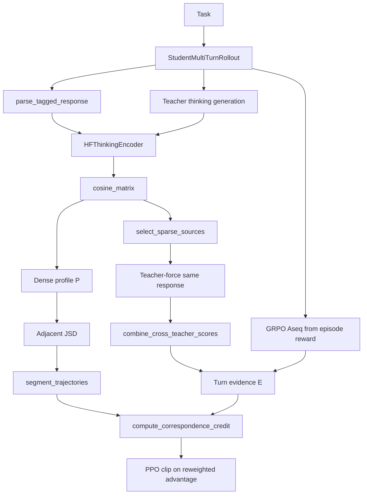
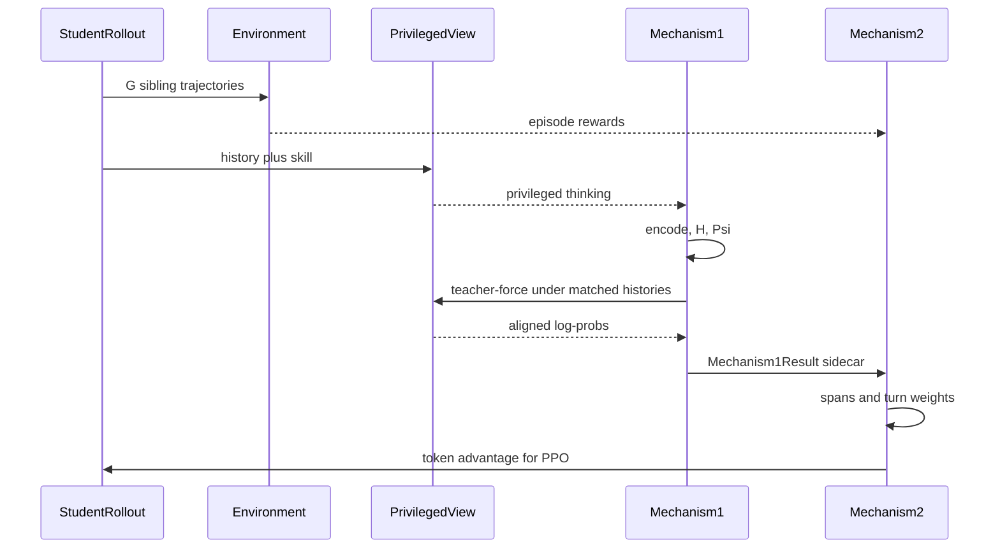
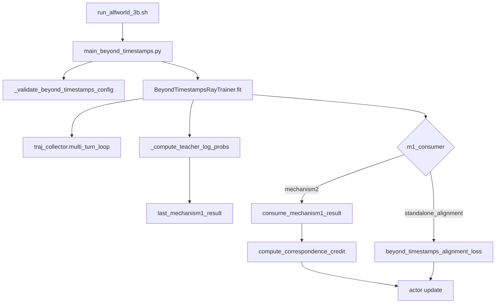

# CODE_PAPER_MAP — ALIGNOPSD

论文：arXiv:2609.33391。PDF：[`docs/ALIGNOPSD.pdf`](../../ALIGNOPSD.pdf)。  
官方仓：[github.com/mingju-c/Align-OPSD](https://github.com/mingju-c/Align-OPSD)。  
本地 submodule：`algorithm/Align-OPSD/`（本稿核对 `main@6654edc`）。  
内部名：`BeyondTimestamps`。M1 = 决策对齐校正，M2 = 半马尔可夫分层 credit。

精讲：[`BRIEFING.md`](BRIEFING.md)。启动：[`QUICK_START.md`](QUICK_START.md)。

---

## 仓库树（只看方法相关）

```text
algorithm/Align-OPSD/
|-- agent_system/                  # 多轮环境与 rollout（verl-agent 风格）
|   |-- environments/env_package/  # alfworld / webshop / search
|   `-- multi_turn_rollout/        # 学生采轨迹
|-- examples/
|   |-- beyond_timestamps_trainer/ # 主方法：M1 + M2（论文 ALIGNOPSD）
|   |-- thinking_correspondence_trainer/  # 只要 M1（standalone alignment）
|   |-- data_preprocess/           # parquet 生成
|   `-- search/retriever/          # Search-QA 检索服务
|-- skills/{alfworld,webshop,search}/
|-- verl/trainer/
|   |-- main_beyond_timestamps.py
|   `-- ppo/
|       |-- thinking_correspondence.py          # M1 公式
|       |-- thinking_correspondence_trainer.py  # M1 前向 + 消费
|       |-- correspondence_credit.py            # M2 公式
|       |-- beyond_timestamps_ray_trainer.py    # 训练循环
|       |-- beyond_timestamps_loss.py           # 只要 M1 时的对齐 loss
|       `-- action_consistency.py               # 动作一致性过滤
|-- tests/                         # 公式级单测（校正混合、切段、消融）
`-- docs/training.md
```

`verl/` 其余部分是 vendored 的 verl / FSDP / vLLM 底座，复现时不要当 ALIGNOPSD 贡献读。

---

## 论文模块 ↔ 代码

| 论文 | Eq. / 节 | 代码 |
|---|---|---|
| 学生多轮 rollout | Eq. 1 | `agent_system/multi_turn_rollout/rollout_loop.py` |
| 特权教师 $\pi^+_\theta(\cdot\mid h,k_x)$ | §2.1 | `thinking_correspondence_trainer.py`：`_generate_teacher_responses`、`_compute_teacher_log_probs` |
| 思考解析 $z_u,z^+_v$ | Eq. 3 | `thinking_correspondence.py::parse_tagged_response` |
| 冻结编码器 | Table 6 | `HFThinkingEncoder`，默认 `Qwen3-Embedding-0.6B` |
| 余弦矩阵 $H$ | Eq. 4 | `cosine_matrix` / `cosine_matrix_by_task` |
| 对齐算子 $\Psi$ | Eq. 4 | `select_sparse_sources`（阈值、每兄弟最多 1、top-K） |
| 动作一致性过滤 | §2.2 | `action_consistency.py`，阈值 0.8 |
| 跨上下文 teacher-force | Eq. 5 | `_build_cross_teacher_batch` + `_compute_teacher_log_probs` |
| 概率混合 $\ell^{+,\text{align}}$ | Eq. 6 | `combine_cross_teacher_scores`（`probability_mixture`） |
| $\rho_u,\alpha_u$ | Eq. 7 | 同函数：`correction_strength = alpha_max * rho` |
| 稠密对应分布 $P$ | Eq. 8 | `build_dense_correspondence_profiles`（top-K **之前**） |
| $D^{\text{corr}}=\mathrm{JSD}$ | Eq. 8 | `normalized_js_divergence` / `compute_adjacent_jsd` |
| 自适应切段 2–8 轮 | §2.3 | `segment_trajectories` |
| 轮证据 $E$ | Eq. 9 | `aggregate_policy_masked_turn_gap` |
| 两层分配 $B,Q$ | Eq. 17–18 | `compute_correspondence_credit_from_tensors` |
| 密度上界 + $\eta$ 混合 | Eq. 19 | `project_weighted_box_budget`，$d_{\max}=4$，$\eta=0.5$ |
| $\hat A=A^{\text{seq}}\mathrm{sg}(W)$ | Eq. 12 | `consume_mechanism1_result` 写入 batch 优势 |
| PPO-clip | Eq. 14 | 标准 actor；M2 路径 **关闭** 直接对齐 loss |
| 消融 A/B/C/D/E | Table 2 | `ablation_mode`：A 关校正，B token，C turn，D random，E 完整 |
| 主启动 | Table 8 | `examples/beyond_timestamps_trainer/run_*.sh` |
| 真实超参（按设置） | 与论文 Table 6 不一致 | `examples/beyond_timestamps_trainer/CONFIGS.md` |

---

## 架构图



M1 产出 `Mechanism1Result` sidecar（相似度、匹配、校正师生差）。M2 只读 sidecar，不再做模型前向。

---

## 训练时序



---

## 调用流



- 主方法脚本：`thinking_correspondence.consumer=mechanism2`，`mechanism2.enabled=true`。
- `examples/thinking_correspondence_trainer/`：只要 M1，走 `standalone_alignment`，用 `beyond_timestamps_loss.py` 的门控对齐 loss，**不是论文主方法**。

---

## 代码内部名

| 代码 | 论文 |
|---|---|
| Mechanism 1 / thinking correspondence | Decision-Aligned Supervision Rectification |
| Mechanism 2 / correspondence credit | Semi-Markov Hierarchical Credit Assignment |
| `corrected_token_gap` | $\tilde\delta_{u,r}$ |
| `correction_strength` | $\alpha_u$ |
| `ablation_mode=A` | Table 2 变体 1（关校正） |
| `ablation_mode=B/C/D` | token / turn / random 分配 |
| `ablation_mode=E` | 完整 ALIGNOPSD |
| `sdar_aux` | 额外的 SDAR 辅助蒸馏；论文正文说没有，ALFWorld 3B 脚本开着 |

---

## Paper ↔ Code gaps

核对 `CONFIGS.md`，不要只信论文 Table 6–7 的统一超参：

- ALFWorld 3B：$\gamma_H=0.65$、$K=2$，并开启 `sdar_aux`（系数 0.01）。论文写 $\gamma_H=0.80$、$K=3$、不加辅助 loss。
- Search 3B：聚合用 `log_mean`，$\alpha_{\max}=0.20$，信用温度 $T=1.0$。
- WebShop 3B：脚本默认 4 卡，$T=0.2$；论文 Table 8 写 2 张 A800。
- 验证集就是 `test.parquet`（ALFWorld / WebShop 128 条，Search 512 条）。
- `ablation_mode` 在代码里齐全，官方没有按 A–D 各给一份启动脚本，消融要自己改 Hydra。

推理：方法只改训练优势（和可选辅助 loss）。部署是不带技能的普通 generate。
