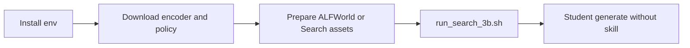

# Quick Start — ALIGNOPSD

方法只改训练。部署 = 不带技能的 Qwen2.5 generate。  
本地仓：`algorithm/Align-OPSD/`。详细安装见上游 `docs/training.md`。



## 仓库入口

| 要做什么 | 命令 / 路径 |
|---|---|
| 主方法（论文 ALIGNOPSD） | `examples/beyond_timestamps_trainer/run_*.sh` |
| 只要 M1 | `examples/thinking_correspondence_trainer/run_*.sh` |
| 真实超参表 | `examples/beyond_timestamps_trainer/CONFIGS.md` |
| 配置预检 | `python scripts/check_training.py --task search --model-size 3b --config-only` |
| 公式单测 | `pytest -q tests` |

## 1. 环境

在 `algorithm/Align-OPSD/` 下。ALFWorld / Search 用 Python 3.12；WebShop **必须另开 Python 3.10**。

```bash
cd algorithm/Align-OPSD
conda create -n alignopsd python=3.12.14 pip ninja packaging -y
conda activate alignopsd
python -m pip install -r requirements.txt
python -m pip install flash-attn==2.7.4.post1 --no-build-isolation
```

WebShop：

```bash
conda create -n alignopsd-webshop python=3.10 pip ninja packaging -y
conda activate alignopsd-webshop
(cd agent_system/environments/env_package/webshop/webshop && bash setup.sh -d small)
python -m pip install -r requirements-webshop.txt
python -m pip install flash-attn==2.7.4.post1 --no-build-isolation
```

## 2. 权重

```bash
hf download Qwen/Qwen3-Embedding-0.6B \
  --revision c54f2e6e80b2d7b7de06f51cec4959f6b3e03418 \
  --local-dir ./models/Qwen3-Embedding-0.6B
hf download Qwen/Qwen2.5-3B-Instruct --local-dir ./models/Qwen2.5-3B-Instruct
export MODEL_PATH=./models/Qwen2.5-3B-Instruct
```

7B 换成 `Qwen/Qwen2.5-7B-Instruct`。不设 `MODEL_PATH` 时脚本会直接拉 Hugging Face ID。

## 3. 数据

```bash
# ALFWorld
export ALFWORLD_DATA="$PWD/data/alfworld"
alfworld-download -f

# Search-QA（另需检索服务）
python -m examples.data_preprocess.preprocess_search_r1_dataset \
  --local_dir ./data/searchR1_processed_direct
python examples/search/searchr1_download.py --local_dir ./data/searchR1
bash examples/search/retriever/retrieval_launch.sh
```

ALFWorld / WebShop 的 placeholder parquet 由启动脚本自动生成。Search 的目录里必须同时有 `train.parquet` 和 `test.parquet`。

## 4. 推理冒烟

加载学生 checkpoint，**不要**往 prompt 里塞 `{skill_context}`。验证温度 0.4。不需要编码器，也不需要教师。

## 5. 训练

```bash
export MODEL_PATH=./models/Qwen2.5-3B-Instruct
# 最省卡：Search 3B，默认 4 GPU，最多 4 轮
bash examples/beyond_timestamps_trainer/run_search_3b.sh

# ALFWorld 3B：默认 8 卡，且开着 sdar_aux（和论文“无辅助 loss”不一致）
bash examples/beyond_timestamps_trainer/run_alfworld_3b.sh
```

短跑冒烟（Search 3B）：

```bash
NUM_GPUS=4 bash examples/beyond_timestamps_trainer/run_search_3b.sh vllm \
  data.train_batch_size=4 env.rollout.n=2 \
  trainer.total_training_steps=2 trainer.test_freq=-1 \
  trainer.save_freq=-1 trainer.val_before_train=false \
  trainer.logger='[console]'
```

复现主表前先读 `CONFIGS.md`。ALFWorld 3B 若要对齐论文正文，应关掉 `algorithm.sdar_aux.enabled`。
