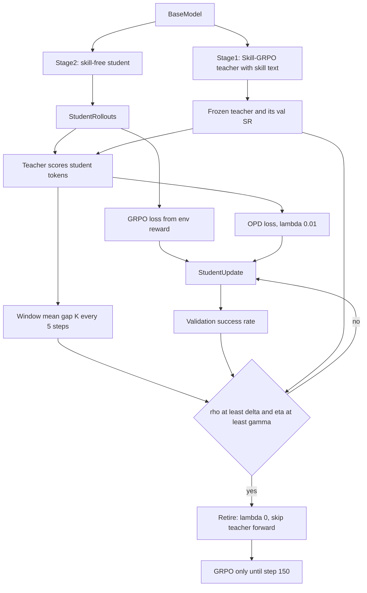
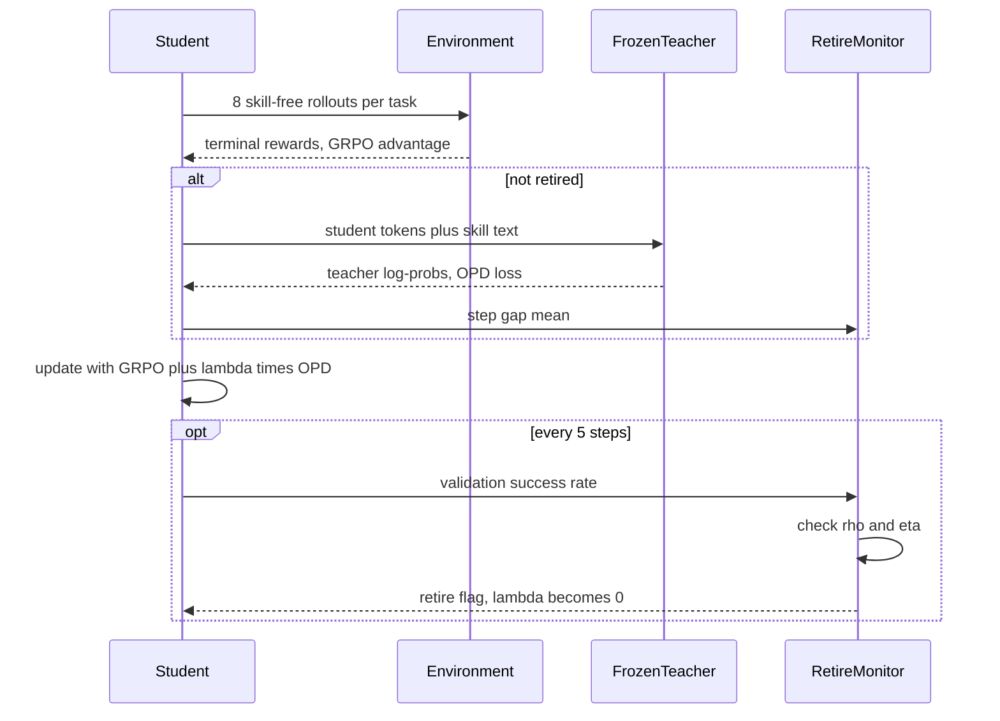

# 组会汇报：RetireOPD（Self-Retiring On-Policy Distillation for Agentic Reinforcement Learning）

论文：Yan Yu, Zhengxi Lu, Yizhou Liu, Yichen Pan, Aozhe Wang, Qipeng Chen, Hua Yang, Wenqi Zhang, Qianglong Chen, Yongliang Shen. *RetireOPD: Self-Retiring On-Policy Distillation for Agentic Reinforcement Learning*. arXiv:2609.20784v2, 2026-09-27.
单位：浙江大学、阿里巴巴（SDAR 同组）
PDF：仓库副本 [`docs/RetireOPD.pdf`](../../RetireOPD.pdf)（23 页，含附录 A.1–A.9 与 Algorithm 1）
代码：没有独立仓库，在 SDAR 里。本地 submodule [`algorithm/SDAR/`](../../../algorithm/SDAR/)（[github.com/ZJU-REAL/SDAR](https://github.com/ZJU-REAL/SDAR)，`master@29dcb12`）。对照表：[`CODE_PAPER_MAP.md`](CODE_PAPER_MAP.md)；启动：[`QUICK_START.md`](QUICK_START.md)。核心文件：

- `verl/trainer/ppo/retire_opd.py`：退休状态机
- `verl/trainer/ppo/retire_opd_trainer.py`：训练器
- `examples/retireopd_trainer/run_{alfworld,webshop}_3b.sh`：启动脚本

证据口径：论文正文 + 附录 > 官方代码与脚本。**[推断]** 是我根据数字或代码做的判断；**【注解】** 是组会追问的展开。

和组里已读材料的位置：SAGE-OPD 回答“**哪一轮** 该蒸”，ALIGNOPSD 回答“教师证据该 **和哪个决策对齐**”，RetireOPD 回答的是更粗的问题：“**这个教师该教多久**”。它在整个训练层面只做一次决定：什么时候彻底撤掉 OPD。

---

# 0. 一句话贡献

在 agent 自蒸馏里，“同一模型加技能文本”的教师不一定比学生强，而且 OPD 只在前期有用，后期会和 RL 打架。RetireOPD 分三步：先用环境奖励单独训练一个会用技能的教师（就是 Skill-GRPO）；再用 GRPO + OPD 联合训练不带技能的学生；同时每 5 步监控一次，当“师生差不再缩小”且“学生成功率达到教师的 90%”时，永久撤掉教师，剩下的步数只做 GRPO。

---

# 1. 任务定义与动机剖析

## 1.1 任务是什么

- **训练阶段**：agent 强化学习 + on-policy 蒸馏的混合（GRPO + OPD），后期退化为纯 GRPO。
- **谁生成**：学生 $\pi_\theta$（不看技能）和环境多轮交互，每个任务采 $G=8$ 条轨迹；部署时学生自己生成，不需要技能文本。
- **谁当教师**：同尺寸、同初始化的模型，在技能文本 $c^+$ 下先用 GRPO 训练好，然后冻结，记为 $\pi_T$。
- **模型**：Qwen2.5-1.5B / 3B / 7B-Instruct。
- **环境**：ALFWorld（最多 50 步）、WebShop。

记号：轨迹 $\tau=(x,y)$，$y=(y_1,\ldots,y_T)$ 是把所有轮的有效回复 token 拼成的一条序列，$R(\tau)$ 是终局奖励。

一句话任务：**把训练期才有的技能“内化”进不看技能的学生参数里，并且在教师开始拖后腿之前自动把教师撤掉。**

## 1.2 要解决的问题

作者在 ALFWorld + Qwen2.5-3B 上观察到两个现象（论文 Figure 2）：

1. **加了技能的教师不一定更强。** Figure 2 左图的“教师”就是 Qwen2.5-3B-Instruct **自己**，和学生 **同一套权重**，差别只在输入：教师分支看「技能文本 + 任务 prompt + 学生已经生成的前缀」，学生分支只看「任务 prompt + 前缀」。这就是论文说的 GRPO+OPSD：同一个策略的两个分支。附录 Figure 14 的教师模板是在学生 prompt 前加一段 `[Privileged Skill Information] {skill_text}`。

   说“教师没有经过专门训练”时要更精确：这套共享权重 **在训练中会更新**（左图教师曲线大约从 0.27 涨到 0.71），但更新信号全部来自学生分支（学生的 GRPO 奖励加上 OPSD 损失），**没有任何信号奖励“带技能的那个分支把技能用好”**。所以这个教师是“跟着学生一起变强”，不是“学会了怎么用技能”。SkillRL 原文也观察到：把技能直接塞进没改过的模型，收益很有限，所以他们在 RL 之前先做一轮启动 SFT。RetireOPD 的教师则完全不同：先单独用 Skill-GRPO 训练（3B 到 79.7%），再冻结，是另一份独立权重。

   左图读数可以和 Table 1（3B ALFWorld）对上；第 0 步是从图上估的，和表差约 1 个点：

   | Figure 2 左图 | 对应 Table 1（3B） | Table 1 |
   |---|---|---:|
   | 第 0 步教师 $\approx 0.277$ | Skill-Prompt∗（原模型 + 技能 prompt） | 28.9 |
   | 第 0 步学生 $\approx 0.23$ | Vanilla | 21.9 |
   | 最终学生 $\approx 0.766$ | GRPO+OPSD | 78.1 |

   直接拿没改过的 7B 加技能提示，ALFWorld 也只有 23.4%（Table 1 的 Skill-Prompt∗）。教师要先 **学会用技能**，才有资格教人。
2. **教师的作用随阶段变化。** GRPO+OPD 解决了纯 GRPO 起步慢、纯 OPD 天花板低的问题。但师生差（teacher–student discrepancy）先缩小、后反弹：学生学会了技能带来的行为之后，奖励优化开始偏向教师之外的动作，两股梯度开始冲突，继续对齐教师会把学生卡在教师的水平附近。

## 1.3 Motivation

两个问题，对应两个设计：

- **该跟哪个教师学？** → 先用环境奖励把带技能的教师训练好（Privileged Teacher Construction）。
- **该学多久？** → 不预设时间表，从训练信号里在线判断：师生差停止缩小，说明两个目标开始冲突；学生成功率接近教师，说明技能已经内化（Adaptive Retirement）。

附录 A.9：不同模型、不同任务里，师生差停止下降的时间点在第 50 步到第 90 步之间变化。所以固定在某一步切换，总会有些设置切得太早、有些切得太晚。

## 1.4 现有方法局限

| 方法族 | 做法 | 为何不够（作者视角） |
|---|---|---|
| GRPO / GiGPO / PPO / RLOO | 只用终局奖励 | 监督稀疏，起步慢 |
| OPD / OPSD | 只用教师的稠密监督 | 被教师水平卡住；未训练的技能教师质量差 |
| GRPO+OPD / GRPO+OPSD（SDAR） | 固定权重联合优化 | 后期两个目标冲突，学生停在教师附近 |
| 退火蒸馏权重（ATOD、SAF-OPD） | 预设时间表逐渐减小 λ | 时间表是事先定的，和实际训练状态无关 |
| 先蒸馏后 RL（OPDSearch+ 等） | 在固定步数切换 | 同上，最佳切换点随设置变化 |
| 按题或按 token 门控（HDPO、SDAR） | 细粒度在线开关 | 从不彻底撤掉教师 |

RetireOPD 的切口：**在整个训练层面在线决定一次“何时退休”**，并且退休后连教师前向也一起省掉。

## 1.5 用论文里的 ALFWorld 例子说明

附录 A.7 给了两条真实轨迹：

- **前期教师有用**：任务“清洗生菜再放到台面上”。第 8 步走到水槽边，技能里写着“放之前先清洗”。训练过的技能教师给 `clean` 这个 token 的 log 概率是 **−0.826**，未训练的 OPSD 教师给 **−16.625**。只有前者能真正把技能变成有用的 token 级监督。
- **后期教师碍事**：任务需要“冷却番茄再用微波炉”。学生走向微波炉的动作最终让任务成功，环境也给了正反馈，但教师对这一步打了很低的分。这时继续对齐教师，等于让学生放弃一个正确的动作。

## 1.6 技能 prompt 到底是什么

技能来自 SkillRL 的 SkillBank，**不是标准答案**。SkillRL 原文的建库过程分四步（RetireOPD 正文只说沿用这个库，细节以 SkillRL 为准）：

1. **收集轨迹。** 先让基座模型在环境里跑，成功和失败的轨迹都留下来。
2. **提炼技能。** 用 OpenAI o3 作提炼模型。成功轨迹提炼成关键决策点和可迁移模式；失败轨迹被收成“哪里错了、为什么、本来该怎么做”的教训。
3. **分两层组织。** 一层通用技能，适用于所有任务类型，比如系统性搜索、执行动作前检查前提条件；另一层按任务类别分的专用技能，例如 ALFWorld 里的 clean、heat、cool。
4. **统一格式。** 每条技能有三个字段：名称、原则、适用条件。SkillRL 初始库约 55 条，其中 12 条通用、43 条专用。

本地 SDAR / RetireOPD 仓不是 55 张独立卡片，而是按任务类型合成的几份 markdown：`skills/alfworld/general_skills.md` 正好 12 条（含 Progressive Goal Decomposition）；`clean.md` 一类里有 “Phase-Ordered Plan / Sink First for Cleaning / State Verification Before Drop” 等。附录 Figure 10 里检索到的技能名，例如 “Clean before placing”“Use sink for cleaning”“Verify object state”，对应的就是这类策略。

**RetireOPD 怎么取技能：** 沿用 SDAR 的关键词匹配。从任务描述里识别类别（例如出现 `clean`），再取出通用技能 + 该类专用技能。SDAR 原文对比过 UCB、关键词、全量、随机四种检索，RetireOPD 固定用关键词。代码里对 ALFWorld parquet 是 `any` 匹配：多个关键词命中时会把多份技能拼在一起，不只取一类。

拼进教师 prompt 后大致是这样（按 SkillRL 字段和 Figure 10 的技能名写的示意，不是论文原文）：

```text
[Privileged Skill Information]
- Clean before placing
  原则：clean 类任务，拿到目标物先去水槽清洗，再放到目标位置
  适用：任务描述形如 "clean some X and put it in Y"
- Verify object state
  ...
You are an expert agent operating in the ALFRED Embodied Environment.
Your task is to: clean some lettuce and put it in countertop.
...
```

关键区别：**技能 $\neq$ 答案。** 它告诉教师“先洗再放”，不把 `clean lettuce 2 with sinkbasin 1` 这种具体动作写死。学生从头到尾看不到这段文本。

---

# 2. 方法论树状拆解

## 2.1 为什么是这些工具

1. **用 GRPO 训练技能教师。** 让教师在环境奖励下学会把技能文本变成有效动作，而不是只把技能塞进提示词。
2. **reverse KL 的采样估计做 OPD。** 和 Thinking Machines 的 OPD 一样，在学生自己采的 token 上比较学生与教师的 log 概率，不需要在整个词表上算精确 KL。
3. **用师生差的趋势当冲突信号。** 附录 A.1 的一阶分析：师生差不再下降，意味着 OPD 方向和 RL 方向开始冲突，或者 OPD 已经没什么可教的了。
4. **用相对教师的成功率防止过早退休。** 训练早期噪声大，单看师生差容易误触发；要求学生先达到教师 90% 的成功率。
5. **只做一次、不可逆。** 退休后不再恢复。附录 A.4 实验显示，第 90 步把教师加回来也没有收益。

创新落在 **训练流程的编排（先训练教师、再在线退休）**。GRPO、OPD、k3 KL 估计都是现成组件。

## 2.2 ASCII 树

```text
RetireOPD
|-- 阶段 1：特权教师构造
|   |-- 同尺寸、同初始化的模型，上下文加技能文本 c+（独立权重，不是 GRPO+OPSD 的共享分支）
|   |-- c+ 来自 SkillRL SkillBank：通用 12 条 + 按任务类型的专用技能，关键词检索
|   |-- 用 GRPO + 环境奖励训练（即 Skill-GRPO，150 步，同 GRPO 超参）
|   |-- 按验证集选 checkpoint，冻结为 pi_T
|   `-- 记录教师验证成功率 SR_T，作为退休判据的分母
|-- 阶段 2：联合 GRPO + OPD（技能内化）
|   |-- 学生不看技能，每题采 G=8 条轨迹
|   |-- GRPO 损失：组内标准化的终局优势 + PPO-clip
|   |-- OPD 损失：学生 token 上的 reverse KL 采样估计，权重 lambda=0.01
|   `-- 代码实现：k3 估计 exp(-l)-1+l，乘以 on-policy 比率
`-- 阶段 3：自适应退休（每 W=5 步检查一次）
    |-- 对齐进度：窗口内师生差均值 K，与上一窗口比较的相对变化 rho
    |-- 相对能力：最近两次验证成功率的平均 / SR_T，记为 eta
    |-- 触发条件：rho >= delta=0（不再缩小）且 eta >= gamma=0.9
    `-- 触发后：lambda 置 0，跳过教师前向，剩余步数只做 GRPO
```

## 2.3 Mermaid：模块关系



图里节点和公式的对应：Stage1 是 Eq. 1，GRPO loss 是 Eq. 2，OPD loss 是 Eq. 3–5，K 与退休判据是 Eq. 6–8。

## 2.4 Mermaid：一个训练 step 的时序



## 2.5 三个阶段怎么交互

- 阶段 1 的输出有两样：冻结的教师，以及一个数 $SR_T$。在代码里，$SR_T$ 要通过环境变量 `TEACHER_PERFORMANCE` **手动填入**。
- 阶段 2 和阶段 3 同时运行：阶段 2 每步产出一个师生差均值，阶段 3 每 5 步消费一次，并结合一次验证评测。
- 退休是全局、一次性、不可逆的开关：退休前的损失是 GRPO + λ·OPD，退休后只剩 GRPO，并且不再调用教师。

---

# 3. 算法流程与公式细节推演

## 3.1 符号表

| 符号 | 含义 | 来源 |
|---|---|---|
| $c^+$ | 技能文本（从 SkillRL 的 SkillBank 按关键词检索） | §3.1 |
| $\pi_\phi\to\pi_T$ | 训练中 / 冻结后的技能教师 | Eq. 1 |
| $\Delta_t$ | 第 $t$ 个学生 token 上的师生 log 概率差 | Eq. 4 |
| $\lambda$ | OPD 权重，0.01 | Eq. 5 |
| $K_n,\ \bar K_m$ | 第 $n$ 步的平均师生差、第 $m$ 个窗口的均值 | Eq. 6 |
| $\rho^{(K)}_m$ | 反弹指标 | Eq. 7 |
| $\eta_m$ | 相对能力 | Eq. 7 |
| $W,\ \delta,\ \gamma$ | 窗口 5 步，阈值 0 与 0.9 | §4.1 |

## 3.2 关键公式

**阶段 1：教师**（Eq. 1）：

$$
\phi^*=\arg\max_\phi\ \mathbb{E}_{x\sim\mathcal{D},\ \tau\sim\pi_\phi(\cdot\mid x,c^+)}\big[R(\tau)\big]
$$

**阶段 2：OPD 与联合目标**（Eq. 3–5）：

$$
\mathcal{L}_{\mathrm{OPD}}(\theta)=\mathbb{E}_{y\sim\pi_\theta}\left[\frac{1}{|y|}\sum_{t=1}^{|y|}D_{\mathrm{KL}}\big(\pi_\theta(\cdot\mid x,y_{<t})\,\|\,\pi_T(\cdot\mid x,c^+,y_{<t})\big)\right]
$$

$$
\Delta_t=\log\pi_T(y_t\mid x,c^+,y_{<t})-\log\pi_\theta(y_t\mid x,y_{<t}),\qquad \mathcal{L}_{\text{student}}=\mathcal{L}_{\mathrm{GRPO}}+\lambda\,\mathcal{L}_{\mathrm{OPD}}
$$

**代码里的 OPD 实现**（`verl/trainer/ppo/skillsd_utils.py::compute_sdl_loss`）：令 $\ell_t=\log\pi_\theta-\log\pi_T=-\Delta_t$，

$$
\mathcal{L}_{\mathrm{OPD}}^{\text{code}}=\text{token-mean}\Big[\frac{\pi_\theta(y_t)}{\pi_{\theta_{\text{old}}}(y_t)}\cdot\big(e^{-\ell_t}-1+\ell_t\big)\Big]
$$

括号里是 reverse KL 的 k3 估计（恒非负），前面乘了一个 on-policy 重要性比率（log 比率上限裁剪到 10）。

**【注解 · 论文伪代码和代码不一致】** Algorithm 1 第 16 行写的是 $\mathcal{L}_{\mathrm{OPD}}\leftarrow-K_n$，也就是直接最小化 $\frac{1}{|y|}\sum_t(\log\pi_\theta-\log\pi_T)$。如果照字面实现，教师项是常数，梯度只是均匀地压低学生对自己采样 token 的概率，和教师无关。真实代码用的是上面的 k3 形式，梯度是 $(1-\pi_T/\pi_\theta)\nabla\log\pi_\theta$，确实依赖教师。复现时请以代码为准。

**阶段 3：退休判据**（Eq. 6–8）：

$$
K_n=\frac{1}{G}\sum_{i=1}^{G}\frac{1}{|y^{(i)}_n|}\sum_{t}\Delta^{(i)}_t,\qquad \bar K_m=\frac{1}{W}\sum_{n=mW}^{mW+W-1}K_n
$$

$$
\rho^{(K)}_m=\frac{\bar K_m-\bar K_{m-1}}{\bar K_m},\qquad \eta_m=\frac{SR_m+SR_{m-1}}{2\,SR_T},\qquad m^*=\inf\{m\ge2:\ \rho^{(K)}_m\ge\delta\ \wedge\ \eta_m\ge\gamma\}
$$

**【注解 · 符号方向】** $K$ 是 reverse KL 的负值估计，正常情况下小于 0，并且随对齐越好越接近 0。分母 $\bar K_m$ 是负数，所以：

- 师生差在缩小（$\bar K_m>\bar K_{m-1}$）时，$\rho<0$；
- 师生差停滞或反弹（$\bar K_m\le\bar K_{m-1}$）时，$\rho\ge0$，触发条件之一满足。

如果 $K$ 的符号在训练中翻转，这个指标会失去意义。代码换了一种写法：$K^{\text{code}}=-\text{gap}$（正数），进度 $=(\bar K^{\text{code}}_{m-1}-\bar K^{\text{code}}_m)/\bar K^{\text{code}}_{m-1}$，进度 $\le$ `alignment_threshold` 时触发。在 $\delta=0$ 时两者等价。但 $\delta\ne0$ 时方向相反：论文里 $\delta$ 越大越晚退休（Table 3 也是这个趋势），代码里阈值越大越早退休 [推断]。

## 3.3 手算一次退休判定

设 3B 学生在 ALFWorld 上，教师验证成功率 $SR_T=0.797$（Table 1 中 3B 的 Skill-GRPO∗）。窗口均值与验证成功率如下（数值是我设的）：

| 窗口结束步 | $\bar K_m$ | $\rho^{(K)}_m$ | $SR_m$ | $\eta_m$ | 退休？ |
|---|---:|---:|---:|---:|---|
| 45 | −0.30 | — | — | — | — |
| 50 | −0.22 | $\frac{-0.22+0.30}{-0.22}=-0.364$ | 0.66 | — | 否：还在缩小 |
| 55 | −0.18 | $\frac{-0.18+0.22}{-0.18}=-0.222$ | 0.70 | $\frac{0.70+0.66}{1.594}=0.853$ | 否：还在缩小，能力也不够 |
| 60 | −0.19 | $\frac{-0.19+0.18}{-0.19}=+0.053$ | 0.75 | $\frac{0.75+0.70}{1.594}=0.910$ | **是**：两个条件都满足 |

用代码的写法算第 60 步：$K^{\text{code}}$ 从 0.18 变成 0.19，进度 $=(0.18-0.19)/0.18=-0.056\le0$，同样触发。

退休之后：λ 变成 0，教师前向被跳过（代码用 `old_log_probs` 作占位），第 61–150 步只做 GRPO。论文里 3B ALFWorld 的退休步正好是 60。

## 3.4 一阶分析（附录 A.1）

令 $g=\nabla J$（奖励方向），$h=\nabla D$（师生差的梯度），联合更新 $\theta^+=\theta+\eta(g-\lambda h)$。

$$
J(\theta^+)-J(\theta)=\eta\big(\|g\|^2-\lambda\langle g,h\rangle\big)+O(\eta^2),\qquad \frac{d}{dt}D(\theta)=\langle g,h\rangle-\lambda\|h\|^2
$$

- 若 $\langle g,h\rangle<0$：OPD 帮助奖励上升。
- 若师生差不降，即 $\frac{dD}{dt}\ge0$，则 $\langle g,h\rangle\ge\lambda\|h\|^2\ge0$：两者冲突，或者 $h\approx0$（教师已没东西可教）。
- 冲突时，只做 GRPO 比联合更新多涨 $\eta\lambda\langle g,h\rangle$。

这是一阶、无噪声、忽略 clip 的推导，起到“把直觉写成公式”的作用。它没有说明“窗口均值的一次反弹”是否真的对应 $\langle g,h\rangle>0$，而采样噪声恰恰最容易造成一次假反弹。

---

# 4. 实验设定与资源开销

## 4.1 模型、数据、评测

| 项 | 内容 |
|---|---|
| 模型 | Qwen2.5-1.5B / 3B / 7B-Instruct，教师与学生同尺寸、同初始化 |
| 技能 | SkillRL 的 SkillBank（约 55 条：12 通用 + 43 专用；本地仓按任务类型合成 markdown）。沿用 SDAR 关键词匹配；SDAR 还对比过 UCB / 全量 / 随机，本文不用 |
| ALFWorld | 6 类任务；成功率；验证集 128 条 |
| WebShop | Score 与 Acc；验证集 256 条 |
| 评测 | 论文没有单独写测试集。官方 ALFWorld 脚本把 `data.val_files` 指向 `test.parquet`，`val_data_size=128`；主表的 ALFWorld 数字基本都能被 128 整除，例如 93.8 = 120/128 |

## 4.2 Baseline

| 组 | 方法 | 说明 |
|---|---|---|
| 提示 | Vanilla、Skill-Prompt∗ | ∗ 表示评测时也给技能 |
| RL | GRPO、GiGPO、PPO、RLOO | 标准 RL |
| RL + 技能 | Skill-GRPO∗ | **就是本文阶段 1 训练出的教师**，评测时带技能 |
| 蒸馏 | OPD-Skill-同尺寸、OPD-更大模型、OPSD | 后缀表示教师。“OPD-3B”是用 **没做过 Skill-GRPO** 的 3B 加技能，当 1.5B 学生的教师 |
| 混合 | GRPO+OPD、GRPO+OPSD（即 SDAR 设定） | 固定 λ，不退休。GRPO+OPSD 的教师是 **共享权重的技能分支**，不是阶段 1 那种独立教师 |

**【注解 · baseline 数字和 ALIGNOPSD 论文完全一样】** 3B 与 7B 的 Vanilla、GRPO、OPSD 行，每一格都和 ALIGNOPSD（北航）论文 Table 1 相同，只是 ALFWorld 列顺序不同。两篇很可能都沿用了 SDAR 论文的数字 [推断]。另外，1.5B 和 7B 的 GRPO / GiGPO / PPO / RLOO 等多个数字不能被 128 或 256 整除，说明这些 baseline 可能不是用同一套 128 / 256 条评测跑出来的 [推断]。

## 4.3 超参与成本

| 项 | 论文 Table 4 | 官方脚本（ALFWorld 3B） |
|---|---|---|
| 学习率 | $1\times10^{-6}$ | $1\times10^{-6}$ |
| 组大小 $G$ | 8 | `env.rollout.n=8` |
| 训练批 | 16 个任务 | 16 |
| OPD 权重 $\lambda$ | 0.01 | 0.01 |
| 参考 KL $\alpha_{\mathrm{KL}}$ | 0.01 | **`use_kl_loss=False`** |
| 窗口 / 阈值 | 5 / $\delta=0$ / $\gamma=0.9$ | 5 / 0.0 / 0.9 |
| 训练步数 | 150 | `total_epochs=150` |
| 其他 | — | 无效动作惩罚 0.1，最多 50 步，验证温度 0.4 |
| GPU | **未报告** | 默认 8 卡，rollout 张量并行 2 |

**【注解 · 计算预算不对等】** RetireOPD 的总计算量是“教师 150 步 GRPO + 学生 150 步”，大约是 GRPO baseline 的两倍。不过退休后学生不再调用教师前向，能省回一部分。论文没有报告墙钟时间，也没有给 GRPO 一个“训练 300 步”的对照。

退休步（附录 A.9）：

| 模型 | ALFWorld | WebShop |
|---|---:|---:|
| 1.5B | 75 | 90 |
| 3B | 60 | 80 |
| 7B | 60 | 85 |

---

# 5. 实验结论的因果支撑

## 5.1 指标

| 指标 | 含义 | 方向 |
|---|---|---|
| ALFWorld 各类 / Avg | 成功率 | ↑ |
| WebShop Score | 部分满足约束也给分的平均得分 | ↑ |
| WebShop Acc | 完全成功的比例 | ↑ |

全部为单次评测，没有误差条。只有附录 Fig. 9 提到“阴影表示多次运行的波动”，但没有给出运行次数。

## 5.2 主结果（Table 1 汇总列）

| 方法 | 1.5B ALF | 1.5B WS Acc | 3B ALF | 3B WS Acc | 7B ALF | 7B WS Acc |
|---|---:|---:|---:|---:|---:|---:|
| Vanilla | 5.5 | 5.5 | 21.9 | 0.8 | 12.5 | 1.6 |
| GRPO | 72.8 | 56.8 | 75.0 | 63.3 | 81.2 | 72.6 |
| GiGPO | 86.7 | 65.0 | 92.2 | 69.5 | 90.8 | 72.8 |
| Skill-GRPO∗（教师） | 81.2 | 67.9 | 79.7 | 64.8 | 90.6 | 78.9 |
| OPD-Skill-同尺寸 | 71.1 | 69.1 | 74.2 | 66.4 | 86.7 | 78.1 |
| OPSD | 14.1 | 10.2 | 28.1 | 3.1 | 32.8 | 2.3 |
| GRPO+OPD | 87.5 | 69.9 | 82.8 | 74.2 | 92.2 | 81.2 |
| GRPO+OPSD | 72.7 | 66.8 | 78.1 | 66.4 | 79.7 | 76.5 |
| **RetireOPD** | **89.8** | **75.8** | **93.8** | **77.3** | **95.3** | **84.4** |

WebShop Score：RetireOPD 为 86.6 / 85.8 / 91.7；GRPO+OPD 为 82.5 / 84.5 / 90.3。

**摘要里的“比 GRPO 高 14.1%–18.8%（ALFWorld）、11.8%–19.0%（WebShop）”是绝对百分点**：ALFWorld 3B 93.8−75.0=18.8、7B 95.3−81.2=14.1；WebShop 1.5B 75.8−56.8=19.0、7B 84.4−72.6=11.8。

**支撑：**

- 强：OPSD（教师只是共享权重加技能，没有单独的 Skill-GRPO）在三个尺寸上都崩掉（ALFWorld 14–33），换成先 Skill-GRPO 再冻结的教师后，OPD 就能到 71–87。“教师要先学会用技能”这一点证据最充分。
- 强：“学生超过自己的教师”在 6 个设置里都成立，ALFWorld 3B 从 79.7 涨到 93.8。纯 OPD 学生则基本停在教师附近，甚至低于教师。
- 中：相对 GRPO+OPD（不退休的同一配方），3B ALFWorld 高 11.0 个点；但 1.5B 只高 2.3（约 3 个 episode）、7B 只高 3.1（约 4 个 episode）。**退休机制的大收益主要集中在 3B**，而所有消融恰恰都只在 3B ALFWorld 上做。
- 弱：相对最强的纯 RL baseline GiGPO，3B ALFWorld 只高 1.6 个点（约 2 个 episode）。

**【注解 · 正文有一处数字张冠李戴】** §4.2 写“用单独训练的教师做 OPD 而不是 OPSD，1.5B ALFWorld 从 72.7% 提到 87.5%”。这两个数其实是 **GRPO+OPSD vs GRPO+OPD**（混合方法），不是纯 OPD vs OPSD。纯蒸馏的对比是 OPD-Skill-1.5B 71.1 vs OPSD 14.1，差距更大。WebShop 的“69.9 vs 66.8”同理。

## 5.3 训练动态（Figure 4，3B ALFWorld）

- **RetireGRPO**（反过来撤掉 GRPO、只留 OPD）：撤掉之后成功率下降，学生被拉得更贴近教师，熵上升、训练不稳。
- **GRPO+OPD**：约 60 步后收敛，熵持续下降，探索减少。
- **RetireOPD**：退休后继续上升，熵保持在中等水平。

这组对照很好地说明了“退休的是哪一个目标”很重要，但同样只有 3B ALFWorld、单次运行。

## 5.4 消融

**教师构造**（Figure 5，3B 学生，ALFWorld）：

| 教师 | 教师自身 | 用 RetireOPD 训出的学生 |
|---|---:|---:|
| 3B 只加技能、无 Skill-GRPO（= Skill-Prompt∗） | 28.9 | 78.1 |
| 3B 先 Skill-GRPO 再冻结 | 79.7 | **93.8** |
| 7B 只加技能、无 Skill-GRPO | 23.4 | 86.7 |
| 7B 先 Skill-GRPO 再冻结 | 90.6 | 91.4 |

- 强：训练过的教师明显更好（3B：78.1 → 93.8）。
- 有意思：训练过的 7B 教师（自身 90.6）教出来的学生（91.4），**不如** 训练过的 3B 教师（自身 79.7）教出来的学生（93.8）。论文没有讨论这一点；它提示“教师越强越好”并不成立，师生同尺寸可能更容易对齐 [推断]。

**退休判据**（Table 2 与 Table 3，3B ALFWorld）：

| 设置 | 退休步 | SR |
|---|---:|---:|
| RetireOPD（$\delta=0,\gamma=0.9$） | 60 | **93.8** |
| 去掉反弹指标 | 50 | 89.0 |
| 去掉相对能力 | 100 | 89.0 |
| 不退休（= GRPO+OPD） | — | 82.8 |
| 不用 OPD（= GRPO） | 0 | 75.0 |
| $\delta=0.03$ | 65 | 89.1 |
| $\delta=0.05$ | 75 | 91.4 |
| $\gamma=0.8$ | 55 | 90.6 |
| $\gamma=1.0$ | 95 | 91.4 |

- 强：“要退休”本身有用。只要在 50–100 步之间的任何时候退休，结果都在 89–94，明显高于不退休的 82.8。
- 弱：“两个条件都要”。按退休步排列，SR 分别是：50 步 89.0、55 步 90.6、**60 步 93.8**、65 步 89.1、75 步 91.4、95 步 91.4、100 步 89.0。默认设置恰好落在最高点，而相邻 5 步的差距就有 3–5 个点（4–6 个 episode）。这更像单次运行的噪声，不足以说明默认阈值组合本身更优 [推断]。
- 作者说“对阈值不敏感”（Figure 7：$\delta\in[-0.10,0.04]$、$\gamma\in[0.80,0.96]$ 时退休步变化在 ±5 步以内）。这和上表里“退休步变 5 步、SR 变 3–5 个点”放在一起看，结论应该是：**退休步稳定，但最终成绩对退休步本身并不稳定**。

**λ 敏感性**（附录 A.6）：λ=0.1 前期最快但后期变慢、最终更低；λ=0.001 前期慢，后期追上；λ=0.01 最好。这本身又是“教师作用随阶段变化”的旁证。

**线性退火对照**（Figure 6）：线性退火波动更大、最终更低。但论文没有给数字，只有曲线。

**退休后再恢复教师**（附录 A.4）：第 60 步退休、第 90 步恢复，没有带来收益，说明退休判据捕捉的是持续性的变化。

## 5.5 不能支撑的地方

1. **退休判据用的就是测试集。** 官方脚本里，算 $\eta$ 的验证集就是 `test.parquet` 里的 128 条，而主表报告的 ALFWorld 数字也是这 128 条上的成功率。教师 checkpoint 和 $SR_T$ 同样按验证集选。也就是说，“什么时候退休”这个决定用到了测试集的信息 [推断]。
2. 单次运行、无误差条；1 个 episode 约 0.8 个点，而退休机制相对 GRPO+OPD 的增益在 1.5B / 7B 上只有 3–4 个 episode。
3. 所有消融都只在 3B ALFWorld 上，正好是收益最大的设置。
4. 计算预算约为 GRPO 的两倍（教师训练 + 学生训练），没有同预算对照。
5. 论文与代码有三处不一致：OPD loss 的写法、$\delta$ 的符号方向、参考 KL 是否开启。
6. 没有 Search-QA 这类不能给出动作失败反馈的环境。

---

# 6. 复现前置准备清单

## 6.1 数据

- **ALFWorld**：`alfworld` 数据（`json_2.1.1`，脚本会在 `~/.cache/alfworld` 或 `~/data/alfworld` 下找），用 `examples/data_preprocess/prepare --mode text --train_data_size 16 --val_data_size 128` 生成 parquet。
- **WebShop**：商品库与搜索服务（verl-agent 的标准 WebShop 环境）。
- **技能**：SkillRL SkillBank，关键词匹配。完整 submodule 里有 `skills/alfworld/`、`skills/webshop/`、`skills/search/`。ALFWorld 看 `skill_mapping.json`：先拼 `general_skills.md`（12 条），再按 `clean` / `heat` / `cool` 等关键词拼专用文件。WebShop 脚本用 `skills/webshop`。实现在 `verl/trainer/ppo/rlsd_utils.py::SkillProvider`。
- **评测划分**：建议另外留出一份不参与退休判据和 checkpoint 选择的测试集。

## 6.2 模型

- `Qwen/Qwen2.5-{1.5B,3B,7B}-Instruct`，教师与学生从同一权重初始化。
- 阶段 1 训练出的教师需要从 FSDP 分片 checkpoint 合并成 HF 格式（`scripts/model_merger.py`），再通过 `TEACHER_MODEL_PATH` 传给阶段 2。

## 6.3 硬件 [估计]

论文没写。脚本默认单机 8 卡、rollout 张量并行 2。3B 在 8×A100 / A800 80GB 上可以跑；1.5B 可以先用 4 卡试。总时长约为两次 150 步的 GRPO。

## 6.4 代码

本地已作为 submodule 放在 `algorithm/SDAR/`。换电脑后在仓库根执行 `./gitsubmodules.sh algorithm/SDAR`。

```text
cd algorithm/SDAR
bash examples/skill_grpo_trainer/run_alfworld_3b.sh
TEACHER_MODEL_PATH=/path/to/teacher_hf TEACHER_PERFORMANCE=0.797 \
  bash examples/retireopd_trainer/run_alfworld_3b.sh
```

对照与启动说明：[`CODE_PAPER_MAP.md`](CODE_PAPER_MAP.md)、[`QUICK_START.md`](QUICK_START.md)。

第一条命令训练阶段 1 的教师，第二条训练阶段 2 + 3 的学生。`TEACHER_PERFORMANCE` 填教师在同一验证指标（默认 `val/success_rate`）上的值；README 的例子写的是 0.50，需要换成自己教师的实测值。

关键实现文件：

| 文件 | 内容 |
|---|---|
| `verl/trainer/ppo/retire_opd.py` | 退休状态机：窗口均值、对齐进度、相对能力、状态保存与恢复 |
| `verl/trainer/ppo/retire_opd_trainer.py` | 继承 GRPO+OPD 训练器；退休后跳过教师前向 |
| `verl/trainer/ppo/skillsd_utils.py` | `compute_sdl_loss`：k3 估计 × on-policy 比率 |
| `examples/retireopd_trainer/run_*_3b.sh` | 启动脚本（目前只有 3B） |

## 6.5 算法：必做与可延后

| 优先级 | 内容 |
|---|---|
| 必做 | 阶段 1 复现 Skill-GRPO∗（3B ALFWorld 约 79.7） |
| 必做 | 同一份代码重跑 GRPO 与 GRPO+OPD，对齐 75.0 / 82.8 |
| 必做 | RetireOPD 主配置；**换一个独立测试集评测**，至少 3 个 seed |
| 再做 | 固定退休步 50 / 60 / 70 / 80 的对照，判断“自适应”相对“任意时间点退休”的真实价值 |
| 再做 | 同预算对照：GRPO 训练 300 步 |
| 可延后 | 1.5B / 7B、WebShop、阈值扫描 |

## 6.6 Sanity check

1. 把 $\gamma$ 设得很大（永不触发）：结果应等于 GRPO+OPD。
2. 把 $\lambda$ 设为 0：结果应等于 GRPO。
3. 打印每个窗口的 $\bar K$：应为负并逐步接近 0；若符号翻转，说明 $\rho$ 已经失效。
4. 退休后检查 `retire_opd/teacher_forward_skipped=1`，以及每步耗时是否下降。
5. 断点续训后检查 `retire_opd_state.json` 是否被正确加载（代码在缺失时会直接报错）。

---

# 7. 与组里已读论文的对照、组会追问

## 7.1 多轮 agent 上“教师怎么用、用多久”

| 方法 | 教师从哪来 | 开关粒度 | 何时关 | 是否彻底撤掉 |
|---|---|---|---|---|
| SDAR / GRPO+OPSD | 同模型加技能（共享权重，无单独 Skill-GRPO） | token 门控 | 每个 token 在线 | 否 |
| SAGE-OPD | 外部更大教师 | 每轮 0 / 0.5 / 1 | 每轮在线 | 否 |
| TCOD-F2B | 外部教师 | 轨迹深度 | 预设课程 | 否 |
| ALIGNOPSD | 同模型加技能（共享权重，无单独 Skill-GRPO） | 轮权重（只调幅度） | 每轮在线 | 不需要（没有 OPD loss） |
| 线性退火（ATOD） | 外部或自教师 | 全局 λ | 预设时间表 | 是（λ 到 0） |
| **RetireOPD** | **同尺寸，先用 GRPO 训练会用技能** | **全局 λ** | **在线判据，一次性** | **是，且跳过教师前向** |

## 7.2 组会可追问（预答）

**Q0. Figure 2 左图的教师是谁？技能是标准答案吗？**
教师就是学生同一套 Qwen2.5-3B 权重，只是多看一段 SkillBank 文本。这段文本是“先洗再放”这类策略，不是 `clean lettuce 2 with sinkbasin 1` 这种标准答案。共享权重要更新，但没有单独奖励教师把技能用好；RetireOPD 的阶段 1 才是另一份用环境奖励训过的独立教师。

**Q1. 自适应退休比“随便挑一个中间步退休”好多少？**
论文没有做这个对照。Table 2 和 Table 3 里，退休步在 50–100 之间时结果都在 89–94，明显好于不退休的 82.8。所以 **“退休”本身的证据强，“自适应”的证据弱**。最值得补的实验是固定退休步的网格扫描，加多 seed。

**Q2. 为什么学生能超过教师？**
退休后学生用纯 GRPO 又训练了 60–90 步，而教师只训练了 150 步。学生的总训练量和起点都占优。“超过教师”主要说明退休避免了被教师卡住，不能直接说明蒸馏比 RL 更有效。

**Q3. 退休判据依赖 $SR_T$，教师的验证成功率从哪来？**
阶段 1 按验证集选教师 checkpoint，并记录它的成功率；代码里要手动填进环境变量。如果验证集就是测试集，这里又多了一处测试集信息泄漏。

**Q4. 和 ALIGNOPSD 能结合吗？**
RetireOPD 的两个发现可以迁移：

- “先用环境奖励训练教师”可以直接搬过去，ALIGNOPSD 的教师就是学生本身加技能，质量可能是瓶颈。
- “后期教师会碍事”对 ALIGNOPSD 影响小，因为它的教师只能重新分配 GRPO 优势，不能改变方向。

**Q5. 为什么 7B 教师教 3B 学生，不如 3B 教师？**
论文没有解释。可能的原因：同尺寸师生的分布差距更小，reverse KL 更容易对齐；或者 7B 教师的 $SR_T$ 更高，学生更难达到 90% 的门槛，退休被推迟 [推断]。可以通过对比两种设置下的退休步来验证。

## 7.3 一页纸结论

RetireOPD 把 agent 自蒸馏的流程拆成三步：先用环境奖励训练会用技能的教师，再做 GRPO + OPD 联合训练，最后在师生差停止缩小、且学生达到教师 90% 成功率时永久撤掉教师。

有两个结论证据最强：

- 未训练的技能教师基本不能用（OPSD 在 ALFWorld 只有 14–33）；
- 联合训练到中途“退休”明显好于一直不退休（3B ALFWorld：82.8 → 89–94）。

但“自适应时机”本身的价值证据较弱：

- 所有消融只在 3B ALFWorld、单次运行；
- 默认设置恰好是最高点，相邻 5 步就差 3–5 个点；
- 在 1.5B 和 7B 上，相对不退休只多 3–4 个 episode；
- 退休判据和 checkpoint 选择用的验证集就是测试集；
- 总计算量约为 GRPO 的两倍。

复现时建议先换独立测试集、多 seed，并补上“固定退休步”和“同预算 GRPO”两个对照。
