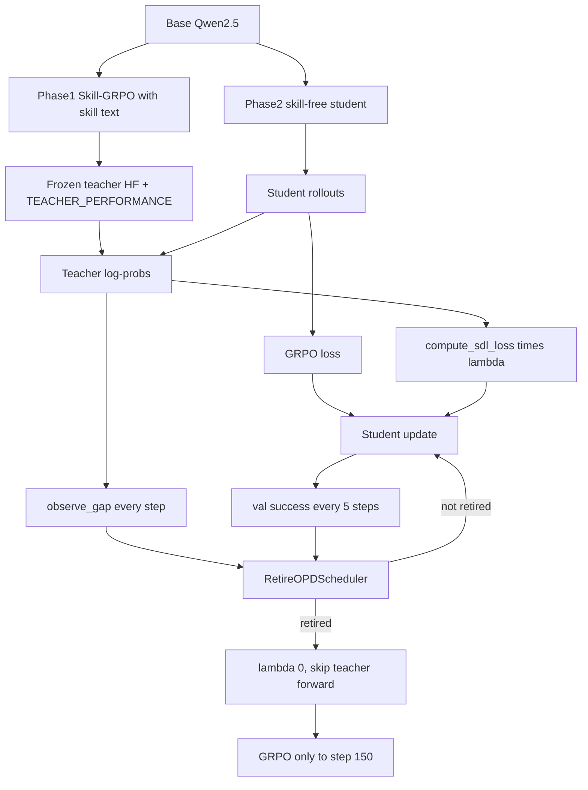
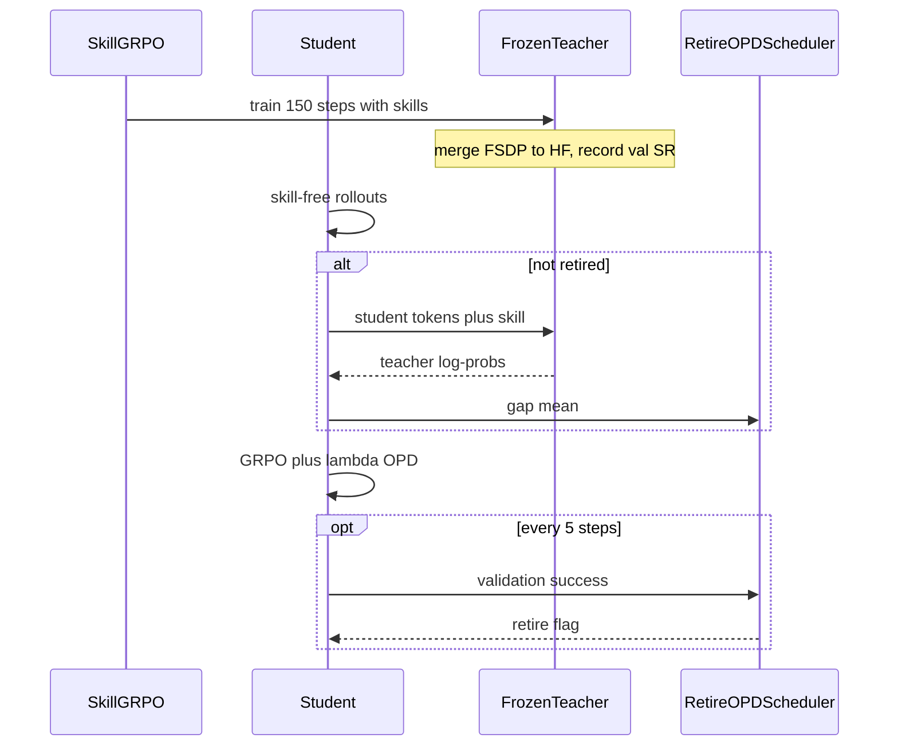
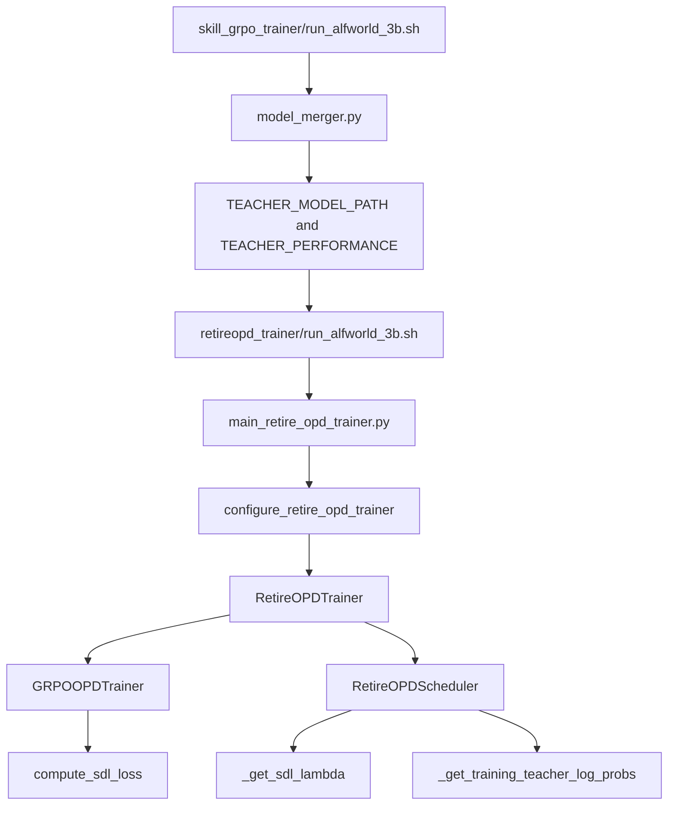

# CODE_PAPER_MAP — RetireOPD

论文：arXiv:2609.20784。PDF：[`docs/RetireOPD.pdf`](../../RetireOPD.pdf)。  
官方仓：**没有独立仓库**，代码在 [github.com/ZJU-REAL/SDAR](https://github.com/ZJU-REAL/SDAR)。  
本地 submodule：`algorithm/SDAR/`（本稿核对 `master@29dcb12`）。  
SDAR 仓同时带 GRPO、Skill-GRPO、OP(S)D、GRPO+OPD、Skill-SD、RLSD、SDAR 的脚本；RetireOPD 只是其中一条两阶段流水线。

精讲：[`BRIEFING.md`](BRIEFING.md)。启动：[`QUICK_START.md`](QUICK_START.md)。

---

## 仓库树（只看 RetireOPD）

```text
algorithm/SDAR/
|-- examples/
|   |-- skill_grpo_trainer/     # 阶段 1：用环境奖励训练带技能的教师
|   |-- retireopd_trainer/      # 阶段 2+3：GRPO+OPD + 在线退休（目前只有 3B）
|   |-- grpo_opd_trainer/       # 不退休的 GRPO+OPD（消融对照）
|   |-- opsd_trainer/           # 未训练教师的 OPSD
|   |-- sdar_trainer/ / rlsd_trainer/ / skillsd_trainer/
|   `-- data_preprocess/
|-- skills/{alfworld,webshop,search}/
|-- verl/trainer/
|   |-- main_retire_opd_trainer.py
|   |-- main_grpo_opd_trainer.py
|   `-- ppo/
|       |-- retire_opd.py            # 退休状态机
|       |-- retire_opd_trainer.py    # 继承 GRPOOPDTrainer
|       |-- grpo_opd_trainer.py      # 固定 lambda 的 GRPO+OPD
|       |-- skillsd_utils.py         # compute_sdl_loss（真实 OPD）
|       `-- skillsd_ray_trainer.py   # 技能检索 + 师生差日志
`-- scripts/model_merger.py          # FSDP 分片合成 HF，阶段 2 要用
```

`verl/` 其余部分、`recipe/`、`tests/` 是 SDAR 继承的 verl 底座，不是 RetireOPD 贡献。

---

## 论文模块 ↔ 代码

| 论文 | Eq. / 节 | 代码 |
|---|---|---|
| SkillBank $c^+$ | §3.1、附录 Figure 14 | `skills/{alfworld,webshop,search}/`；检索 `verl/trainer/ppo/rlsd_utils.py::SkillProvider` |
| 阶段 1 教师 GRPO | Eq. 1 | `examples/skill_grpo_trainer/run_*.sh` |
| 冻结教师 $\pi_T$ | §3.1 | 阶段 1 checkpoint → `scripts/model_merger.py` → `TEACHER_MODEL_PATH` |
| $SR_T$ | Eq. 7 分母 | 环境变量 `TEACHER_PERFORMANCE`（**手动填**） |
| 学生 skill-free rollout | §3.2 | `agent_system/multi_turn_rollout/`；prompt 不塞技能 |
| GRPO 损失 | Eq. 2 | 标准 verl GRPO 路径 |
| OPD reverse KL | Eq. 3–4 | **不是**伪代码的 $-K_n$；见 `compute_sdl_loss` |
| 联合目标 $\lambda=0.01$ | Eq. 5 | `algorithm.opd.opd_coef`；退休后被置 0 |
| 窗口均值 $\bar K_m$ | Eq. 6 | `RetireOPDScheduler.observe_gap` |
| 反弹 $\rho$、能力 $\eta$ | Eq. 7 | `observe_validation` |
| 退休条件 | Eq. 8 | $\rho$ 用代码口径：进度 $\le$ `alignment_threshold` |
| 退休后跳过教师前向 | §3.3 | `_get_training_teacher_log_probs` 返回 `old_log_probs` 占位 |
| 状态保存 | — | checkpoint 旁的 `retire_opd_state.json` |
| 启动 | Table 4 | `examples/retireopd_trainer/run_{alfworld,webshop}_3b.sh` |

---

## 架构图



---

## 训练时序



---

## 调用流



继承关系：`RetireOPDTrainer` → `GRPOOPDTrainer` → `SkillSDRayTrainer`。退休逻辑只改两件事：$\lambda$ 和是否做教师前向。

---

## 真实 OPD 公式（以代码为准）

`verl/trainer/ppo/skillsd_utils.py::compute_sdl_loss`：

$$
\ell_t=\log\pi_\theta(y_t)-\log\pi_T(y_t),\qquad
\mathcal{L}=\mathrm{token\text{-}mean}\Big[\frac{\pi_\theta}{\pi_{\theta_{\mathrm{old}}}}\cdot\big(e^{-\ell_t}-1+\ell_t\big)\Big]
$$

括号是 reverse KL 的 k3 估计。Algorithm 1 写的 $\mathcal{L}_{\mathrm{OPD}}\leftarrow -K_n$ 不能照字面实现。

退休指标的代码口径：$K^{\text{code}}=-\mathrm{gap}$（正数），对齐进度 $=(\bar K_{m-1}-\bar K_m)/\bar K_{m-1}$。进度 $\le 0$ 且 $\eta\ge 0.9$ 时退休。$\delta=0$ 时与论文 $\rho\ge 0$ 等价；$\delta\neq 0$ 时方向相反。

---

## Paper ↔ Code gaps

- 官方 `retireopd_trainer/` **只有 3B** 脚本。1.5B / 7B 要自己改 `MODEL_PATH` 和卡数。
- 论文 Table 4 写 $\alpha_{\mathrm{KL}}=0.01$；ALFWorld 3B 脚本是 `use_kl_loss=False`。
- `TEACHER_PERFORMANCE` 必须人手填，填错会让 $\eta$ 永久达不到或过早达到 0.9。
- `trainer.test_freq` 必须 $\le$ 窗口 $W=5$，否则启动直接报错。默认脚本把 `test_freq` 设成窗口大小。
- 验证指标默认 `val/success_rate`，数据文件是 `test.parquet`（ALFWorld 128 / WebShop 256）。
- 阶段 1 + 阶段 2 的总步数大约是 GRPO baseline 的两倍；退休后才省掉教师前向。

推理：部署是不带技能的学生 generate。教师只在训练期使用。
