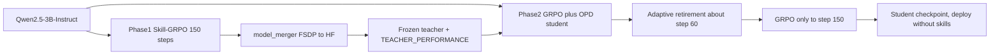

# RetireOPD 在 9007 上的训练部署方案

目标服务器：`eq-cjl_zju_5` → `cjl@100.88.54.3:1049`（主机名 `9007`，经 Tailscale DERP 中继）。
代码：`ZJU-REAL/SDAR`（本地 submodule `algorithm/SDAR/`，核对 `master@29dcb12`）。RetireOPD 没有独立仓库。
相关文档：[`BRIEFING.md`](BRIEFING.md)、[`CODE_PAPER_MAP.md`](CODE_PAPER_MAP.md)、[`QUICK_START.md`](QUICK_START.md)。

资源盘点时间：2026-10-22 00:17，00:35 补查完毕。

---

## 1. 9007 现有资源

| 项 | 实测 | 对 RetireOPD 的含义 |
|---|---|---|
| GPU | 5 × RTX A6000 48GB（Ampere，支持 bf16） | 官方脚本按 8 × 80GB 写，需要改卡数和 batch |
| GPU 占用 | GPU3 被用户 `hxl` 的 `VLLM::EngineCore` 占 43GB、100% 利用率（已跑 10 小时）；GPU0 有用户 `gmh` 的 648MB 小进程 | 实际可用 **4 张**（0、1、2、4）。共享机器，启动前要再看一次 |
| GPU 拓扑 | 没有 NVLink。GPU0/1 同一 PCIe 交换（PIX），GPU2 同 NUMA0；GPU3/4 在 NUMA1 | 用 `0,1,2,4` 时 FSDP 通信要跨 NUMA；`0,1` 两卡最快但慢一半 |
| 驱动 | 595.91.07 / CUDA 13.2 | 兼容 cu12x 的 torch / vLLM wheel |
| CPU / 内存 | 64 核，754GB（可用约 639GB），load ≈ 19 | ALFWorld 环境进程够用 |
| 磁盘 `/home1` | 14T，**只剩 579G（96%）** | checkpoint 必须限量，见 §5 |
| 磁盘 `/` | 916G，剩 145G | conda 在 `~/anaconda3`，pip 缓存别占满 |
| conda 环境 | `alignopsd`：Python 3.12.14、torch 2.8.0+cu128、`vllm 0.11.0`、`flash-attn 2.7.4.post1`，已装 `alfworld`。**没有 `sdar`** | SDAR 要求的 vLLM / flash-attn 版本与它一致，可以 `conda create -n sdar --clone alignopsd` 再 `pip install -e .`，省去编译 flash-attn |
| 代码 | `ICLR2026/Align-OPSD/` 已部署；**没有 SDAR** | 新放到 `ICLR2026/SDAR/` |
| `ICLR2026/models/Qwen2.5-3B-Instruct` | 软链到 `ICLR2026/.cache/modelscope/.../Qwen--Qwen2.5-3B-Instruct`，**实际 5.8G，完整** | 直接作为 `MODEL_PATH`。`du` 不加 `-L` 只显示 56K |
| `Align-OPSD/models/Qwen2.5-3B-Instruct` | 软链到上一行 | 同一份权重 |
| `ICLR2026/models/Qwen2.5-1.5B-Instruct` | 只有 config / tokenizer，1.7M，**没有权重** | 跑 1.5B 前要从 ModelScope 下载 |
| `Align-OPSD/models/Qwen3-Embedding-0.6B`、`data/searchR1*` | 存在 | RetireOPD 不需要 |
| ALFWorld 数据 | `~/.cache/alfworld`、`~/data/alfworld` **都不存在** | `alfworld-download` 要从 GitHub 拉，9007 上不通，见 P0 |
| 外网 | hf-mirror 200、ModelScope 302、PyPI 200；**huggingface.co 与 github.com 不通** | 权重走 ModelScope / hf-mirror；SDAR 代码与 ALFWorld 数据从本机 rsync |

---

## 2. 训练流水线

1. **阶段 1：教师**。带 SkillBank 文本做 Skill-GRPO，150 步。论文 3B ALFWorld 教师 79.7%。
2. **合并**。用 `scripts/model_merger.py` 把 FSDP actor 合成 HF 目录，并记下教师的 `val/success_rate`。
3. **阶段 2+3：学生**。学生不看技能，做 GRPO + OPD（λ=0.01），每 5 步检查一次。师生差不再缩小、且学生 SR ≥ 0.9 × 教师 SR 时退休，之后只做 GRPO。论文 3B 在第 60 步退休，最终 93.8%。
4. **部署**。只加载学生，prompt 不加技能，验证温度 0.4。

---

## 3. 输入与输出

### 输入

| 类别 | 内容 |
|---|---|
| 代码 | SDAR `master@29dcb12` |
| 环境 | conda `sdar`：Python 3.12，`vllm==0.11.0`，`flash-attn==2.7.4.post1`，`pip install -e .`，`gymnasium==0.29.1`、`stable-baselines3==2.6.0`、`alfworld` |
| 基座 | `Qwen/Qwen2.5-3B-Instruct`（约 6GB），师生同一份初始化 |
| 环境数据 | ALFWorld `json_2.1.1` + `logic/` |
| 任务表 | `~/data/verl-agent/text/{train,test}.parquet`，脚本自动生成（train 16 / val 128） |
| 技能 | 仓内 `skills/alfworld/`，由 `SkillProvider` 按关键词匹配 |
| 阶段 2 额外输入 | `TEACHER_MODEL_PATH`（阶段 1 合并后的 HF 目录）、`TEACHER_PERFORMANCE`（**自己阶段 1 的实测值**） |

不需要的：Qwen3-Embedding、Search-R1 检索服务、WebShop / Java / Python 3.10（只跑 ALFWorld 时）。

### 输出

| 阶段 | 产物 | 用途 |
|---|---|---|
| 阶段 1 | `val/success_rate` 曲线 | 对照 79.7，并填给 `TEACHER_PERFORMANCE` |
| 阶段 1 | FSDP checkpoint | 官方教师脚本是 `save_freq=-1`，**不加参数就不落盘** |
| 合并 | 教师 HF 目录，约 6GB | 阶段 2 输入 |
| 阶段 2 | 学生 checkpoint + `retire_opd_state.json` | 断点续训必须有这个 json |
| 阶段 2 | `retire_opd/retired`、`teacher_forward_skipped`、窗口师生差 | 对照论文第 60 步退休 |
| 评测 | 学生不带技能的 ALFWorld SR（128 条） | 对照 93.8（= 120/128） |

---

## 4. 针对 4 × A6000 的参数改动

官方脚本默认值和建议起点（冒烟后再调）：

| 参数 | 阶段 1 官方 | 阶段 2 官方 | 9007 建议起点 |
|---|---|---|---|
| `CUDA_VISIBLE_DEVICES` | — | — | `0,1,2,4`（启动前按 `nvidia-smi` 重选） |
| `trainer.n_gpus_per_node` | 8 | `N_GPUS_PER_NODE=8` | 4 |
| rollout TP | 2 | 2 | 1 或 2（3B 单卡放得下，先试 1） |
| `ppo_micro_batch_size_per_gpu` | 32 | 8 | 阶段 1 先 8，阶段 2 先 4 |
| `log_prob_micro_batch_size_per_gpu` | 32 | 8 | 8 / 4 |
| vLLM `gpu_memory_utilization` | 0.6 | 0.45 | 0.45 / 0.35（阶段 2 还要放冻结教师） |
| `trainer.save_freq` | **-1** | 5 | 阶段 1：50；阶段 2：10 |
| `trainer.max_actor_ckpt_to_keep` | — | — | 2 |
| logger | console + wandb | 同 | `['console']`，或 `WANDB_MODE=offline` |

`ppo_mini_batch_size`（128 / 256）、组大小 8、train batch 16、λ、窗口 5、阈值 0 / 0.9 都 **不改**，否则就不算复现论文配置。

---

## 5. 磁盘预算（`/home1` 只剩 579G）

| 项 | 估计 |
|---|---|
| SDAR 代码 + `sdar` conda 环境 | 15–25GB（`~/anaconda3` 也在 `/home1` 上；clone 环境会尽量硬链接，pip 缓存要清） |
| 3B 基座 | 6GB（能复用 Align-OPSD 那份就是 0） |
| ALFWorld 数据 | 5–15GB |
| 阶段 1 checkpoint（含优化器） | 约 35–45GB / 份，保留 2 份约 90GB |
| 教师 HF | 6GB |
| 阶段 2 checkpoint | 约 35–45GB / 份，保留 2 份约 90GB |
| 日志与 rollout dump | < 10GB |
| **合计** | **约 220–250GB** |

能放下，但余量不大。官方阶段 2 默认 `save_freq=5` 且不限份数，150 步会存 30 份、上 TB 级，**必须改**。阶段 1 合并完教师后，可以删掉阶段 1 的 FSDP 分片。

---

## 6. 时间与算力估计 [估计]

论文没有报告墙钟时间。A6000 的 bf16 算力约为 A100 的一半，显存带宽约 0.4 倍；agent rollout 主要受显存带宽限制。

| 配置 | 阶段 1 | 阶段 2 | 单格合计 |
|---|---|---|---|
| 官方 8 × A100 80GB（参照） | 1–2 天 | 1.5–2.5 天 | 2.5–4.5 天 |
| **9007 · 4 × A6000 · 3B ALFWorld** | **4–7 天** | **5–8 天** | **约 9–15 天，约 900–1400 GPU·h** |
| 9007 · 4 × A6000 · 1.5B ALFWorld | 2–4 天 | 3–5 天 | 约 5–9 天 |

冒烟 2–5 步后，用实测的 `timing_s/step` × 150 重新估算，再决定跑 3B 还是先跑 1.5B。机器是共享的，load 约 19，GPU3 被别人长期占用，实际时间可能更长。

### 6.1 阶段 1（教师）的开销拆解 [估计]

依据：`examples/skill_grpo_trainer/run_alfworld_3b.sh`、`agent_system/multi_turn_rollout/rollout_loop.py`、`verl/trainer/main_skill_grpo.py`。

每个训练步的工作量：

| 量 | 数值 | 来源 |
|---|---|---|
| 并行环境 | 16 任务 × 8 = 128 | `train_data_size=16`、`group_size=8` |
| 生成轮数 | 几乎总是 **50** | 循环只在 **全部** 环境结束时才停；128 条里只要有一条失败，就要跑满 `max_steps=50` |
| 生成次数 | 128 × 50 ≈ **6400 次 / 步** | 已结束的环境每轮也会参与生成，只是奖励被 mask 掉 |
| 训练样本 | 每个仍在进行的 (环境, 轮) 一行，约 **3000–4000 行 / 步** | `gather_rollout_data` 只保留 `active_masks` 为真的轮 |
| 每行长度 | prompt ≈ 1500–2000 token + 回复 ≤ 512 | 任务 + 最近 2 轮历史（`history_length=2`）+ 可选动作 + **技能文本约 1000 token**；`max_prompt_length=2048`，超长直接报错 |
| 验证 | 每 5 步一次，外加训练前一次，共 31 次；**每次跑两遍**（带技能、不带技能），每遍 128 个环境 × 最多 50 轮 | `main_skill_grpo.py` 的双重验证；`val_before_train=True`、`test_freq=5` |

4 × A6000 上各环节的估计（每训练步）：

| 环节 | 日志键 | 估计耗时 | 占比 | 主要原因 |
|---|---|---|---|---|
| Actor 更新 | `timing_s/update_actor` | 15–25 min | 约 45–55% | 约 700 万 token × 3B 做前向 + 反向，开了梯度检查点还要多算一次前向；没有 NVLink，FSDP 的参数聚合与梯度归约走 PCIe 甚至跨 NUMA |
| 多轮 rollout | `timing_s/gen` | 10–14 min | 约 25–35% | 50 轮串行；每轮要等这一批里最长的回复（最多 512 token）解码完，再等 ALFWorld 在 CPU 上走一步 |
| old / ref log-prob | `timing_s/old_log_prob`、`timing_s/ref` | 3–6 min | 约 10% | 两次只做前向；阶段 1 开了 `use_kl_loss=True`，所以要算 ref，ref 参数还 offload 到 CPU |
| 验证（摊到每步） | `timing_s/testing` | 4–6 min | 约 12–15% | 每次验证约 20–28 min，共 31 次，合计 10–14 h |
| 权重同步、存盘、其他 | — | 1–2 min | < 5% | actor 权重每步同步给 vLLM；存盘约 36GB / 次（fp32 参数 + Adam 状态） |
| **合计** | `timing_s/step` | **约 30–47 min** | — | × 150 步 ≈ **75–120 h（3–5 天），约 300–480 GPU·h**；机器忙时按 4–7 天算 |

结论：教师训练的主要开销是 **actor 更新** 和 **50 轮串行 rollout**。验证是第三大开销，而且是最容易省的一块。

不改变训练本身、可以省时间的做法：

1. **少做验证**。阶段 1 只需要最终的 `val/success_rate`，验证不影响梯度。改成 `trainer.test_freq=25 trainer.val_before_train=False`，验证从 31 × 2 遍降到 6 × 2 遍，约省 **8–11 h**。注意：`val/success_rate` 取的是 **带技能** 那一遍，阶段 2 的 `TEACHER_PERFORMANCE` 也应该用这个值，因为阶段 2 的教师同样看技能。
2. **加大 micro batch**。阶段 1 官方是 `ppo_micro_batch_size_per_gpu=32`；48GB 显存放不下时先试 16，尽量不要降到 8。micro batch 越小，FSDP 参数聚合的次数越多，PCIe 通信越重。
3. **选卡**。`0,1,2,4` 跨 NUMA；只用 `0,1` 通信快，但算力少一半。冒烟时两种都测一下 `update_actor`。

这些都是按 FLOPs 和显存带宽推出来的量级，真实数字以 P1 冒烟的 `timing_s/*` 为准。

---

## 7. 能复现哪些结果

| 目标 | 9007 上是否可行 | 说明 |
|---|---|---|
| 3B 教师 Skill-GRPO（79.7） | 可行 | 第一块试金石 |
| 3B ALFWorld RetireOPD（93.8） | 可行，约两周 | 88–94 都算复现；单 seed，1 个 episode ≈ 0.8 点 |
| 退休步 ≈ 60、`teacher_forward_skipped=1` | 可行 | 看日志趋势，差 5–10 步正常 |
| 同脚本 GRPO（75.0）、GRPO+OPD（82.8） | 可行，每条再加约一周 | 没有它们，就判断不了“退休”到底带来多少提升 |
| 1.5B ALFWorld（89.8） | 可行 | 没有官方 RetireOPD 1.5B 脚本，要改 `MODEL_PATH` |
| WebShop 3B（77.3 / 85.8） | 吃力 | 要另开 Python 3.10 + Java 环境；脚本 val 128 条，论文写 256 条 |
| 7B 任意格（95.3 / 84.4） | 不建议 | 4 × 48GB 显存紧，时间按月算 |
| Table 1 全部 baseline、消融、阈值扫描 | 不现实 | 每条都是一轮 150 步 |

已知的论文与代码差异：ALFWorld 脚本里 `use_kl_loss=False`，论文 Table 4 写的是 α_KL = 0.01；退休判据用的验证集就是最终报告的 128 条评测集。

---

## 8. 行动项

### P0：准备环境（约半天，不占 GPU）

- [x] 补查资源（2026-10-22 00:35）：3B 权重完整；网络只通 hf-mirror / ModelScope / PyPI；`alignopsd` 环境版本与 SDAR 要求一致
- [ ] 代码：9007 不通 GitHub，从本机推上去：`rsync -a --exclude .git algorithm/SDAR/ cjl@9007:/home1/cjl/ICLR2026/SDAR/`（本机是 `29dcb12`）
- [ ] 环境：`conda create -n sdar --clone alignopsd`，然后在 `ICLR2026/SDAR` 下 `pip install -e .`、`pip install gymnasium==0.29.1 stable-baselines3==2.6.0`；验证 `import verl` 指向 SDAR 而不是 Align-OPSD
- [ ] 基座：`export MODEL_PATH=/home1/cjl/ICLR2026/models/Qwen2.5-3B-Instruct`（已有，5.8G）
- [ ] ALFWorld 数据：9007 上 `alfworld-download` 拉不到 GitHub。在本机 `alfworld-download -f`，再 rsync 到 9007 的 `~/data/alfworld`；确认 `json_2.1.1/{train,valid_seen,valid_unseen}` 和 `logic/` 都在

### P1：冒烟（约半天，4 卡）

- [ ] 阶段 1 跑 2 步：`n_gpus_per_node=4`、`total_epochs=2`、`save_freq=2`、logger 设为 console。看显存峰值和单步耗时
- [ ] 用冒烟的 step 2 checkpoint 试一次 `model_merger.py merge --backend fsdp`
- [ ] 拿合并出的“伪教师”跑阶段 2 两步：`TEACHER_PERFORMANCE=0.5`，`total_epochs=2`。确认教师前向、OPD loss、`retire_opd_state.json` 都正常
- [ ] 按单步耗时重估 §6，决定正式跑 3B 还是先跑 1.5B

### P2：阶段 1 正式训练（约 4–7 天）

- [ ] 用 `nohup` 或 `tmux` 跑满 150 步，`save_freq=50`、`test_freq=25`、`val_before_train=False`（见 §6.1），日志写到 `ICLR2026/retireopd_phase1.log`
- [ ] 记录最终 `val/success_rate`（目标 75–85）
- [ ] 合并为 `ICLR2026/models/retireopd_teacher_alfworld_3b`，然后删掉阶段 1 的 FSDP 分片

### P3：阶段 2 正式训练（约 5–8 天）

- [ ] 设 `TEACHER_PERFORMANCE` 为 P2 实测值，`save_freq=10`，`max_actor_ckpt_to_keep=2`
- [ ] 监控：第 50–90 步之间 `retire_opd/retired` 从 0 变 1；退休后单步耗时应下降
- [ ] 记录最终学生 SR（目标 88–94），并和教师 SR 对比

### P4：对照与收尾（可选）

- [ ] 同环境跑 GRPO 和 GRPO+OPD（不退休）各一轮
- [ ] 换 seed 再跑一次 RetireOPD，看退休步和 SR 的波动
- [ ] 把结果表回填到 `BRIEFING.md` §5

---

## 9. 12–18 小时、4 卡的压缩方案

约束：GPU 时间总共 12–18 小时，**包含调试**；最多 4 张卡。作者没有公开教师权重（hf-mirror 上搜不到 ZJU-REAL / RetireOPD 的模型），所以第一阶段必须自己训。

### 9.1 先说结论

论文配置（3B，150 + 150 步）在这台机器上要 9–15 天，这个窗口只够大约 **1/7**。所以这次目标定为：

1. 两个阶段的完整流水线在 9007 上跑通，包括合并教师、断点续训、`retire_opd_state.json`
2. 训出一个短程教师，实测它带技能的成功率
3. 第二阶段跑出师生差曲线、OPD loss 和窗口判据的日志，退休逻辑至少被触发一次
4. 量出真实的单步耗时，为后续更长的运行给出准确预算

**做不到的**：复现 Table 1 的数字，以及“退休带来的提升”。论文里退休发生在第 60–90 步，提升也在那之后才出现。

### 9.2 压缩配置（相对论文）

| 旋钮 | 论文 / 官方 | 压缩版 | 影响 |
|---|---|---|---|
| 模型 | 3B | **3B**（备选 1.5B） | 3B 权重现成；带技能的起点 28.9%，1.5B 只有 6.2%，冷启动太慢。1.5B 要提前从 ModelScope 下载备用 |
| 每步任务数 | 16 × 8 | **8 × 8** | 每步耗时约减半；组大小 8 不变，GRPO 优势计算口径不变。`ppo_mini_batch_size` 的校验在代码里已注释掉 |
| 单局最多轮数 `env.max_steps` | 50 | **30** | rollout 轮数减 40%；早期失败的轨迹最贵，被截短了。会略压低成功率上限，**和论文数字不可比** |
| 阶段 1 验证 | 每 5 步，31 次 × 2 遍 | **只在最后验证一次**，`val_data_size=64` | 省下约 10 小时的量级；教师 SR 用 64 局估计，误差约 ±6 点 |
| 阶段 2 验证 | 每 5 步，128 局 | 每 5 步，**64 局** | 退休判据需要窗口验证，不能关；η 的噪声更大 |
| 阶段 2 vLLM | `enforce_eager=True` | **保持 `True`** | `free_cache_engine=True` 时 `vllm_rollout.py` 断言必须 eager，不能改 |
| 阶段 1 `max_prompt_length` | 2048 | **3072** | 技能文本拼在 ALFWorld 提示词前，第 1 步就到 2132 token，2048 会直接报错（见 §10.2） |
| 存盘 | 阶段 1 不存，阶段 2 每 5 步存 | 阶段 1 最后存一次；阶段 2 每 10 步存，保留 2 份 | 磁盘可控 |
| λ、窗口 5、δ=0、γ=0.9、lr、组大小 | — | **不改** | 方法本身保持原样 |

单步耗时估计（4 卡，压缩版）[估计，已被 §10 实测取代]：

| 模型 | rollout | actor 更新 | log-prob | 每步合计 |
|---|---|---|---|---|
| 3B | 5–7 min | 6–9 min | 1.5–2 min | **约 12–18 min** |
| 1.5B | 3–4 min | 3–5 min | 约 1 min | **约 8–11 min** |

### 9.3 时间表（以 16 小时为基准）

**窗口开始前（不占 GPU）**：完成 §8 P0，也就是 rsync 代码和 ALFWorld 数据、clone 环境、按压缩尺寸生成 parquet、下载 1.5B 备用。再用 `--cfg job` 解析一次配置，确认参数覆盖生效。

| 时段 | 内容 | 产出 / 判据 |
|---|---|---|
| H0–H2.5 | **冒烟与调试**。① 阶段 1 跑 2 步，记录 `timing_s/{gen,update_actor,old_log_prob,ref,step}` 和显存峰值；② 合并这个 2 步的 checkpoint；③ 用它当伪教师，阶段 2 跑 3 步，设 `RETIREMENT_WINDOW_SIZE=1`、`test_freq=1`、`COMPETENCE_THRESHOLD=0`、`ALIGNMENT_THRESHOLD=1`，**强制触发退休**；④ 杀掉进程再续训一次 | 看到 `retire_opd/retired=1`、`teacher_forward_skipped=1`；续训能正确读回 `retire_opd_state.json` |
| H2.5 | **定步数**。用实测单步耗时 t 算：阶段 1 步数 N1 = 5h / t1，阶段 2 步数 N2 = 5.5h / t2。3B 的 t1 > 20 min 就换 1.5B | 预计 3B 是 N1 ≈ 17–25、N2 ≈ 18–27 |
| H2.5–H7.5 | **阶段 1**：Skill-GRPO 跑 N1 步，`test_freq=N1`、`save_freq=N1` | 最后一次的 `val/success_rate`（带技能那遍），即 SR_T |
| H7.5–H8 | 合并教师为 HF 目录，填 `TEACHER_PERFORMANCE=SR_T` | 教师目录约 6GB |
| H8–H13.5 | **阶段 2**：RetireOPD 跑 N2 步，默认判据（窗口 5、δ=0、γ=0.9） | 师生差窗口均值曲线、每 5 步的 SR 和 η、是否退休 |
| H13.5–H16 | 用 128 局（不带技能）评一次最终学生，整理日志并回填本文档；剩余时间做缓冲 | 学生 SR 和教师 SR 对比；单步耗时表 |

**只有 12 小时**：调试压到 2 小时，阶段 1 和阶段 2 各给 3.5–4 小时（3B 大约各 12–16 步），缓冲 0.5–1 小时。
**有 18 小时**：阶段 1 和阶段 2 各给 6.5–7 小时（3B 大约各 22–30 步）。

### 9.4 预期与风险

- 教师训练步数只有论文的 1/6 左右，SR_T 会 **远低于 79.7**。学生只要达到 0.9 × SR_T 就满足能力条件，所以 γ 条件比论文更容易满足；真正决定退休的是师生差是否停止缩小。短程训练里师生差可能还在下降，**不退休也是合理结果**，那这一轮就等价于 GRPO+OPD。
- 退休判据至少要两个完整窗口才能算进度，阶段 2 少于 10 步就看不到判据行为。
- GPU0 上有别人的小进程，GPU3 被占满。启动前用 `nvidia-smi` 确认，固定 `CUDA_VISIBLE_DEVICES=0,1,2,4`。
- 阶段 2 没有退休时，教师前向每步都要算，单步会比阶段 1 慢 10–20%，N2 要按冒烟实测来定。

### 9.5 这一轮之后

如果以后能拿到多个窗口，就用 checkpoint 加 `retire_opd_state.json` 分段续训。阶段 1 续训到 60–80 步，教师 SR 才能接近论文水平。到那时再在阶段 2 用 2 + 2 卡并行跑 RetireOPD 和“永不退休”对照（`COMPETENCE_THRESHOLD=10`），才能回答论文的核心问题：退休到底有没有带来提升。

### 风险

- **GPU 抢占**：GPU3 长期被他人占用；启动前固定 `CUDA_VISIBLE_DEVICES`，训练中别人再占卡会导致 OOM
- **磁盘**：`/home1` 96% 已用，checkpoint 不限量会写满整盘，影响所有用户
- **网络**：DERP 中继不稳，长任务必须放进 `tmux` / `nohup`，不能挂在 SSH 前台
- **和 Align-OPSD 冲突**：两套代码各自内嵌了不同版本的 `verl`，环境和目录必须分开

## 10. 冒烟实测（2026-10-22，3B，4 × A6000，8 任务 × 8 组，`max_steps=30`）

脚本在本仓库 `tools/retireopd_9007/`，服务器上是 `/home1/cjl/ICLR2026/retireopd_9007/`；日志、checkpoint、教师都在 `/home1/cjl/ICLR2026/retireopd_runs/`。

### 10.1 结论

整条链路在 9007 上跑通了：阶段 1 训练、存盘、合并成 HF 教师、阶段 2 带 OPD 训练、退休触发、退休后跳过教师前向、退休状态随 checkpoint 落盘。

| 检查项 | 结果 |
|---|---|
| 阶段 1 两步 + 最终验证 + 存盘 | 通过，共 54 min |
| 合并教师 `model_merger.py` | 通过，25 s，6.4G |
| 阶段 2 OPD 生效 | 通过，`opd_coef=0.01`，`teacher_forward` 约 190 s/步，师生差均值 -0.16 |
| 强制退休（W=1，δ=100，γ=0） | 通过，第 2 步 `criterion_valid=1`、`retired=1`、`trigger_step=2`、`opd_coef=0` |
| 退休后跳过教师 | 通过，第 3 步 `teacher_forward_skipped=1`，`timing_s/teacher_forward=0.001` |
| `retire_opd_state.json` | 写在 `global_step_3/` 下，`retired=true`，两个窗口均值都在 |
| 断点续训（`STEPS=4`，`resume_mode=auto`） | 通过。从 `global_step_3` 接着跑到 `global_step_4`，读回 `retired=1`、`trigger_step=2`、`num_evaluated_windows=2`；续训的第一步就跳过了教师 |

### 10.2 踩到的坑（都已修进脚本）

1. **NCCL 第一次 broadcast 就挂死 30 分钟**。没有 NVLink、GPU 跨两个 NUMA 节点，PCIe P2P 不通。用 4 卡 torchrun 单测复现：默认 40 s 超时，`NCCL_P2P_DISABLE=1` 立即通过。已写进 `common.sh`。
2. **`enforce_eager` 和 `free_cache_engine` 的组合有断言**：`free_cache_engine=True` 时必须 `enforce_eager=True`。阶段 1 按官方用 `False/False`，阶段 2 按官方用 `True/True`。
3. **阶段 1 提示词超长**：技能文本加上 ALFWorld 提示词和 2 轮历史，第 1 步就到 2132 token，而官方的 `max_prompt_length=2048` 配 `truncation=error` 会直接报错。阶段 1 改成 3072；阶段 2 学生不带技能，保持 2048，没出问题。
4. 运维层面：`prepare.py` 要从 hf-mirror 下载 geometry3k，会超时，所以改成离线生成占位 parquet。远程用 `pgrep -f` 杀进程时，模式要写成 `[v]erl...`，否则会把自己的 SSH 命令也杀掉。

### 10.3 单步耗时（实测）

| 环节 | 阶段 1（Skill-GRPO） | 阶段 2 未退休 | 阶段 2 已退休 |
|---|---|---|---|
| rollout `gen` | 445 s | 465 s | 464 s |
| `old_log_prob` | 124 s | 140 s | 160 s |
| `ref` / `teacher_forward` | 124–131 s（ref） | 186–196 s（教师） | 0 |
| `update_actor` | 472–475 s | 551–574 s | 630 s |
| **训练部分合计** | **约 19.7 min** | **约 22.5 min** | **约 21 min** |
| 一次验证 | 64 局 × 带/不带技能两遍：855 s | 16 局：约 410 s | 同左 |
| 存盘 | 26 s，每份 36G（含优化器） | 28 s，36G | — |

几点观察：

- 每步训练时间里 rollout 约占 1/3，actor 更新约占 40%，和 §6.1 的拆解一致。但总量比 §9.2 的估计（12–18 min）偏高。
- 验证时间几乎不随局数变化：16 局和 64 局都是每遍约 7 min，因为各局并行，耗时由最长那一局的 30 轮决定。所以阶段 2 验证局数可以保持 64，不用为了省时间缩。
- 阶段 2 的 `update_actor` 比阶段 1 慢约 20%，原因是 micro batch 是 4（阶段 1 是 8），再加上 OPD 项。显存峰值只有 reserved 42G，可以试 `MICRO_BSZ=8`。
- 退休后省掉了教师前向，但单步只少了约 1.5 min，相当于 7%。退休在这个规模下主要是改变训练信号，省的时间不多。

### 10.4 冒烟里的数值（只作为链路是否正常的参考，不代表效果）

- 阶段 1 两步后验证（64 局）：带技能 18.8%，不带技能 10.9%。技能注入确实有效，带技能比不带高约 8 个点。
- 阶段 2 验证（16 局，噪声很大）：6.3%–25%。

### 10.5 据实测重算正式训练（16 小时窗口里，冒烟已经用掉约 5 小时）

- 3B 的 t1 = 19.7 min，在 §9.3 定的 20 min 门槛以内，**继续用 3B**。
- 阶段 2 每步按 23 min 算，每 5 步验证一次，摊下来约 24.5 min/步。

| 剩余预算 | 阶段 1 | 阶段 2 | 备注 |
|---|---|---|---|
| 约 11 h（16 h 窗口） | 15 步 + 最终验证，约 5.2 h | 12 步，约 5 h | 能完成 2 个完整窗口，退休判据可以评估 1 次 |
| 约 7 h（12 h 窗口） | 10 步，约 3.5 h | 10 步，约 4 h | 刚好 2 个窗口，判据评估 1 次 |

可以加速的地方（按收益排）：

1. 阶段 2 `MICRO_BSZ=8`，预计每步省 1.5 min。
2. 阶段 1 若只关心带技能的 SR，可以跳过不带技能那一遍验证，省约 7 min。这需要改 `main_skill_grpo.py`，暂时不动。
3. 每步任务数 8 → 6，rollout 和更新都按比例缩短，但 GRPO 的组数也会更少。

正式压缩训练（阶段 1 共 15 步、阶段 2 共 12 步、基座评测）已跑完，见 [`TRAIN_REPORT_9007.md`](TRAIN_REPORT_9007.md)。实测：阶段 1 每步 20.2 min，阶段 2 每步 23.8 min，总墙钟 11 h，退休未触发。
