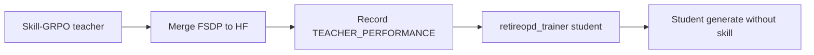

# Quick Start — RetireOPD

方法是两阶段训练。部署 = 不带技能的 Qwen2.5 generate。  
本地仓：`algorithm/SDAR/`。RetireOPD 没有独立仓库。



## 仓库入口

| 要做什么 | 命令 / 路径 |
|---|---|
| 阶段 1 教师 | `examples/skill_grpo_trainer/run_alfworld_3b.sh` |
| 合并教师权重 | `scripts/model_merger.py` |
| 阶段 2+3 学生 | `examples/retireopd_trainer/run_alfworld_3b.sh` |
| 不退休对照 | `examples/grpo_opd_trainer/` |
| 退休状态机 | `verl/trainer/ppo/retire_opd.py` |

## 1. 环境

按上游 `README.md` / `environment.yml` 装 SDAR（Linux + NVIDIA）。工作目录必须是仓库根。

```bash
cd algorithm/SDAR
# 按 README Installation 建环境；ALFWorld 与 WebShop 的依赖不完全相同
```

## 2. 权重

```bash
hf download Qwen/Qwen2.5-3B-Instruct --local-dir ./models/Qwen2.5-3B-Instruct
export MODEL_PATH=./models/Qwen2.5-3B-Instruct
```

教师和学生对同一份 Instruct 权重初始化。阶段 1 训完后，把 FSDP actor 合成 Hugging Face 目录，再交给阶段 2。

## 3. 数据

```bash
# 脚本内部会调 prepare；也可先手动生成
python3 -m examples.data_preprocess.prepare \
  --mode text --local_dir "$HOME/data/verl-agent" \
  --train_data_size 16 --val_data_size 128
export ALFWORLD_DATA="$HOME/.cache/alfworld"   # 或 $HOME/data/alfworld
```

技能文本在 `skills/alfworld/`、`skills/webshop/`、`skills/search/`。WebShop 脚本使用 `skills/webshop`。

## 4. 推理冒烟

加载**学生** checkpoint，prompt 不要加特权技能。验证温度 0.4。不需要教师。

## 5. 训练（两阶段）

```bash
# 阶段 1：会用技能的教师（Skill-GRPO）
bash examples/skill_grpo_trainer/run_alfworld_3b.sh

# 把 FSDP checkpoint 合成 HF，并记下验证成功率，例如 0.797
# python scripts/model_merger.py ...

# 阶段 2：学生 + 自适应退休
TEACHER_MODEL_PATH=/path/to/phase1_teacher_hf \
TEACHER_PERFORMANCE=0.797 \
bash examples/retireopd_trainer/run_alfworld_3b.sh
```

`TEACHER_PERFORMANCE` 必须换成**你自己**阶段 1 教师在 `val/success_rate` 上的值。README 示例里的 `0.50` 只是占位。

WebShop：

```bash
TEACHER_MODEL_PATH=/path/to/webshop_teacher_hf \
TEACHER_PERFORMANCE=0.648 \
bash examples/retireopd_trainer/run_webshop_3b.sh
```

退休后日志里应出现 `retire_opd/retired=1` 和 `retire_opd/teacher_forward_skipped=1`。断点续训会读 checkpoint 目录下的 `retire_opd_state.json`，缺了会直接报错。
