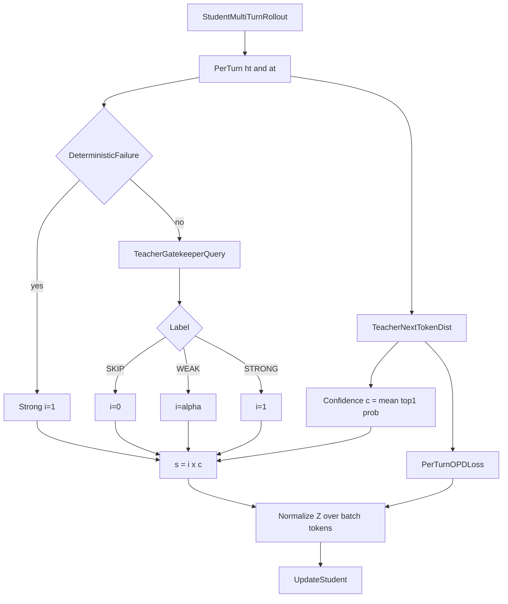
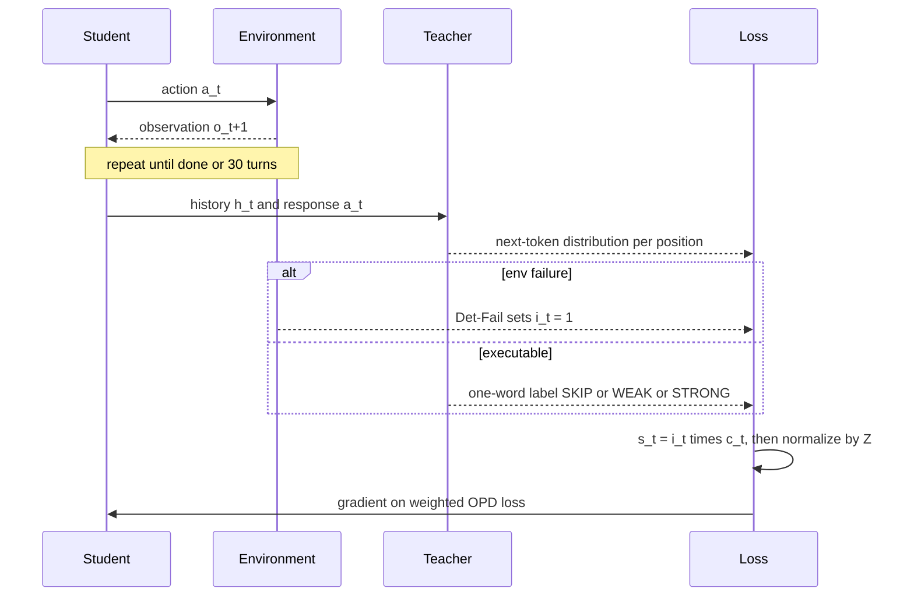

# 组会汇报：SAGE-OPD（Selective Agent-Guided Intervention for Multi-Turn On-Policy Distillation）

论文：Yuhang Zhou, Lizhu Zhang, Yifan Wu, Mingyi Wang, Bo Peng, Jiayi Liu, Xiangjun Fan, Zhuokai Zhao. *SAGE-OPD: Selective Agent-Guided Intervention for Multi-Turn On-Policy Distillation*. arXiv:2606.19659v1, 2026-06-17（正文日期 2026-06-19）。
单位：Meta AI
PDF：仓库副本 [`docs/SAGE-OPD.pdf`](../../SAGE-OPD.pdf)（21 页，含附录 A–C 与 Algorithm 1）
代码：PDF 中 **没有给出官方仓库链接**；实现写的是基于 verl fully-async pipeline。下文实现细节以附录 A 为准。
汇报定位：博士后组会精讲（任务 → 树状方法 → 公式走查 → 实验 → 复现清单 → 缺口）。

文中 **【注解】** 是组会追问的展开；**[推断]** 是我根据论文数字做的判断，不是作者主张。

和组里已读材料的位置：前面读的 TrOPD / TOP-D / TRB / β-OPSD / SPOT / TGOPD 几乎都是 **单轮数学推理**。SAGE-OPD 是 **多轮 agent**（ALFWorld、ScienceWorld、SearchQA）上的 OPD。它最接近 TGOPD 的“先决定要不要蒸，再蒸”，但粒度是 **每一轮（turn）**，而且 **不用任务验证器**，让教师自己当“监督守门员”。

---

# 0. 一句话贡献

标准多轮 OPD 对学生轨迹的每一轮、每个 token 都做稠密 reverse-KL。SAGE-OPD 在每一轮先问一句：**这一轮值不值得蒸、教师此刻靠不靠谱？** 环境报执行失败就强制全量蒸馏；否则让教师给出 Skip / Weak / Strong 三档标签，再乘上教师在这一轮的平均 top-1 概率，得到每轮权重 $s_t\in[0,1]$；最后把整批 loss 重新缩放回标准 OPD 的量级。

---

# 1. 任务定义与动机剖析

## 1.1 任务是什么

- **训练阶段**：后训练里的 on-policy distillation（OPD），不是 RL，也不是 SFT。
- **谁生成**：学生 $\pi_\theta$ 自己和环境多轮交互，生成整条轨迹；部署时也是学生自己生成。
- **谁监督**：同家族更大的冻结教师 $\pi_\phi$（Qwen3-8B / Qwen3-32B）在学生走出来的历史上给 token 级分布。
- **学生**：Qwen3-0.6B、Qwen3-1.7B。
- **环境**：ALFWorld（文字版家务具身任务）、ScienceWorld（文字版科学实验）、SearchQA（多次调用 Wikipedia 检索后回答）。

每一轮的状态是到当前为止的完整交互历史：

$$
h_t=(o_0,a_0,o_1,a_1,\ldots,o_{t-1},a_{t-1},o_t)
$$

学生在 $h_t$ 上输出一段回复 $a_t$（Thought + Action），环境执行其中的动作并返回下一个观察 $o_{t+1}\sim\mathcal{E}(\cdot\mid h_t,a_t)$。（论文 Eq. 1–2）

一句话任务：**在多轮 agent 上保留 OPD 的 on-policy 优点，但只在“需要纠正且教师可信”的那些轮次上施加教师监督。**

## 1.2 要解决的问题

标准多轮 OPD（论文 Eq. 5）对每一轮都做 reverse KL：

$$
\mathcal{L}_{\mathrm{OPD}}(\theta)=\mathbb{E}_{\tau\sim\pi_\theta}\left[\sum_{t=0}^{T-1}D_{\mathrm{KL}}\big(\pi_\theta(\cdot\mid h_t)\,\|\,\pi_\phi(\cdot\mid h_t)\big)\right]
$$

作者指出它在多轮场景里会在三处出错：

1. **过度惩罚合理的替代动作。** 两个动作写法不同、步骤拆法不同，但对任务推进是等价的。token 级对齐仍会因为“没写成教师喜欢的样子”而惩罚学生。
2. **强化局部退化。** 重复的思考、重复的动作、浅层格式，只要碰巧拿到不错的教师似然，稠密梯度就会把它们加强。多轮里一个重复动作还会改变下一轮观察，影响扩散。
3. **误差累积让教师失准。** 早期学生犯错 → 环境状态被带偏 → 后面的历史越来越不像教师见过的分布。教师仍然会给出一个分布，但那个分布未必可信。

## 1.3 Motivation

多轮交互本身已经把轨迹切成了一轮一轮的单位，这给了教师一个比 token 更大的“批改单位”。于是作者问：

> 能否保留 on-policy 教师监督，但只在“确实需要干预、并且教师可靠”的轮次上施加它？

两个判断对应两个模块：

- **需要干预吗？** → 轮级干预标签 $i_t$（环境失败 + 教师判断）。
- **教师可靠吗？** → 教师置信度 $c_t$（教师在这一轮的平均 top-1 概率）。

## 1.4 现有方法局限

| 方法 | 作用位置 | 为何不够（作者视角） |
|---|---|---|
| 多轮 SFT | 教师轨迹，逐轮模仿 | off-policy，学生从没见过自己犯错后的状态 |
| RLVR / GRPO | 终局环境奖励 | 要环境奖励或验证器；几十轮只给一个终局分，credit assignment 难 |
| 标准 OPD（Lu & Lab 2025） | 每轮每 token 的 reverse KL | 上面三条：过罚等价动作、强化退化、在偏离分布的历史上照单全收 |
| Entropy-Aware OPD（EOPD） | 教师高熵 token 加 forward-KL | 为单轮设计；熵高不等于“这一轮该纠正” |
| TCOD-F2B（同组并行工作） | 轨迹深度课程：先只让学生控制前几轮，再逐步放长 | 课程是手工设计的，回答“蒸多长”，不回答“在哪一轮蒸、蒸多重” |

SAGE-OPD 的切口：**不手设课程，把“这一轮要不要蒸、蒸多重”交给教师和环境判断。**

## 1.5 用一个 ALFWorld 例子说明

任务：把盘子冷却后放进柜子（`pick_cool_then_place_in_recep`）。学生一条轨迹里有四轮（附录 B.1 的真实样例改写）：

| 轮 | 学生输出 | 环境反馈 | 合理吗 |
|---|---|---|---|
| 0 | Action: look | 正常返回场景 | 合理的探索 |
| 1 | Action: examine cabinet 1 | 柜子是空的 | 能执行，但不是最优 |
| 2 | Thought: 要先在冰箱里冷却盘子… Action: go to cabinet 1 | 正常移动 | 想法和动作自相矛盾 |
| 3 | Action: put plate 1 in/on fridge 1 | `Nothing happens.` | 执行失败 |

**标准 OPD** 对四轮一视同仁：第 0 轮的 `look` 只要不是教师首选的词，也会被拉；第 3 轮的失败轨迹之后，教师在一个已经被带偏的历史上继续打分。

**SAGE-OPD**：

- 第 3 轮：环境说 `Nothing happens`，属于确定性失败 → 直接 Strong，$i_3=1$，不再问教师。
- 第 0 轮：教师判 Skip → $i_0=0$，这一轮完全不蒸。
- 第 1 轮：教师判 Weak → $i_1=\alpha=0.5$。
- 第 2 轮：教师判 Strong → $i_2=1$。

再乘上教师在每一轮的置信度，就得到每轮该蒸多重。数值算法放到第 3 节。

---

# 2. 方法论树状拆解

## 2.1 为什么是这些工具

1. **轮结构是现成的切分。** 多轮交互天然把轨迹切成“回复 → 环境反馈”的块，在块上做决策比在 token 上便宜也更有语义。
2. **环境报错是免费的高精度信号。** 无法解析、动作不合法、`Nothing happens` 这类失败不需要任何验证器就能判定“这一轮该纠正”。
3. **教师可以当裁判（LLM-as-judge）。** 对能执行但好坏不明的轮次，教师看任务目标、当前状态、可选动作和学生回复，输出一个词：SKIP / WEAK / STRONG。这就是标题里的 *verifier-free*：不依赖任务成功与否的验证器。
4. **教师的 top-1 概率是零成本的置信度。** 蒸馏本来就要算教师分布，取最大概率不需要额外前向。
5. **乘权重会改变 loss 尺度。** 所以要加归一化，确保涨点来自“重新分配监督”，而不是“学习率变小”。

创新在 **轮级加权与它的三个因子**；底下的 OPD loss、verl 异步训练框架都是现成组件。

## 2.2 ASCII 树

```text
SAGE-OPD
|-- 模块 A：轮级干预 i_t（这一轮要不要蒸）
|   |-- A1 确定性失败短路
|   |   |-- 空回复 / 无法解析 / 违反动作格式 / 环境执行失败
|   |   `-- 直接 z_t = Strong, i_t = 1，不问教师
|   |-- A2 教师守门员查询
|   |   |-- 输入：任务目标、当前场景、上一个观察、可选动作、学生回复
|   |   |-- 输出：一个词 SKIP / WEAK / STRONG（温度 0，最长 1028 token）
|   |   `-- 解析失败时保守回退 i_t = 1
|   `-- A3 标签映射：Skip -> 0, Weak -> alpha=0.5, Strong -> 1
|-- 模块 B：教师置信度 c_t（教师此刻靠不靠谱）
|   |-- 每个 token 位置取教师 top-1 概率
|   |-- 在这一轮所有 token 上取平均
|   `-- 复用蒸馏时已有的教师分布，不加前向
|-- 合成：s_t = i_t * c_t，同一轮内所有 token 共用
`-- 模块 C：损失归一化（保持 OPD 的总尺度）
    |-- Z = 总 token 数 / sum_t( s_t * |a_t| )
    |-- 有效 token 权重平均为 1
    `-- 底层仍是标准 OPD per-turn loss
```

## 2.3 Mermaid：模块关系



图里各节点和公式的对应：Label 映射是论文 Eq. 7，Confidence 是 Eq. 9，`s = i x c` 是 Eq. 10，Normalize 是 Eq. 11–12。

## 2.4 Mermaid：一个训练 step 的时序



## 2.5 三个模块怎么交互

- A 和 B 是 **乘法**：任何一个为 0，这一轮就不蒸。A 决定“该不该”，B 决定“信多少”。
- 确定性失败只会把 $i_t$ 设成 1，**仍然会乘 $c_t$**（Algorithm 1 第 10 行对所有轮统一计算 $s_t=i_tc_t$）。
- C 在 A、B 之后，只改整体尺度，不改轮与轮之间的相对比例。
- 采样仍是纯学生 on-policy；SAGE-OPD **不改采样分布**，只改每轮 loss 的权重。

---

# 3. 算法流程与公式细节推演

## 3.1 符号表

| 符号 | 含义 | 来源 |
|---|---|---|
| $h_t$ | 第 $t$ 轮之前的完整交互历史 | Eq. 1 |
| $a_t$ | 学生第 $t$ 轮的回复（Thought + Action），长度 $\lvert a_t\rvert$ 个 token | Eq. 4 |
| $\pi_\theta,\ \pi_\phi$ | 学生、教师 | §3.1 |
| $z_t$ | 干预标签 Skip / Weak / Strong | Eq. 6 |
| $i_t$ | 干预权重 $\{0,\alpha,1\}$，默认 $\alpha=0.5$ | Eq. 7 |
| $p^\star_{t,j}$ | 教师在第 $t$ 轮第 $j$ 个 token 位置的 top-1 概率 | Eq. 8 |
| $c_t$ | 教师置信度，这一轮 $p^\star$ 的平均 | Eq. 9 |
| $s_t$ | 最终轮权重 $i_tc_t$ | Eq. 10 |
| $Z$ | 归一化系数 | Eq. 12 |

## 3.2 关键公式

**干预权重**（Eq. 7）：

$$
i_t=\begin{cases}0, & z_t=\text{Skip}\\ \alpha, & z_t=\text{Weak}\\ 1, & z_t=\text{Strong 或确定性失败}\end{cases}
$$

**教师置信度**（Eq. 8–9）：

$$
p^\star_{t,j}=\max_{v\in\mathcal{V}}\pi_\phi(v\mid h_t,a_{t,<j}),\qquad c_t=\frac{1}{\lvert a_t\rvert}\sum_{j=1}^{\lvert a_t\rvert}p^\star_{t,j}\in(0,1]
$$

注意它衡量的是 **教师自己有多确定**，不是教师和学生有多一致。

**选择性权重与归一化目标**（Eq. 10–12）：

$$
s_t=i_t\cdot c_t,\qquad \mathcal{L}_{\text{SAGE-OPD}}=Z\sum_{t}s_t\,\mathcal{L}_{\mathrm{OPD}}(h_t,a_t),\qquad Z=\frac{N}{\max\big(\sum_t s_t\lvert a_t\rvert,\ \epsilon\big)}
$$

其中 $N=\sum_t\lvert a_t\rvert$ 是学生 token 总数（Algorithm 1 第 12 行）。这样“每个 token 的有效权重”平均正好是 1，和标准 OPD 同量级。

## 3.3 手算一条 4 轮轨迹

沿用 1.5 节的冷却盘子例子，设每轮长度和教师置信度如下：

| 轮 | 标签来源 | $i_t$ | $\lvert a_t\rvert$ | $c_t$ | $s_t=i_tc_t$ | $s_t\lvert a_t\rvert$ |
|---|---|---:|---:|---:|---:|---:|
| 0 | 教师判 Skip | 0 | 20 | 0.90 | 0 | 0 |
| 1 | 教师判 Weak | 0.5 | 30 | 0.60 | 0.30 | 9.0 |
| 2 | 教师判 Strong | 1 | 25 | 0.80 | 0.80 | 20.0 |
| 3 | 环境 Det-Fail | 1 | 25 | 0.50 | 0.50 | 12.5 |

$$
N=20+30+25+25=100,\qquad \sum_t s_t\lvert a_t\rvert=41.5,\qquad Z=\frac{100}{41.5}\approx 2.41
$$

每轮最终的有效 token 权重 $Zs_t$：

| 轮 | 标准 OPD | SAGE-OPD $Zs_t$ |
|---|---:|---:|
| 0 | 1 | 0 |
| 1 | 1 | 0.72 |
| 2 | 1 | 1.93 |
| 3 | 1 | 1.20 |

检查：$(0\times20+0.72\times30+1.93\times25+1.20\times25)/100\approx 1.00$。

三点直观结论：

1. 被判 Skip 的合理探索完全不受教师拉扯。
2. 被判 Strong 的轮次拿到的梯度 **接近标准 OPD 的两倍**。SAGE-OPD 不是“少蒸”，而是“把总预算挪到该纠正的轮上”。
3. 第 3 轮虽然是确定性失败，但教师在这个被带偏的历史上只有 0.5 的置信度，所以权重低于第 2 轮。这正是模块 B 想处理的“该纠正但教师未必会纠”。

**【注解 · 归一化的放大风险】** 如果一个 batch 里绝大多数轮都被判 Skip，只剩一小段 Weak，那么 $\sum s_t\lvert a_t\rvert$ 很小，$Z$ 会很大，整个 batch 的梯度量级都压到这一小段上。论文 Remark 也承认“归一化后某些 batch 的绝对方差可能变大”。实现上只靠 $\epsilon$ 和“按整个 batch 而不是单条轨迹归一化”来缓冲，没有设 $Z$ 上限 [推断]。复现时建议记录 $Z$ 的分布。

## 3.4 训练流程（Algorithm 1）

1. 学生在环境里 on-policy 采样整条轨迹（最多 30 轮，SearchQA 16 轮）。
2. 对每一轮 $(h_t,a_t)$：
   - 若环境或解析器报确定性失败 → $z_t=\text{Strong}$，$i_t=1$；
   - 否则用附录 Table 9 的守门员 prompt 问教师一次，拿到一个词，映射成 $i_t$。
3. 用蒸馏本来就要算的教师分布求 $c_t$。
4. $s_t=i_tc_t$。
5. 算 $N$ 和 $Z$，用 $Z\sum_t s_t\mathcal{L}_{\mathrm{OPD}}$ 更新学生。

Algorithm 1 末行把目标写成 $\mathcal{L}_{\text{SL-OPD}}$，是旧方法名残留。

## 3.5 理论部分的分量

论文 §4 给了两个命题：

- **命题 4.1**：归一化后，两轮噪声方差贡献之比仍是 $s_p^2\sigma_p^2/(s_q^2\sigma_q^2)$，即低权重轮的噪声被平方级压低。证明就是公共系数 $Z$ 约掉。
- **命题 4.2**：和理想的 0/1 oracle 掩码相比，误差不超过 $B\sum_t\lvert s_t-m^\star_t\rvert$。证明就是三角不等式。

两者都很初等。作者自己在 Remark 里说：不保证总方差比标准 OPD 小，也不保证能恢复 oracle 掩码。组会上可以当“直觉的形式化”，不必当成理论贡献。

---

# 4. 实验设定与资源开销

## 4.1 模型、数据、评测

| 项 | 内容 |
|---|---|
| 教师 | Qwen3-8B、Qwen3-32B（同家族，避免 tokenizer / 格式不一致） |
| 学生 | Qwen3-0.6B、Qwen3-1.7B |
| 组合 | 4 组：0.6B←8B、1.7B←8B、0.6B←32B、1.7B←32B（SearchQA 只有 8B 教师两组） |
| ALFWorld | 训练集训练；评测 valid-seen 与 valid-unseen |
| ScienceWorld | 训练集训练；测试集 30 类任务 × 5 变体 |
| SearchQA | 训练集随机抽 1 万条；评测 NQ、TriviaQA、PopQA、HotpotQA、2WikiMQA、Musique、Bamboogle，每集最多 500 题（Bamboogle 125） |
| 检索 | Wikipedia-2018，E5 dense + FAISS-Flat，每次取 top-3，每局最多 8 次检索 |
| Prompt | ReAct 格式，完整历史，不开 thinking，以 `</action>` 为停止符 |

## 4.2 Baseline

| 方法 | 做法 | 共享配方 |
|---|---|---|
| Base | 不训练 | — |
| SFT | 教师轨迹离线模仿 | 否 |
| OPD | 每轮每 token 的标准 OPD | 是，作为锚点 |
| OPD (rollout 2) | 学生和教师都多采一次，**计算量对齐** SAGE 多出的教师查询 | 是 |
| Entropy-Aware OPD | 教师熵大于 0.8 的 token 权重乘 $1+\alpha_e$，$\alpha_e=1$ | 是 |
| TCOD-F2B | 只让学生控制前 $k(n)=\min(k_{\text{start}}+n/\eta,T)$ 轮，$k_{\text{start}}=1,\eta=1$，一个 epoch 内放到满长 | 是 |

附录 A 说明：所有 OPD 类 baseline 共享同一 OPD 主干，**只改每 token 或每轮的权重**。这一点让对比比较干净。

## 4.3 超参与成本

| 项 | 值 |
|---|---|
| 框架 | verl fully-async，rollouter 与 trainer 解耦，`trigger_parameter_sync_step=4`，`staleness_threshold=0.5` |
| 优化 | AdamW，lr $10^{-6}$，weight decay 0.1，global batch 64，1 epoch |
| 采样 | rollout 数 1，温度 0.4，top-p 1.0，每轮最长 4096 token |
| SAGE 专属 | $\alpha=0.5$；守门员查询温度 0.0，最长 1028 token，解析失败回退 $i_t=1$ |
| 训练步数 | 论文没直接写；Figure 2 横轴约 55 步 [推断] |
| GPU 型号与数量 | **论文没写** |
| 墙钟 / GPU-hour | **论文没写** |
| 额外开销 | 每个“能执行”的轮多一次教师生成（输出一个词）；置信度零额外前向 |

训练成本是本文最大的信息缺口。作者用 “OPD (rollout 2)” 去对齐 **教师查询次数**，但没有报告墙钟时间，也没说守门员查询是否阻塞异步流水线。

---

# 5. 实验结论的因果支撑

## 5.1 指标

| 指标 | 含义 | 方向 |
|---|---|---|
| ALFWorld SR | 30 轮内环境返回 `won=True` 的比例；seen 为训练分布内的房间，unseen 为新房间 | ↑ |
| Turns | 平均交互轮数，衡量效率 | ↓ |
| ScienceWorld SR | 累计分达到 100 的比例 | ↑ |
| ScienceWorld Mean Score | 环境给的累计分（含部分完成，可为负）的平均，比 SR 更敏感 | ↑ |
| SearchQA EM | 归一化后与任一参考答案完全匹配 | ↑ |

全部是 **单次评测**；论文没有报 seed 数、方差或误差条。

## 5.2 主结果：ALFWorld（Table 1，SR %）

| 组合 | 方法 | Seen SR | Unseen SR |
|---|---|---:|---:|
| 0.6B←8B | OPD | 55.00 | 56.72 |
| | OPD (rollout 2) | 56.43 | 59.70 |
| | EOPD | 54.26 | 54.48 |
| | TCOD-F2B | 56.43 | 61.19 |
| | **SAGE-OPD** | **57.86** | **61.94** |
| 1.7B←8B | OPD | 60.00 | 61.94 |
| | OPD (rollout 2) | 63.00 | 64.93 |
| | EOPD | 63.57 | 65.67 |
| | TCOD-F2B | **64.29** | 58.21 |
| | **SAGE-OPD** | **64.29** | **70.15** |
| 0.6B←32B | OPD | 53.57 | 68.66 |
| | OPD (rollout 2) | 52.14 | 70.37 |
| | EOPD | 48.57 | 68.13 |
| | TCOD-F2B | **54.29** | 67.91 |
| | **SAGE-OPD** | **54.29** | **70.90** |
| 1.7B←32B | OPD | 58.57 | 74.85 |
| | OPD (rollout 2) | 62.14 | 72.39 |
| | EOPD | 60.00 | **79.10** |
| | TCOD-F2B | 57.14 | 73.13 |
| | **SAGE-OPD** | **62.82** | 73.88 |

参照：Base 0.6B 只有 1.43 / 0.75，SFT 几乎没用（0.6B←8B 2.86 / 4.48）。教师自身：8B 为 61.43 / 67.16，32B 为 57.14 / 69.40。

**摘要里的“相对提升 13.3%”** 来自 1.7B←8B 的 unseen：$70.15/61.94-1\approx 13.3\%$。这是四组里最好的一格，不是平均。

**支撑：**

- 强：OPD 本身就把小学生从几乎为零拉到 55–75，说明多轮 OPD 是有效基线；SAGE 在此基础上，seen SR 四组都是最好或并列最好。
- 中：unseen SR 四组里三组最好，并且大多高于计算量对齐的 OPD (rollout 2)，说明涨点不只是“多问了一次教师”。
- 必须报的反例：**1.7B←32B 的 unseen，SAGE 73.88 低于标准 OPD 74.85**，也远低于 EOPD 79.10。最大的教师–学生组合上，选择性干预反而不如稠密 OPD。
- 有意思的是：0.6B 学生在 unseen 上，跟 32B 教师学 **比教师自己还高**（70.90 vs 69.40）。

## 5.3 ScienceWorld（Table 2）

| 组合 | 方法 | SR | Mean Score |
|---|---|---:|---:|
| 0.6B←8B | OPD | 2.01 | −12.88 |
| | EOPD | 3.36 | −11.52 |
| | TCOD-F2B | 3.03 | −2.07 |
| | **SAGE-OPD** | 2.01 | **+3.89** |
| 1.7B←8B | OPD | 4.70 | −2.78 |
| | TCOD-F2B | 4.70 | −9.68 |
| | **SAGE-OPD** | **6.71** | **+0.24** |
| 0.6B←32B | OPD | 3.36 | −28.46 |
| | EOPD | 6.04 | −26.10 |
| | **SAGE-OPD** | 6.04 | −26.10 |
| 1.7B←32B | OPD | 4.03 | −29.89 |
| | TCOD-F2B | 6.04 | −14.89 |
| | **SAGE-OPD** | **7.38** | −16.01 |

**支撑弱。** SR 全部在 2%–7% 之间。按 SR 数值反推，测试集约 149 个 episode [推断]，所以 2.01→6.71 只是从 3 个成功变成 10 个；1.7B 的两组 SAGE 相比次优方法只多出 2 个和 2 个成功。0.6B←8B 的 SAGE SR（2.01）甚至低于 Base（3.36）。作者主要靠 Mean Score 的提升讲故事。

**【注解 · 一处可疑】** 0.6B←32B 这组里，SAGE-OPD 与 EOPD 的 SR、Mean Score、Turns 三列 **完全一样**（6.04 / −26.10 / 20.00）。可能是巧合，也可能是表格复制错误 [推断]，组会上值得问。

## 5.4 SearchQA（Table 3，七集平均 EM）

| 组合 | OPD | EOPD | TCOD-F2B | SAGE-OPD |
|---|---:|---:|---:|---:|
| 0.6B←8B | 25.46 | **25.80** | 25.09 | 25.31 |
| 1.7B←8B | 30.09 | 30.60 | 30.51 | **30.77** |

**支撑很弱。** 0.6B 时 SAGE 低于标准 OPD；1.7B 只比 EOPD 高 0.17 分。这里只能说“不掉点”。另外，Table 3 的 Base 参照列的是 Qwen3-8B 和 Qwen3-14B，而 ALFWorld / ScienceWorld 用的是 8B 和 32B；SearchQA 为何换成 14B 参照、又不做 32B 教师，论文没有解释。

## 5.5 训练动态（Figure 2，1.7B←8B，ALFWorld）

- Unseen SR：标准 OPD 在 20–30 步后在 60–63% 附近波动；SAGE 继续上升到 70.15%。
- 训练 batch SR：两者几乎重合。
- 结论：两者拟合训练分布的程度相当，差距只出现在 unseen 上 → SAGE 改善的是 **泛化**，不是训练拟合。这条推理是自洽的，但只有一组、一个 seed。

## 5.6 干预标签分布（Figure 3）

- 训练越往后，Skip 越多、Weak 和 Strong 越少 → 学生变好后教师干预自动减少。
- 越靠后的轮次，Det-Fail 越多 → 与“误差随交互累积”的动机一致。
- 这是全文对动机最直接的观察证据，但只是描述统计，没有检验标签对不对。

## 5.7 消融（Table 4，ALFWorld，逐步叠加）

| 组合 | 变体 | Seen SR | Unseen SR |
|---|---|---:|---:|
| 0.6B←8B | OPD | 55.00 | 56.72 |
| | 只用干预 $i_t$ | **57.86** | **62.69** |
| | 加置信度，不归一化 | 55.71 | 55.22 |
| | 完整 SAGE | **57.86** | 61.94 |
| 1.7B←8B | OPD | 60.00 | 61.94 |
| | 只用干预 | 59.29 | 66.42 |
| | 加置信度，不归一化 | **66.43** | 64.93 |
| | 完整 SAGE | 64.29 | **70.15** |
| 0.6B←32B | OPD | 53.57 | 68.66 |
| | 只用干预 | 53.86 | 67.16 |
| | 加置信度，不归一化 | **57.86** | 69.40 |
| | 完整 SAGE | 54.29 | **70.90** |
| 1.7B←32B | OPD | 58.57 | 74.85 |
| | 只用干预 | 62.14 | **79.10** |
| | 加置信度，不归一化 | 61.43 | 73.13 |
| | 完整 SAGE | **62.82** | 73.88 |

**这张表对“三个组件互补”的支撑是弱的：**

- 只用干预就已经拿到大部分收益，并且在两组 unseen 上 **比完整 SAGE 更好**（62.69 > 61.94；79.10 > 73.88）。
- 加置信度但不归一化，在两组 seen 上 **比完整 SAGE 更好**（66.43 > 64.29；57.86 > 54.29）。
- 完整 SAGE 在 8 个格子里只拿了 4 个最好。

我的读法：**模块 A（轮级干预）证据最强；模块 B（置信度）效果不稳定；模块 C（归一化）主要是在修补 B 带来的尺度缩小**。

## 5.8 敏感性（Table 5，1.7B←8B）

| 设置 | Seen SR | Unseen SR |
|---|---:|---:|
| $\alpha=0.3$ | 63.57 | 67.16 |
| $\alpha=0.5$（默认） | **64.29** | **70.15** |
| $\alpha=0.7$ | 57.86 | 66.42 |
| $\alpha=1.0$ | 58.57 | 61.94 |
| 教师温度 0.0（默认） | 64.29 | 70.15 |
| 教师温度 0.3 / 0.7 / 1.0 / 1.5 | 57.86–60.71 | 62.69–65.67 |
| 只按“未被 Skip 的 token”归一化 | 62.14 | 68.66 |

$\alpha=1.0$ 时 Weak 等于 Strong，unseen 退回 61.94，正好等于标准 OPD。这说明“模糊轮次只给部分监督”确实重要，是消融里最干净的一条证据。

**【注解 · 教师温度 0 和置信度的矛盾】** Table 5 正文明确说这个温度用于“置信度估计”（confidence estimation），默认 0.0，温度越高 SR 越低。但温度为 0 时分布退化成 one-hot，top-1 概率恒为 1，$c_t$ 会变成常数，模块 B 等于没开。附录 A 又写“守门员查询的默认温度是 0.0”。所以这个温度更可能是 **守门员查询的解码温度**，置信度仍按温度 1 的分布计算 [推断]。复现时必须先确认这一点，否则模块 B 会悄悄失效。

## 5.9 不能支撑的地方

1. 没有 seed、没有误差条；ALFWorld unseen 134 题，1 题约 0.75 个点。主表大多数差距是 1–5 个 episode。
2. 有 7 个 ALFWorld SR 不能由 140 / 134 个 episode 整除得到，例如 1.7B←32B 的 OPD unseen 74.85、SAGE seen 62.82 [推断]。要么混入了多次平均，要么是笔误。恰好包括 SAGE 输给 OPD 的那一格。
3. 没有评估教师标签本身的准确率（没有人工标注的“该不该干预”对照）。
4. 没有训练成本、GPU 型号和墙钟时间。
5. 只有 Qwen3 一个家族；只测了 0.6B / 1.7B 两个小学生。

---

# 6. 复现前置准备清单

## 6.1 数据

- **ALFWorld**：官方训练集；评测 `valid_seen`（140）与 `valid_unseen`（134）。需要 TextWorld 环境与 admissible commands 列表。
- **ScienceWorld**：官方 Java 后端 + Python 封装；30 类任务 × 5 变体测试。
- **SearchQA**：按 Search-R1 的数据处理；训练随机抽 1 万；评测七集各最多 500（Bamboogle 125）。
- **检索**：Wikipedia-2018 语料 + E5 编码 + FAISS-Flat 索引，top-3。离线建索引需要大内存和较长时间。

## 6.2 模型

- 教师：`Qwen/Qwen3-8B`、`Qwen/Qwen3-32B`（关闭 thinking）。
- 学生：`Qwen/Qwen3-0.6B`、`Qwen/Qwen3-1.7B`。
- 教师要同时承担两种调用：逐 token 打分（蒸馏 + 置信度）和一次短生成（守门员标签）。

## 6.3 硬件 [估计]

论文没写。按配置估计：32B 教师 bf16 推理约 64GB 显存，至少需要 2 张 80GB 卡或张量并行；加上学生训练和异步 rollout，最低建议 **8×A100/H100 80GB**。只做 8B 教师 + 0.6B 学生可以先在 4×80GB 上跑通。

## 6.4 代码

- 基座：verl fully-async（rollouter / trainer 解耦，staleness 队列）。组里 `algorithm/verl/` 可作为起点。
- 需要自己写：
  1. 多轮 agent rollout 与 ALFWorld / ScienceWorld / SearchQA 环境封装；
  2. 确定性失败检测（空回复、解析失败、动作不在格式内、`Nothing happens`）；
  3. 守门员 prompt（附录 Table 9 原文可直接用）与一词解析，解析失败回退为 1；
  4. 置信度：从教师 logprob 取每位置最大概率并按轮平均；
  5. 按 batch 的归一化系数 $Z$；
  6. TCOD-F2B 与 EOPD baseline（附录 A Eq. 25–26 有公式）。

## 6.5 算法：必做与可延后

| 优先级 | 内容 |
|---|---|
| 必做 | 标准多轮 OPD 跑通，并复现 OPD 一行（例如 1.7B←8B unseen 约 62） |
| 必做 | 只用干预 $i_t$（消融里最强的部分），检查 unseen 是否到 66 左右 |
| 必做 | 确认置信度的温度口径（见 5.8 注解） |
| 再做 | 加 $c_t$ 与归一化，复现完整 SAGE |
| 可延后 | ScienceWorld / SearchQA（信号太弱，先别花算力） |
| 可延后 | 32B 教师 |

## 6.6 Sanity check

1. 所有轮都设 $i_t=1$、$c_t=1$：$Z=1$，必须精确退回标准 OPD。
2. $\alpha=1$：Weak 与 Strong 等价，结果应接近标准 OPD（论文 unseen 正好是 61.94）。
3. 每个 batch 打印 Skip / Weak / Strong / Det-Fail 比例，训练后期 Skip 应上升（对照 Figure 3）。
4. 打印 $c_t$ 的分布：若恒为 1，说明温度口径错了。
5. 打印 $Z$ 的分布：若出现极大值，考虑加上限或改为按轨迹归一化。

---

# 7. 与组里已读论文的对照、组会追问

## 7.1 “先判断，再蒸”的几种粒度

| 方法 | 判断单元 | 谁来判断 | 判断后做什么 | 设定 |
|---|---|---|---|---|
| TGOPD | 整道题 | 验证器给教师探针打分 | 通过走 OPD，否则改走 GRPO | 单轮，外部教师 |
| **SAGE-OPD** | **每一轮** | **环境报错 + 教师自评** | **轮权重 0 / 0.5 / 1，再乘置信度** | **多轮 agent，外部教师** |
| TrOPD | 每个 token | 师生概率比 | 可信区 RKL，离群区 top-k FKL | 单轮 |
| SPOT | 少数 token 位置 | 学生续写 + 验证器 | 在该位置构造结果校准的目标分布 | 单轮 |
| EOPD | 每个 token | 教师熵 | 高熵位置加 forward-KL | 单轮 |
| TCOD-F2B | 轨迹深度 | 手设课程 | 逐步放长学生控制的轮数 | 多轮 |

SAGE-OPD 的位置：**比 TGOPD 细（轮而不是题），比 TrOPD / SPOT 粗（轮而不是 token），并且是唯一不需要任务验证器、靠教师自评的。** 代价是标签质量完全取决于教师当裁判的能力，论文没有单独验证这一点。

## 7.2 组会可追问（预答）

**Q1. “verifier-free” 是否名副其实？**
半对。它不用任务成功与否的验证器，但用了环境的执行失败信号（`Nothing happens`、解析失败）。这是很强的免费信号，在没有这种反馈的环境（比如纯对话）里，模块 A 只剩教师自评。

**Q2. 为什么最强的 1.7B←32B 组合反而输给标准 OPD？**
论文只给了猜测：“更强的教师信号稠密使用时未必更可靠”。但这个解释更支持 EOPD（79.10）而不是 SAGE（73.88）。我的看法是，教师越强、学生犯的“教师认为必须纠正”的错越少，Skip 越多，归一化后剩下少数轮被放大，梯度噪声反而变大 [推断]。可以用 $Z$ 的分布去验证。

**Q3. 守门员查询的成本有多大？**
每个能执行的轮多一次教师生成，只输出一个词，但 prefill 要吃完整历史（最多 30 轮）。在异步 pipeline 里能否和 rollout 重叠，论文没说。实际成本更可能来自长历史的 prefill，而不是那一个输出词 [推断]。

**Q4. 为什么不让教师直接输出连续分数？**
论文没有做这个对照。三档离散标签加 $\alpha=0.5$ 是工程选择；敏感性表显示 $\alpha$ 影响很大（0.5 比 1.0 的 unseen 高 8 分），说明连续化可能值得试。

**Q5. 和 TOP-D 的“近端教师”能叠吗？**
可以。TOP-D 改的是每个 token 的奖励形状（给下界），SAGE 改的是每轮的权重，两者正交。SAGE 管“这一轮蒸多重”，TOP-D 管“这一轮里每个 token 怎么罚”。

## 7.3 一页纸结论

SAGE-OPD 把多轮 OPD 的监督单位从“每个 token”提升到“每一轮”：环境报错直接强纠，其余让教师判 Skip / Weak / Strong，再乘教师置信度，最后归一化回原尺度。ALFWorld 上最有说服力：seen SR 四组都是最好或并列最好，unseen 四组赢三组，最好一格相对 OPD 高 13.3%。ScienceWorld 和 SearchQA 的差距在噪声范围内。

消融显示真正起作用的主要是 **轮级干预标签**，置信度和归一化的贡献不稳定。没有 seed、没有成本、部分数字无法整除评测集大小，复现时应先只实现干预标签，验证 ALFWorld unseen 能否从约 62 涨到约 66。
