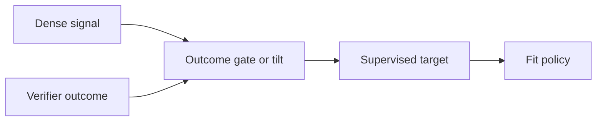
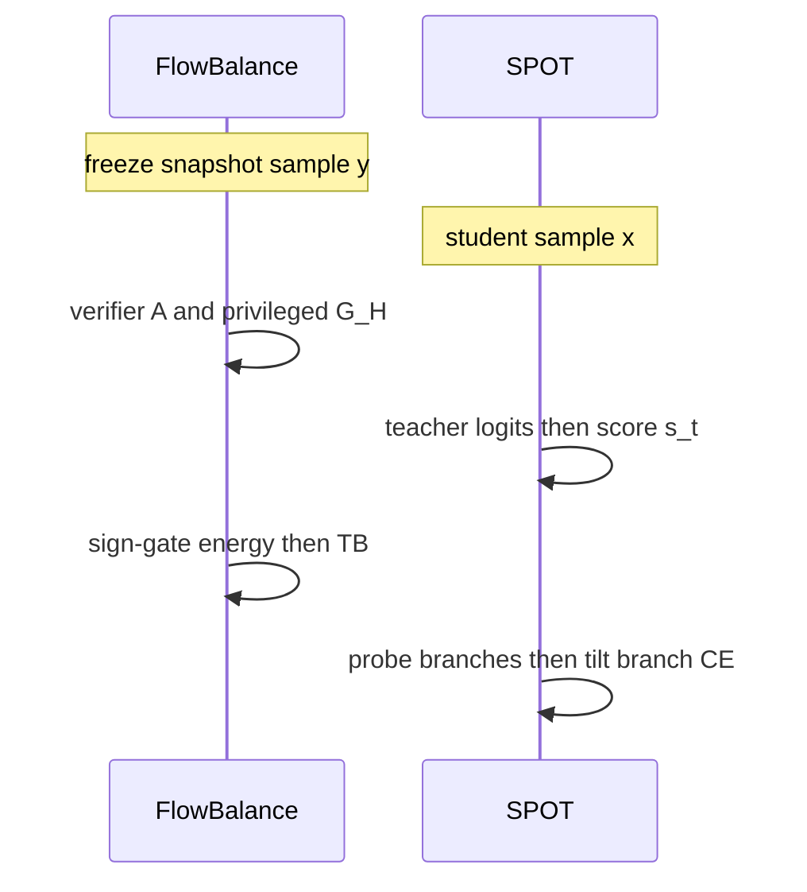

# 组会对照：FlowBalance × SPOT

两篇都在回答同一类后训练问题——**稠密指导很有用，但不可盲信；验证器更可靠，但太稀疏**——却落在不同设定上：

| | FlowBalance | SPOT |
|---|---|---|
| 设定 | **同模型自改进**（无外部教师） | **师生蒸馏**（外部冻结教师） |
| 稠密信号来源 | 特权后见 $\pi_{\mathrm{H}}(\cdot\mid x,c)$ | 教师 $\pi_T(\cdot\mid c_t)$ |
| 校准粒度 | **整条轨迹**能量 + 符号门 | **token 位置**探测 + reward-tilt |
| 拟合对象 | 归一化完整回复分布（TB） | 全序列 reverse-KL + 局部 branch CE |
| 代码 | `algorithm/FlowBalance/` | `algorithm/SPOT/` |
| 单篇详解 | [`paper_assist/flowbalance/BRIEFING.md`](paper_assist/flowbalance/BRIEFING.md) | [`paper_assist/spot/BRIEFING.md`](paper_assist/spot/BRIEFING.md) |

打开本文件用 **Preview**：公式应是排版，Mermaid 应是图。交互对照见旁侧 Canvas。

---

## 0. 一句话贡献（对照）

- **FlowBalance**：把组相对优势 $A$ 与特权增益 $G_{\mathrm{H}}$ 合成 $E=\eta_A A+\beta_G G_{\mathrm{H}}\operatorname{sgn}(A)$，再对 $\pi_{\mathrm{ref}}$ 做 Gibbs 重加权，用组内 profiled trajectory balance 学归一化目标——**方向由验证器定，稠密只塑形**。
- **SPOT**：用 $s_t=\bar H_T\cdot C^{k_s}\cdot G^{k_s}$ 把有限探测预算分到 $M$ 个位置，对学生续写打分后做 KL 信赖域内的闭式 reward-tilt——**先决定 where，再决定 what**。

共同母题：**Outcome-calibrated dense guidance**。差异：FlowBalance 校准「同模型特权自信」；SPOT 校准「外部教师局部 prior」。

---

## 1. 任务定义与动机剖析

### 1.1 任务分别是什么

**FlowBalance（自改进内环）**

- 输入：prompt $x$；训练专用上下文 $c$（参考解 / 反馈）
- 过程：当前策略无 $c$ 采样组 $\mathcal G$；验证器给 $R$；冻结快照条件在 $c$ 上重打分
- 输出：下一轮 $\pi_\theta(\cdot\mid x)$；部署看不见 $c$
- 骨干：Qwen3-4B / 8B；数据 DAPO-17k

**SPOT（On-Policy Distillation）**

- 输入：prompt $q$；学生自己生成前缀；冻结教师在每个 $c_t$ 上给分布
- 过程：acquisition 选位 → 学生续写探测 → tilt 教师 prior → 与全序列 OPD 相加
- 输出：更小学生 $\pi_\theta$；部署只有学生
- 教师 Qwen3-8B（thinking off）；学生 0.6B / 1.7B / 4B-Base

### 1.2–1.3 问题与 Motivation（对照）

| 失败模式 | FlowBalance 侧 | SPOT 侧 |
|---|---|---|
| 稀疏可靠 | RLVR / GRPO 只有终点 $R$；FlowRL 仍是 outcome-only 能量 | GRPO 无 token 级教师 |
| 稠密不可靠 | 特权 $G_{\mathrm{H}}>0$ 可打在错误轨迹上 → self-confirmation；直接 OPSD 长度崩塌 | reverse-KL mode-seeking；EOPD 只看熵，prior $\neq$ 下游对错 |
| 分布性问题 | 下一轮该学哪个 **归一化回复分布**？ | 有限预算下 **在哪探测、蒸什么局部目标**？ |

### 1.4 现有方法局限（共享对照表）

| 方法族 | FlowBalance 为何不够 | SPOT 为何不够 |
|---|---|---|
| GRPO | 无轨迹内部塑形 | 无教师、无局部覆盖 |
| FlowRL | 能量无稠密自指导 | 非蒸馏设定 |
| OPSD / Vanilla OPD | 局部模仿可与验证器冲突 | reverse-KL 欠覆盖 |
| RLSD | 仍是局部 RL 信号，非归一化分布 | — |
| EOPD | — | 熵$\neq$紧凑候选；prior$\neq$对错 |
| 彼此 | SPOT 要外部教师 + 探测 rollout | FlowBalance 要特权 $c$、无外师 |

### 1.5 例子（同一「假置信」母题，两种切口）

**FlowBalance**：两条回复，$y^+$ 对、$y^-$ 错，但 $G_{\mathrm{H}}(y^-)=0.5$。无门能量用 $+G_{\mathrm{H}}$ 抬失败侧；符号门把成功/失败目标比再乘 $\exp(2\beta_G G_{\mathrm{H}}(y^-)/\tau)$。取 $\beta_G=\tau=1$ 得 $e\approx 2.72$。

**SPOT**：前缀停在分叉。教师 $\pi_T(\mathrm{sub})=0.45$、$\pi_T(\mathrm{ind})=0.40$。熵高；学生可能已覆盖两词，或只敢说 sub 而 ind 才走得通。SPOT 因 $C,G$ 入选该位；续写后 ind 对、sub 错；tilt 把质量拨向 ind，但仍锚定教师组内相对比。

---

## 2. 方法论树状拆解（对照 + 强制 Mermaid）

### 2.1 为什么是这些工具

| 设计选择 | FlowBalance | SPOT |
|---|---|---|
| 为何要归一化 / 信赖域 | 完整回复相对偏好需要 Gibbs + $Z$，否则稠密变独立局部损失 | 局部单纯形上 $\max\mathbb{E}[\hat V]$ s.t. KL 不离教师 prior → 闭式 Gibbs tilt |
| 为何要门控 | $\operatorname{sgn}(A)$：验证器定方向 | $B^+$：全错则不加 branch |
| 为何稀疏 | 能量在轨迹级聚合，无额外续写 | 探测贵 → $M\times k_p\times N_p$ 预算 |

创新落点：

- FlowBalance 一级 = **验证器校准轨迹能量 + profiled TB**；$\operatorname{sgn}(A)$ 与组内 $Z$ 是二级；clip / 长度平均是三级。
- SPOT 一级 = **acquisition–exploration–exploitation 拆 where/what**；乘积分数与 reward-tilt 是二级；$M=2,k_p=4$ 等是三级。

### 2.2 ASCII 树

```text
共享母题: Outcome-calibrated dense guidance
|-- FlowBalance (self-improvement, same model)
|   |-- A  On-policy sample (no c)
|   |-- B  Verifier group advantage A
|   |-- C  Privileged G_H (clip + length mean)
|   |-- D  Sign gate: +G_H / -G_H / 0
|   `-- E  Profiled trajectory balance vs pi_ref
`-- SPOT (OPD, external teacher)
    |-- A  Acquisition: s = Hbar * C * G
    |-- B  Explore: student cont. -> Vhat; keep B+
    `-- C  Exploit: tilt pi_T; L = OPD + beta Branch
```

### 2.3 顶层对照数据流

```mermaid
flowchart TD
  subgraph fb [FlowBalance]
    FBx["Prompt x"] --> FBroll["Sample group without c"]
    FBroll --> FBver["Verifier R to A"]
    FBroll --> FBgh["Privileged G_H with c"]
    FBver --> FBgate{"sign of A"}
    FBgh --> FBe["Composite energy E"]
    FBgate --> FBe
    FBe --> FBtb["Profiled TB vs pi_ref"]
  end
  subgraph sp [SPOT]
    SPq["Prompt q"] --> SProll["Student trajectory"]
    SProll --> SPt["Teacher on every prefix"]
    SPt --> SPs["Score s_t then Top-M"]
    SPs --> SPprobe["Student continuations"]
    SPprobe --> SPv["Verifier Vhat"]
    SPv --> SPgate{"any positive reward"}
    SPgate -->|yes| SPtilt["Reward-tilt prior"]
    SPgate -->|no| SPopd["OPD only"]
    SPtilt --> SPloss["OPD plus branch CE"]
    SPopd --> SPloss
  end
```



能量（FlowBalance）与位置分数 / tilt（SPOT）写在图外：

$$
E=\eta_A A+\beta_G G_{\mathrm{H}}\operatorname{sgn}(A),
\qquad
s_t=\bar H_T\cdot C_t^{k_s}\cdot G_t^{k_s},
\qquad
\tilde\pi_T(v)\propto \bar\pi_T^{k_p}(v)\exp\bigl(\gamma\hat V(v)\bigr).
$$

### 2.4 一张图看清「校准」发生在哪一层



| 节点 | FlowBalance | SPOT |
|---|---|---|
| Dense | $G_{\mathrm{H}}$（轨迹标量） | $\pi_T$ prior（token 分布） |
| Gate | $\operatorname{sgn}(A)$ 乘在能量上 | $B^+$ 门 + $\gamma\hat V$ tilt |
| Target | $p^\star\propto\pi_{\mathrm{ref}}\exp(E/\tau)$ | $\tilde\pi_T$ 上的 CE + 全序列 OPD |
| Fit | $\min(\Delta_{\mathrm{TB}})^2$ | reverse-KL + branch |

---

## 3. 算法流程与公式细节推演（并排手算）

### 3.1 符号速查

| 概念 | FlowBalance | SPOT |
|---|---|---|
| 稀疏证据 | $A_i$（组相对） | $R$ / $\hat V_t(v)$（分支） |
| 稠密证据 | $G_{\mathrm{H}}$ | $\pi_T$、$\bar H_T$、$C$、$G$ |
| 校准算子 | $\operatorname{sgn}(A)$ | $\exp(\gamma\hat V)$ + $B^+$ |
| 主损失 | TB 残差平方 | $\mathcal L^{\mathrm{OPD}}+\beta\mathcal L^{\mathrm{Branch}}$ |

### 3.2 FlowBalance 一步（压缩）

$$
A_i=\frac{R_i-\mu_R}{\sigma_R+\epsilon},\quad
G_{\mathrm{H}}=\frac1T\sum_t\operatorname{clip}(\log\pi_{\mathrm{H}}-\log\pi_{\mathrm{ref}},-B,B),
$$

$$
\Delta_{\mathrm{TB}}=\tau\widehat{\log Z}+\tau\log\frac{\pi_\theta}{\pi_{\mathrm{ref}}}-E,\quad
\mathcal L=\frac1{2N}\sum_i(\Delta_{\mathrm{TB}}^{(i)})^2.
$$

手算要点（$N=2,\tau=1,\eta_A=2,\beta_G=1$）：$E_+=2.2$、$E_-=-2.4$；无门时失败侧会被抬高约 $e^{0.8}$。详见单篇 §3.3。

### 3.3 SPOT 一步（压缩）

$$
\tilde\pi_T(v)=\frac{\bar\pi_T(v)e^{\gamma\hat V(v)}}{\sum_u\bar\pi_T(u)e^{\gamma\hat V(u)}},
\quad
\mathcal L=\frac1T\sum_t\mathcal L_t^{\mathrm{OPD}}+\frac{\beta}{\max(1,|\mathcal B^+|)}\sum_{t\in\mathcal B^+}\mathcal L_t^{\mathrm{Branch}}.
$$

手算要点（$k_p=2,\gamma=1$）：prior $(0.7,0.3)$、$\hat V=(0,1)$ → tilt 后 $\approx(0.462,0.538)$。全错则 $B^+=\emptyset$，退回 OPD。

### 3.4 训练一步时序对照



---

## 4. 实验设定与资源开销

| 维度 | FlowBalance | SPOT |
|---|---|---|
| 主模型 | Qwen3-4B / 8B（自己改自己） | 学生 0.6B–4B；教师 8B |
| 训练数据 | DAPO-17k | MATH 7.5k 或 DAPO-Math-14k |
| 组 / 样本 | $N=8$ responses / prompt | 蒸馏 1 条 / prompt；GRPO 对照 8 |
| 硬件叙事 | 4 节点 $\times$ 8 GPU `[估计]` 80GB 级 | 4$\times$A800 |
| 主报告点 | step 180，五种子 | 174 或 220 iterations；主表无误差条 |
| 评测协议 | AIME24 Pass@16；其余 Pass@1 | 六基准 Avg@8 / Pass@8 |
| 额外成本 | 特权重打分（不重写轨迹） | 每轨迹最多 $2\cdot4\cdot1=8$ 条探测续写 |
| 框架 | verl + Ray + FSDP + vLLM | verl + SGLang 异步 + FSDP2 |

**不可直接比绝对分数**：学生规模、评测采样（Pass@1 vs Avg@8）、是否有外师、训练步定义都不同。对照应比 **相对基线增益与机制消融**。

---

## 5. 实验结论的因果支撑

### 5.1 各自主结果（只记相对增益）

**FlowBalance（相对 GRPO，五基准 Avg，step 180）**

- 4B：$64.26$ vs $62.31$（$+1.95$）；8B：$67.61$ vs $65.49$（$+2.12$）
- 相对 FlowRL：$+1.04$（4B）、$+1.76$（8B）——同属 TB 家族，隔离符号门控 $G_{\mathrm{H}}$
- OPSD 崩盘（8B Avg $41.16$）+ 长度塌缩 ⇒ 无门 token 模仿有害
- $\beta_G:1\to3$ 反而掉点 ⇒ 稠密不是越强越好
- Simpson 多样性 $0.2194$ vs GRPO $0.1017$（弱–中：单 seed LLM judge）

**SPOT（相对 OPD / EOPD，macro）**

- vs OPD：Avg@8 $+0.47$–$1.48$，Pass@8 $+4.55$–$5.28$（覆盖故事）
- vs EOPD：Avg@8 $+0.29$–$0.68$，Pass@8 $+2.49$–$3.19$
- Table 2：Full acquisition 的 macro Pass 明显高于仅熵 / 缺 $C$ / 缺 $G$
- Table 3：去掉 verifier tilt，Pass 大掉（AIME24 Pass@8 $+13.33$ 来自 tilt）
- Pass@$k$ 到 $k=64$ 仍领先 OPD $\Rightarrow$ 非 Pass@8 过拟合

### 5.2 对照因果链（组会可用的「两句」）

1. **验证器定方向、稠密定形状**：FlowBalance 用 $\operatorname{sgn}(A)$；SPOT 用 $B^+$ + $\gamma\hat V$。两边消融都显示「关掉校准」伤害最大。
2. **覆盖 vs 稳定性叙事不同**：SPOT 主打 Pass@k 覆盖；FlowBalance 主打 Avg / 训练稳定 / 策略多样性，并显式反对直接 OPSD。

### 5.3 不能混读

- FlowBalance 4B Minerva 输给 FlowRL；SPOT 0.6B Avg@8 微输 GRPO——都不是「全面碾压」。
- SPOT 的 GRPO 对照模板与样本数不同；FlowBalance 多样性诊断只有 1 seed。
- 两篇都依赖可验证数学答案；开放生成未覆盖。

---

## 6. 复现前置准备清单（合并）

### 共同

- [ ] 规则化 boxed / Math-Verify 类验证器
- [ ] verl 系训练栈；bf16；能跑长回复（4k–8k）
- [ ] 先对齐 **共享基线**（FlowBalance→GRPO；SPOT→OPD），再开本文项

### FlowBalance

- [ ] 数据 `train_dapo17k.parquet` + AIME24 val
- [ ] Qwen3-4B/8B；固定 `pi_ref`；特权 $c$ 管线
- [ ] 入口 `bash recipe/flowsd/run_math_flowsd.sh`（历史名 FlowSD）
- [ ] 必做：符号门、profiled $Z$、stop-grad、采样路径无 $c$
- [ ] Sanity：$\beta_G=0$≈FlowRL 族；全组 $R$ 相同 ⇒ $A=0$ ⇒ 稠密支关

### SPOT

- [ ] MATH 7500 或 DAPO-Math-14k；教师 Qwen3-8B thinking off
- [ ] `on_policy_distill_trainer.py` + `experimental/agent_loop/`
- [ ] 必做：Eq.7 分数、Top-$M$、$\hat V$、$B^+$、Eq.10 tilt
- [ ] Sanity：$\beta=0$ 或 $B^+\equiv\emptyset$→OPD；$\gamma=0$→蒸未校准 prior

### 若只复现一篇

- 要 **小模型 + 外师蒸馏 + 覆盖**：优先 SPOT（0.6B 冒烟更现实）。
- 要 **同规模自改进 + 轨迹分布匹配**：优先 FlowBalance（硬件更重）。

---

## 7. Paper / 代码缺口与组会追问

| 缺口 | FlowBalance | SPOT |
|---|---|---|
| 命名 | 代码仍 `flowsd` | README 主体仍是上游 verl |
| 消融 | 无 LLM 主表「去掉 sgn 只加 $G_{\mathrm{H}}$」 | 无探测墙钟 vs EOPD 官方表 |
| 超参 | $\tau$ 以代码为准 | $M,k_p$ 在附录 Table 7 |

**建议追问**

1. 若把 FlowBalance 的 $\operatorname{sgn}$ 换成「$A<0$ 则丢弃 $G_{\mathrm{H}}$」（不反转），命题 4 的 $2\beta_G G_{\mathrm{H}}(y^-)$ 还在吗？
2. SPOT 的 $N_p=1$ 噪声下，$\gamma=1$ 会不会把一次侥幸对的 token 抬过头？
3. 两篇能否杂交：对外部教师 prior 做轨迹级符号门，或对特权 $G_{\mathrm{H}}$ 做 token 级探测？成本与收益如何估？
4. 0.6B 上 SPOT Avg 微输 GRPO、Pass 大胜——小模型是否更该优化覆盖而非单次准确率？

---

## 附：单篇六问入口

用户原六问的完整展开（符号表、手算、主表全列、Mermaid 模块内图）在：

1. [FlowBalance BRIEFING](paper_assist/flowbalance/BRIEFING.md)
2. [SPOT BRIEFING](paper_assist/spot/BRIEFING.md)
